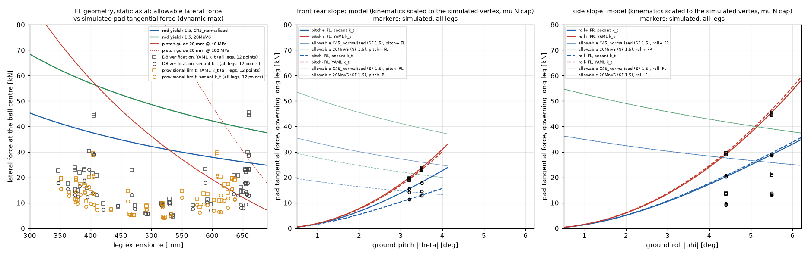

# 다리 로드·실린더 횡하중 검토 (경사 운용, D8) — 개정 3.4, 2026-10-22

> **[개정 3.4] 앞내림 AL-R 재계산(정확한 동시 쌍, `h4_fs_order_check_N.json`)**
>
> - 앞내림 판정 쌍(할선·C45 / YAML·20MnV6): **3.38° / 3.76°**다. 운용 3.2°까지 여유는 **+0.18° / +0.56°**다. 개정 3.3의 R6 공칭은 3.40 / 3.80°였다. 앞내림 감도 묶음(P:pitch+3.2 × 13변형 × 두 $k_t$)이 0.02° / 0.04° 낮췄다.
> - 새 필드(`Ft_at_Fl_max_Ft_held_kN`)와 20 ms 계단 시계열로 만든 정확한 동시 쌍을 넣어도 한계는 같다. 극값 쌍이 이미 지배 순간을 잡고 있었다. 비동시 상한 조합과 축력 하한 없음 감도도 같다(7.5절).
> - 지배: 할선·C45는 V 3.5° 공칭의 짧은 RR(e 0.35 m), k3 접선력 최대 21.6 kN, 축력 120 kN이다. YAML·20MnV6는 같은 실행의 k1 RR, 27.1 kN / 112 kN이다.
> - 앞들림은 C(`nose_down_only`)에서 H4가 돌지 않으므로 **AL 3.42° / 3.30°** 그대로다(사용자 결정 "C 우선, 잠정 B", 잠정 운용 3.1°).
>
> 아래 개정 3.3 상자는 앞들림에서도 H4가 도는 경우의 기록이다.

> **[개정 3.3 핵심] 기본 운용 R6 계단(45 / 30 / 23.2 / 23.2 kN)이면 앞들림 판정 쌍이 운용 한계 3.2° 아래로 떨어진다.**
>
> | 앞들림 판정 쌍 | 할선·C45 | YAML·20MnV6 | 운용 3.2°까지 |
> |---|---|---|---|
> | **R6**(기본 운용, `O\|R6` + 감도 묶음 `S\|R6` 최대) | **3.12°** | **3.20°** | **−0.08° / 0.00°** |
> | R6 공칭만(`O\|R6`) | 3.14° | 3.24° | −0.06° / +0.04° |
> | A(R5 압력 단독 모드, 개정 3.2) | 3.20° | 3.24° | 0.00° / +0.04° |
> | **C**(앞들림에서 H4 생략 = AL) | **3.42°** | **3.30°** | +0.22° / +0.10° |
>
> - **잠정 B(앞들림 3.1°)는 R6 기준으로 통과한다.** 3.1°에서 판정 쌍의 최소 여유는 할선·C45 RA_A 1.53이다(요구 1.5, +2 %). 각도 여유는 0.02°다. 3.2° 실행값을 줄이지 않고 3.1°에 그대로 쓴 보수 규칙으로도 같은 값이다. 그래서 3.1° 실행이 따로 없어도 이 결론은 보수 쪽이다(7.3절).
> - 지배는 할선·C45 계단 k3(RL)에서 내려지는 후방 다리 자신의 접선력이다. 레벨링 끝 대비 ×1.30이고, 감도 묶음 최대는 오거 하단에서 ×1.306이다. YAML·20MnV6는 k1(RL) ×1.09~1.13이고, $F_s$ 12 kN 감도에서 최대다.
> - 앞내림 판정 쌍: R6 3.40 / 3.80°, A 3.46 / 3.84°, C 4.02 / 4.12°(행정).
> - 판정은 dynamics-expert 몫이다(12절). 사용자 결정은 "C 우선, 잠정 B"다(2026-10-22).

dynamics-expert 핸드오프에 대한 cad-expert 검토다. 경사에서 레벨링하면 패드가 바닥에 고착된 채 기체가 수평으로 돌아가서 패드 접선 내력이 생긴다. 이 힘이 그대로 로드 횡하중이 된다. 이 하중으로 로드·배럴 굽힘, 좌굴(P-δ 포함), 가이드(글랜드 부시·피스톤) 면압을 해석식으로 확인했다. FEM은 하지 않았다(판정을 가르는 것이 소재와 가이드 세부라서 FEM으로 결론이 바뀌지 않는다).

- 스크립트: `04_scripts/00_cad/leg_rod_lateral_check.py` (Chrono-dev, 약 17 s)
- 입력 하중: `06_analysis/00_dynamics/pad_tangential_check.json`(REXOME35 YAML로 다시 돌린 행렬, `00_docs/01_dynamics/dynamics_model.md` 개정 31, 5.13.3절)
- 입력 파라미터: `02_params/rexome33.yaml`(SHA-256 `84a46dc1…`, REXOME35 다리별 실린더, 행정 0.70 m)
- 결과: `01_cad/02_legs/leg_rod_lateral_check.json`, 그림 `01_cad/02_legs/leg_rod_lateral_check.png`
- 좌표: 기체 좌표(x 전방, y 좌측, z 상방, 원점 CAD 원점), m. 경사 부호는 3.10.1을 따른다(pitch > 0 앞내림, roll > 0 좌측 위 = 우측 낮음). **앞들림 = pitch −**. 응력은 MPa, 힘은 kN으로 표시했다.
- 판정은 dynamics-expert가 한다(`dynamics_model.md` 5.13.5). 이 문서는 cad 계산값과 근거를 적는다.
- H4 입력(control-expert): A = `s6r17_partO.json`(개정 17 80절, 7.1절). R6 = `06_analysis/02_control/h4_fs_order_check_O3.json` + `h4_fs_order_check_S.json`(개정 18 82.1, 7.2절)

## 개정 기록

| 개정 | 날짜 | 내용 |
|---|---|---|
| 1 | 2026-10-21 | 첫 판. 횡하중은 3.9.7.5의 3.7° 끝값 36 kN을 기구학(고착 스프링, YAML $k_t$)으로 다른 경사에 옮김(보정 계수 0.838) |
| 2 | 2026-10-21 | 횡하중 입력을 `dynamics_model.md` 3.10.5·3.10.6 행렬로 교체. 할선 $k_t(e)$ = 최선 추정, YAML $k_t$ = 상한 두 열로 계산. 보정 계수 0.838 폐기. 행정 끝(680 mm) 검사, 잠김 350 bar 점검, 고착점 재설정(3.10.7) 반영 |
| 3 | 2026-10-22 | **REXOME35 실린더로 교체**(사용자 결정 2026-10-22). 단면을 다리별로 YAML `legs.<leg>.cylinder`에서 읽는다: 전방 보어 ø130 / 로드 ø110 / 배럴 외경 ø160, 후방 ø110 / ø90 / ø137. 행정 0.70 m. 잠김 축력은 다리별 350 bar × 헤드 면적(전방 464.6 kN, 후방 332.6 kN, 이전 공통 363.5 kN). 정적 축력은 L1 $k_n$ 분배(상단, $e_{op}$). 횡하중 행렬은 새 YAML로 다시 돈 `pad_tangential_check.json`을 그대로 쓴다(새 $k_t$와 같아 축척 보정 불필요, `inputs.envelope_rescale.applied = false`) |
| **3.1** | 2026-10-22 | `d8_boundary_scan` 호환 키 추가(4.5절). 06:47 실행이 dynamics 5.13.5 판정의 입력이다. 07:03에 `clip`·`reanchor`·`report` 단계 재실행(07:02) 뒤 같은 코드로 다시 돌렸다. **바뀐 값은 `pitch3.7_clip_check` 52개뿐**이고 나머지 키는 06:47 결과와 비트 단위로 같다(재귀 비교, `runtime_s` 제외) |
| 3.1 보완 | 2026-10-22 | **문서만 고침(계산 재실행 없음).** dynamics 5.13.5 보완 2에 맞춰 판정 쌍 정의를 **AL-R**로 바꿨다. 앞뒤 경사는 A ∧ L ∧ RA_A(SF 1.5), 좌우 경사는 AL 그대로다. 앞들림 3.42 / 3.30° → **3.38 / 3.26°**, 앞내림 4.02 / 4.12° → **3.62 / 4.02°**. 좌굴 최소 18.7(대각 포함)로 dynamics와 맞췄다 |
| 3.2 | 2026-10-22 | **RA_A를 H4 A(P_stop 45 / 32.41 / 32.41 / 32.41 kN, 당시 "채택안"으로 받음) 실행으로 다시 계산**(control-expert, `s6_control_spec.md` 개정 17 80절). 개정 3.1 보완의 RA_A는 후보 계단 `reanchor3`(바닥 32.41 kN 없음)에서 온 값이라 채택안 기준이 아니었다. 스크립트에 `--h4-pairs <json>` 선택 인자를 더했다(JSON 키 `h4_adopted`). 이 인자가 없으면 출력이 개정 3.1과 같다. 07:03 결과와 비교해 바뀐 키는 `h4_adopted` 추가뿐이다. 앞들림 AL-R **3.20 / 3.24°**, 앞내림 **3.46 / 3.84°** |
| **3.3** | 2026-10-22 | control-expert `s6_control_spec.md` 개정 18 82.1의 정정을 반영했다. 개정 3.2의 "채택안" 45 / 32.41 kN은 **A(R5 압력 단독 판정 모드)**의 값이다. 기본 운용 **R6 결합 판정**의 실제 계단은 45 / 30 / 23.2 / 23.2 kN이다. 스크립트에 `--h4-set LABEL MODE FILE…`(반복 가능, JSON 키 `h4_sets`)을 더했다. 계산한 것은 다음과 같다. R6 = `h4_fs_order_check_O3.json` `O\|R6\|*` 8회 + `h4_fs_order_check_S.json` `S\|R6\|*` 26회이고 나쁜 쪽이 지배한다. 그 밖에 R6 공칭(O3만), 'hold' 옮기기 규칙(실행 각 아래에서 줄이지 않음), 비동시·하한 없음 감도, 3.0 / 3.1 / 3.2° 여유. 앞들림 판정 쌍은 **R6 3.12 / 3.20°**(3.2° 미만), C(H4 생략) 3.42 / 3.30°다. 07:03 결과와 비교해 바뀐 키는 `h4_adopted`·`h4_sets`뿐이다 |
| **3.4** | 2026-10-22 | control-expert `s6_control_spec.md` 개정 20(86.5)의 앞내림 묶음 `h4_fs_order_check_N.json`(09:25:53, `N\|R6\|*` 28회)을 R6 세트에 더했다. 새 필드 `Ft_at_Fl_max_Ft_held_kN`과 20 ms 계단 시계열을 정확한 동시 쌍으로 쓴다. 시계열은 다리마다 Pareto 앞면만 남긴다. 허용 횡하중이 축력에 대해 단조 감소하고 한 실행의 접선력은 같은 비로 옮겨지기 때문이다. 앞내림 판정 쌍은 **3.38 / 3.76°**다(R6 공칭 3.40 / 3.80°). 앞들림은 C 기준 AL 3.42 / 3.30°다. 실행 약 92 s |

## 1. 결론

1. **판정 쌍 한계(개정 3.3).** 판정 쌍은 "할선 $k_t$ · C45"와 "YAML $k_t$ · 20MnV6"이고, 기준은 **AL-R**이다(dynamics 5.13.5 보완 2).
   - 앞뒤 경사: A(여유 ≥ 1.5) ∧ L(350 bar 잠김 항복 없음) ∧ RA_A(고착점 재설정 H4 포함, SF 1.5).
   - 좌우 경사: H4를 쓰지 않으므로 AL(A ∧ L) 그대로다.
   - 행은 H4 운용 세 가지다. **R6** = 기본 운용 결합 판정(계단 45 / 30 / 23.2 / 23.2 kN). **A** = R5 압력 단독 판정 모드(45 / 32.41 ×3 kN, 개정 3.2 값). **C** = 앞들림에서 H4 생략.

   | 방향 | H4 운용 | 할선·C45 | YAML·20MnV6 | 운용 한계 | 여유 각 |
   |---|---|---|---|---|---|
   | **앞들림** | **R6**(공칭 + 감도 묶음 최대) | **3.12°** | **3.20°** | 3.2° | **−0.08° / 0.00°** |
   | 앞들림 | R6 공칭만 | 3.14° | 3.24° | 3.2° | −0.06° / +0.04° |
   | 앞들림 | A | 3.20° | 3.24° | 3.2° | 0.00° / +0.04° |
   | **앞들림** | **C**(H4 생략 = AL, L이 지배) | **3.42°** | **3.30°** | 3.2° | +0.22° / +0.10° |
   | 앞들림 | 잠정 B(운용 3.1°, R6) | 3.12° | 3.20° | 3.1° | +0.02° / +0.10° |
   | **앞내림** | **R6 + 앞내림 감도 묶음 N, 정확한 동시 쌍(개정 3.4, 기본)** | **3.38°** | **3.76°** | 3.2° | **+0.18° / +0.56°** |
   | 앞내림 | R6 공칭만(개정 3.3) | 3.40° | 3.80° | 3.2° | +0.20° / +0.60° |
   | 앞내림 | A | 3.46° | 3.84° | 3.2° | +0.26° / +0.64° |
   | 앞내림 | C(AL) | 4.02° | 4.12°(행정) | 3.2° | +0.82° / +0.92° |
   | 좌우 + / − | H4 없음(AL) | 5.16° / 5.10° | 5.14° / 5.08° | 4.4° | +0.68° 이상 |

   - 주사 간격은 0.02°다. 여유 0.00~0.10°는 접선력 포락선 축척 오차(3.3절, 수 %)와 같은 크기다.
   - R6 감도(7.2절): 비동시 상한 조합이면 3.12 / 3.18°, 축력 하한(정적값)을 빼면 3.30 / 3.26°다.
   - 개정 3.1 보완의 3.38 / 3.26°(후보 계단 `reanchor3`)는 폐기한다.

2. **앞들림이 가장 빠듯하고, 후방 로드 ø90이 이를 지배한다.**
   - 앞들림에서는 긴 후방 다리(RL·RR, 신장 0.64~0.66 m)가 한계를 정한다. 잠정 한계·검증 경계 모두에서 최소 여유 위치가 앞들림 RL이다(5.3절).
   - 후방 $k_t$가 8.40 → 3.71 MN/m(0.44배)로 무러져 앞뒤 접선력은 약 40 % 줄었다. 그런데 로드가 ø110 → ø90으로 가늘어져 단면계수가 $(90/110)^3$ = 0.548배다. 그래서 같은 위치의 굽힘 응력은 오히려 커졌다. YAML, 검증 앞들림 3.5°, RL: 접선력 37.5 → 23.4 kN인데 로드 응력은 275 → 332 MPa다.
   - 앞들림은 축력이 작은 후방 다리라서 잠김 350 bar(332.6 kN)의 축력 증가 몫이 크다. 그래서 재설정이 없으면 두 판정 쌍 모두 L(잠김)이 A보다 먼저 걸린다. 재설정을 넣으면 RA_A가 그보다 먼저 걸린다(5항).
3. **최악 조합(YAML $k_t$ · C45, 판정 쌍 아님)**: 앞들림 **기준 A 2.82°, L 2.74°**(AL 2.74°, AL-R은 R6 2.66° / A 2.70°)다. 같은 조합의 앞내림 AL-R은 R6 3.04° / A 3.08°로 운용 3.2°보다 작다. 운용 3.2°에서 YAML·C45 RL 여유는 1.14(요구 1.5)이고 잠김 여유는 **0.73**(요구 1.0, 개정 2는 0.95)이다. 즉 **"후방 로드가 C45급이고 실제 $k_t$가 YAML 쪽"이면 앞들림 3.2°에서 잠김 하중 시 항복 계산이 나온다.** 같은 조합의 좌우 한계는 4.24°로 운용 4.4°보다 작다(P 좌우 −4.4° FL 여유 1.40).
4. **좌굴은 문제가 아니다.** 흔들림 모드 좌굴 여유는 정적 축력에서 18.7배 이상, 다리별 잠김 축력에서 4.1배 이상이다(요구 3.5, 가정).
5. **고착점 재설정(H4)을 넣으면 앞뒤 한계가 내려간다**(기준 RA_A, 6·7절). **판정 쌍에 포함했다(dynamics 5.13.5 보완 2, AL-R).**
   - 앞들림 R6: AL 3.42 / 3.30° → AL-R 3.12 / 3.20°. 할선은 계단 k3(RL, 두 번째 RL 내림, P_stop 23.2 kN)에서 내려지는 후방 다리 자신의 접선력이 9.3 → 12.1 kN(×1.30)이 된다. 그 순간 그 다리의 축력은 28~29 kN이다. YAML은 k1(RL) 18.7 → 20.4 kN(×1.09)이고, $F_s$ 12 kN이면 ×1.13이다.
   - 앞들림 A(개정 3.2): 계단 k1(RL)·k0(RR)에서 YAML 18.7 → 20.4 kN ×1.09, 할선 9.3 → 11.7 kN ×1.25다. 그 순간 축력은 31~47 kN으로 낮다.
   - 두 경우 모두 계산에서는 정적값(72.7 kN)을 축력 하한으로 썼다.
   - 축력 상승 쌍(A에서 접선력이 남은 동안 96~103 kN에 17~22 kN, 풀린 뒤 113~115 kN에 9~16 kN)은 지배 쌍이 아니다. A와 R6의 앞들림 실행 모두에서 후방 다리의 지배 쌍은 (접선력 최대, 그 순간 축력)이다(7.1·7.2절 표).
   - 앞내림: AL 4.02 / 4.12° → AL-R R6 3.40 / 3.80°(A 3.46 / 3.84°). 짧은 후방 다리(e 0.35 m)가 계단 중 축력 96~121 kN에 접선력 18~27 kN(다른 경사로 옮긴 값)을 받는다. 앞내림 잔류는 A에서 시작값의 89~100 %, R6 YAML에서 65~81 %다.
   - 개정 3.1 보완의 3.38 / 3.26°는 후보 계단 `reanchor3`(바닥 32.41 kN 없음)에서 온 값이라 폐기한다.
6. **가이드 면압은 여전히 가장 약한 곳이다.** CAD 피스톤 폭 20 mm(중심 모델)로 운용 경계의 피스톤 면압은 할선 39~46 / YAML 55~66 MPa다. 일반 가이드 링 동적 허용 40 MPa(가정)를 지키는 경사는 앞뒤 2.8~3.2°, 좌우 3.8~4.2°다. CAD에 가이드 링·스톱 튜브 세부가 없어서 **제조사 자료 없이는 판정할 수 없다**(10절 질문 2·3).
7. **앞내림 3.7° 재확인(새 `clip` 단계)**: 고착 기구 내력은 후방 μN에 잘리지 않는다(후방 이용률 ≤ 0.70, μ 0.5와 μ 5 결과 같음). FL 동적 최대 25.4 kN(YAML) / 19.6 kN(할선)에서 FL 로드 여유는 C45 1.50 / 1.90이다(3.2절). 개정 2의 36.5 kN·여유 1.03은 옛 단계 값이라 폐기한다.

## 2. 형상 (CAD B-rep 면 표 `01_cad/02_legs/leg_faces.csv` + YAML 다리별 단면)

**높이(z)는 CAD 면 표에서, 단면 지름은 YAML(REXOME35 도면)에서 가져온다.** CAD의 실린더(보어 약 115 / 로드 110)는 REXOME33 자리표시 형상이다(`00_docs/00_cad/cad_cylinder_vs_drawing.md`). 장착면 위치를 모르므로(Q-C2) 다리 기하·높이는 CAD 그대로 둔다.

| 항목 | 전방 FL·FR | 후방 RL·RR | 출처 |
|---|---|---|---|
| 보어 / 로드 / 배럴 외경 | ø130 / ø110 / ø160 | ø110 / **ø90** / ø137 | YAML `legs.<leg>.cylinder`(REXOME35, 공차 기호에서 추정) |
| 로드 | **중실**, z −0.5405 … 0.3295 | **중실(가정)**, z −0.5507 … 0.3193 | 전방: 면 색인 `convex`(이동부 오목 원통 0). 후방: CAD 형상이 도면과 달라 확인 불가 |
| 피스톤 | 두께 20 mm, z 0.3295 … 0.3495 | 20 mm, z 0.3193 … 0.3393 | 솔리드10 |
| 보어 구간 | z −0.3505 … 0.3495(700 mm) | z −0.3607 … 0.3393 | 솔리드17 |
| 글랜드(로드 가이드) | z −0.4755 … −0.3505(**125 mm**) | z −0.4857 … −0.3607 | 솔리드17 |
| 배럴 | z −0.4755 … 0.4625 | z −0.4857 … 0.4523 | 솔리드17 |
| 브래킷 볼트 | 6열, 무게중심 z 0.047 | 5열, 무게중심 z 0.0593 | 솔리드17 R13 |
| 로드 끝 목 / 보스 | Ø80 × 25 mm(패드 바닥 위 115~140 mm) / Ø170 | 같음 | 솔리드10 |
| 스위블 볼 중심 | 패드 바닥 위 60 mm | 같음 | **가정**(YAML, CAD에 스위블 없음) |
| 패드 바닥 z | −0.6998 | −0.7100 | 면 표 + `retracted_offset_from_cad_m` |
| 이동부 질량 | 106.78 kg | 73.163 kg | 전방: B-rep 부피 0.013603 m³ × 7850. 후방: YAML 형상 합성 추정(Q-C3) |

신장 e에서 전방의 피스톤–글랜드 지지 간격(중심 간)은 e 0.401에서 0.351 m, e 0.654에서 0.099 m다. 판정 점의 레벨링 신장은 모두 0.661 m 이하다. CAD 자리표시 형상은 680 mm 기준이라 e > 0.68 m에서는 지지 간격이 의미가 없다. 그 구간은 행정 끝 검사(700 mm)로만 쓴다.

레벨링 신장은 이 스크립트의 평면·크롤러 여유 50 mm 식으로 구했다. dynamics 축소 모델의 신장(`kin.*.levelled_ext_m`)과 차는 최대 0.52 mm다.

## 3. 하중

### 3.1 축력

| 경우 | 값 | 출처 |
|---|---|---|
| 동시 축력(표의 기본) | 횡하중 최대 순간의 다리 축 접촉력. 전방 103~121, 후방 70~74 kN | `pad_tangential_check.json` `tang.dyn_max_Fl_kN` |
| 운용 정적(한계 각 계산) | 패드력 FL 119.27 / FR 117.03 / RL 72.68 / RR 71.14 kN(= 실린더 힘 118.22 / 115.98 / 71.96 / 70.42 + 로드 무게 1.05 / 0.72 kN) | L1 $k_n$ 분배(`dyn_model.static_loads`, 상단, $e_{op}$) |
| 동적 피크(감도) | 141 kN, 모든 다리 | `dynamics_model.md` 3.7(REXOME33 값 그대로, **가정**) |
| 잠김 상한 | 350 bar × 헤드 면적: 전방 **464.6 kN**, 후방 **332.6 kN** | CLAUDE.md. JSON 키 이름 `*lock364kN*`은 개정 2 이름을 유지했다 |

### 3.2 횡하중: dynamics 행렬 (볼 중심 높이, 기체 x·y)

- **기구**(3.10.2): 크롤러 위에서 기울어진 채 패드가 고착된다. 그 뒤 수평으로 돌리면 앞뒤(또는 좌우) 패드 사이에 어긋남이 생기고, 두 패드의 직렬 접선 강성에 걸려 내력이 된다. 힘은 대략 경사의 제곱에 비례한다.
- **두 $k_t$ 모델**:
  - **할선 $k_t(e)$**: series(경사별 레벨링 신장 e의 스위블 보 굽힘, 콘크리트 3.24×10⁸ N/m)다. 이 스크립트의 보로 다시 계산한 값이 dynamics 값과 1.7×10⁻³ 안에서 같다. **최선 추정**이다.
  - **YAML $k_t$**: FL·FR 7.15 / RL·RR 3.71 MN/m(평지 e 0.40 m의 보, 개정 2는 8.51 / 8.40)다. **상한**이다.
- 값은 세 단계 × 네 마스트 × 시드·지연·β 행렬의 최대다. **구조 점검에는 동적 최대와 그 순간의 축력**을 쓴다. 축 꼭짓점의 최대 다리에서는 동적 최대가 레벨링 끝보다 최대 +0.46 kN 크다. 개별 다리로 보면 차가 더 큰 곳이 있다(최대 +8.4 kN, 검증 대각 (+1.375, −2.625) FR, 할선). 이런 곳은 레벨링 도중의 과도이고 지배 점이 아니다.
- 이 스크립트가 run 단위로 다시 모은 행렬과 dynamics 보고 표(`report.*.max_kN`)의 차는 **0 kN**이다(두 범위, 두 $k_t$, 레벨링 끝·동적 최대).
- 경계 실행의 미끄럼은 0 mm이고(`report.slip_post_liftoff_max_mm`), 그래서 μN 상한이 걸린 경우가 없다. "YAML 고착" 변형(μN 상한 없음)이 모든 한계에서 μ 0.5와 같다.

**앞내림 3.7° 재확인**(`pitch3.7_clip_check`, 새 `clip` 단계 07:02, 상단, `R:BS_hold`, 강체·유연 마스트 중 최대). 값은 레벨링 끝 FL / FR / RL / RR [kN]이고, 오른쪽 열은 FL(e 0.669, 동적 최대)의 로드 여유다.

| 경우 | 레벨링 끝 | FL 로드 여유 C45 / 20MnV6 | FL 잠김 여유 C45 / 20MnV6 |
|---|---|---|---|
| YAML, μ 0.5 | 25.3 / 24.8 / 24.9 / 25.0 — **잘리지 않음**(후방 이용률 ≤ 0.70) | 1.50 / 2.22 | 1.04 / 1.53 |
| YAML, μ 5(고착 수요) | 같음 | 1.50 / 2.22 | 1.04 / 1.53 |
| 할선, μ 0.5 | 19.6 / 19.3 / 19.3 / 19.4 | 1.90 / 2.81 | 1.27 / 1.87 |

- 개정 2의 값(YAML μ 0.5 36.5 kN, FL 여유 1.03)은 옛 YAML(REXOME33 $k_t$, 접지 15.4 s)의 `clip` 단계를 읽은 것이다. 그래서 폐기한다(dynamics 5.13.3).
- dynamics 5.13.3의 고착 기구 내력 24.7 kN과 폐루프 레벨링 끝 25.3 kN의 차는 +2.5 %다.
- 이 점검은 FL만 본다. 앞내림에서는 짧은 후방 다리(ø90)가 더 약하다. 앞내림 판정 쌍(AL-R 3.62° / 4.02°, 6절)은 이 후방 다리가 정한다.

### 3.3 시뮬레이션 사이 각도: 축척한 고착 기구학 (한계 각 계산용)

시뮬레이션은 두 마름모의 꼭짓점(3.2/3.5°, 4.4/5.5°)만 있다. 한계 각을 찾으려면 연속 곡선이 필요하다. 그래서 다음처럼 만들었다.
1. 고착 패드 기구학 모델(평면 강체 이동 제거)에 $k_t$ 모델(YAML 또는 할선 $k_t(e(\theta))$)을 넣는다.
2. **잠정 한계 꼭짓점의 시뮬레이션 동적 최대에 다리별로 축척**한다. 축척 계수는 0.99~1.08이다. 예외는 앞들림 할선의 짧은 전방 다리 1.27~1.30이다.
3. μN 상한을 둔다. μ 0.5 × 정적 패드력 × cos(경사)다.
   - 앞뒤 경사는 Σ$F_t$ = 0이라 네 패드 모두 후방 μN 중 작은 값으로 자른다.
   - 좌우 경사는 다리별로 자른다.
4. "YAML 고착" 변형은 μN 상한 없이 계산한다.

검증(D8 검증 꼭짓점에서 모델 대 시뮬레이션, `model_calibration_check`):
- μN 상한 모델 대 μ 0.5 동적 최대: 8개 경우 중 7개가 차 ≤ 3.3 %다.
- 예외는 앞들림 할선이다. 짧은 전방 다리(FL·FR)를 모델이 16.2 kN, 시뮬레이션이 14.5 kN으로 봐서 차가 11.6 %다. 모델이 큰 쪽(보수 쪽)이다. 지배 다리 RL·RR의 차는 0.1 % 이하다.
- 상한 없는 모델 대 μ 5 고착 수요: 차 ≤ 4.9 %다. 같은 예외(앞들림 할선 FL 28 %, 보수 쪽)가 있다.

## 4. 계산 모델

- **배럴–로드 보:** 브래킷 볼트 무게중심에서 고정한 계단 단면 Euler-Bernoulli 보다. 배럴(전방 Ø160/Ø130, 후방 Ø137/Ø110)은 배럴 하단까지이고, 그 아래는 로드(Ø110 / Ø90)다. 요소는 80개다. 횡강성이 YAML `k_lateral_leg_swivel_N_m`을 1.4×10⁻⁵ 안에서 재현한다.
- **하중점:** 스위블 볼 중심, 끝 모멘트 0(프로젝트 결정).
- **로드 모멘트:** 글랜드 반력점에서 $M = F\,a$($a$ = 글랜드 중심 → 하중점)다.
- **P-δ:** $M_{tot} = (F a + P(\delta + e_0))/(1-P/P_{E,sway})$다. $e_0$ = 초기 굽음 L/1000 + 가이드 틈 0.3 mm에 의한 기울기다(**가정**).
- **좌굴:** 같은 보의 선형 좌굴 고유값이다. 흔들림 모드(고정–자유)를 지배 경우로 두고, Johnson 포물선을 적용했다.
- **가이드 반력:** 중심 모델은 $R_p = M_{gl}/b$, $R_{gl} = R_p + F$다. 가장자리 모델은 비교용이다. 면압 = R/(지름 × 지지 폭)이다. 피스톤 폭 20 mm는 CAD 값, 글랜드 띠 40 mm는 **가정**이다.
- **배럴:** 맨 아래 볼트 열 단면의 굽힘 + Lamé 원주·반경 응력의 von Mises다.
- **허용 횡하중:** 축력이 정해지면 로드 응력이 F에 대해 1차식이다. 그래서 $F_{allow}$ = (항복/요구 여유 − σ(0)) / (dσ/dF)로 구한다.

### 4.5 `d8_boundary_scan` 호환 키 (개정 3.1)

- `run_pad_tangential_check.py`의 그림 함수 `figures()`(report 단계)는 cad JSON의 `d8_boundary_scan`을 읽는다(962행). 그림에 "cad estimate (calibrated), max leg" 표식을 겹치는 데 쓴다. 이 키는 개정 1에 있었고 개정 2에서 빠졌다. 그래서 그대로 두면 report 단계가 KeyError로 멈춘다.
- 개정 3.1은 같은 형식(`range`, `direction`, `phi_deg` = roll, `theta_deg` = pitch [°], `kt_mode`, 다리별 `F_design_kN` FL·FR·RL·RR, `extension_m`)으로 다시 넣었다. 내용은 3.3절 연속 모델(YAML $k_t$, μN 상한)을 V·P 두 범위의 축 꼭짓점 8개에서 계산한 값이다.
  - P 꼭짓점에서는 구성상 시뮬레이션 동적 최대와 같다.
  - V 꼭짓점에서는 모델 외삽값이다(3.3절 검증).
  - 대각 꼭짓점은 넣지 않았다(모델을 축 방향별로만 축척했다). 그래서 그림의 대각 점은 NaN이다.
- 판정 계산에는 쓰지 않는 호환 키다. 07:02 report 단계가 이 키를 읽고 rc=0으로 끝났다.

## 5. 결과 (스위블, 동시 축력)

여유율 = 항복/응력 또는 좌굴하중/축력이다. 로드 항복은 C45 305 / 20MnV6 450 MPa, 배럴은 E355 355 MPa다(모두 **가정**). **후방 로드 재질은 확인되지 않았다.** 전방과 같은 두 가정을 썼다. "잠김"은 같은 횡하중에 다리별 350 bar 축력(전방 464.6, 후방 332.6 kN)을 건 로드 여유다(요구 1.0 = 항복 없음, 가정).

### 5.1 D8 검증 범위(Φ 5.5°, Θ 3.5°) 경계 — 축 꼭짓점

F = 동적 최대 [kN], N = 동시 축력 [kN], 여유 = C45 / 20MnV6, 면압 = 피스톤 20 mm 중심 모델 [MPa].

| 꼭짓점 | 다리, e [m] | 할선: F, N, 로드 여유, 면압 | YAML: F, N, 로드 여유, 면압 |
|---|---|---|---|
| 앞내림 3.5° | FL 0.654 | 17.9, 119, 2.10 / 3.10, 62 | 23.1, 120, 1.67 / 2.46, 80 |
| 앞내림 3.5° | RL 0.347(짧은 후방) | 17.7, 73, 1.88 / 2.77, 11 | 22.7, 73, **1.49** / 2.20, 15 |
| 앞들림 3.5° | RL 0.660 | 13.0, 72, 1.60 / 2.36, 57 | 23.4, 72, **0.92 / 1.36**, 102 |
| 좌우 +5.5°(우측 낮음) | FR 0.660 | 28.5, 117, **1.37** / 2.02, 106 | 44.5, 118, **0.90 / 1.32**, 165 |
| 좌우 −5.5°(좌측 낮음) | FL 0.660 | 29.1, 119, **1.34** / 1.97, 108 | 45.5, 120, **0.88 / 1.29**, 168 |
| 대각 12점 중 최소 | 할선 RL 0.363 (+1.375, +2.625) / YAML RR 0.655 (+1.375, −2.625) | 15.4, —, 2.09 / 3.08, 11 | 17.4, —, 1.23 / 1.81, 72 |

경계 최소는 다음과 같다.
- 할선: C45 1.34 / 20MnV6 1.97(좌우 −5.5°, FL)
- YAML: C45 0.88 / 20MnV6 1.29(좌우 −5.5°, FL)
- 잠김 최소는 YAML 앞들림 3.5° RL 0.60 / 0.88이다.

### 5.2 잠정 한계(Φ 4.4°, Θ 3.2°) 경계 — 축 꼭짓점

| 꼭짓점 | 다리, e [m] | 할선: F, N, 로드 여유, 면압 | YAML: F, N, 로드 여유, 면압 |
|---|---|---|---|
| 앞내림 3.2° | FL 0.632 | 15.5, 119, 2.45 / 3.62, 43 | 19.8, 119, 1.97 / 2.90, 55 |
| 앞내림 3.2° | RL 0.351(짧은 후방) | 15.3, 73, 2.14 / 3.15, 10 | 19.6, 72, 1.70 / 2.51, 13 |
| **앞들림 3.2°** | **RL 0.637** | 11.4, 74, **1.85** / 2.73, 39 | 19.2, 72, **1.14** / 1.68, 65 |
| 좌우 +4.4° | FR 0.608 | 20.2, 117, 2.00 / 2.95, 45 | 29.1, 118, 1.43 / 2.11, 65 |
| 좌우 −4.4° | FL 0.608 | 20.7, 119, 1.95 / 2.88, 46 | 29.8, 120, 1.40 / 2.06, 66 |
| 대각 12점 중 최소 | 할선 RL 0.365 (+1.1, +2.4) / YAML RR 0.625 (+1.1, −2.4) | 12.7, —, 2.47 / 3.64, 9 | 14.0, —, 1.56 / 2.30, 43 |

경계 최소는 둘 다 **앞들림 3.2° RL**이다(개정 2는 앞내림 FL·좌우 FL).
- 할선: C45 1.85 / 20MnV6 2.73, 잠김 1.11 / 1.64
- YAML: C45 1.14 / 20MnV6 1.68, 잠김 **0.73** / 1.08

### 5.3 다리별 최소 여유 (각 범위 12점 중 C45 여유가 가장 낮은 점)

열: 지배 점, e [m] | F [kN](동적 최대), N [kN] | 로드 응력 [MPa] | 로드 여유 C45 / 20MnV6 | 잠김 여유 C45 / 20MnV6 | 좌굴 여유(흔들림) | 배럴 여유 | 글랜드 / 피스톤 반력 [kN] | 피스톤 면압 중심 / 가장자리 [MPa] | 글랜드 40 mm 면압 [MPa]

**D8 검증 범위, 할선(최선 추정)**

| 다리 | 점, e | F, N | σ | 로드 | 잠김 | 좌굴 | 배럴 | 반력 | 피스톤 면압 | 글랜드 면압 |
|---|---|---|---|---|---|---|---|---|---|---|
| FL | 좌우 −5.5°, 0.660 | 29.1, 119 | 228 | 1.34 / 1.97 | 0.94 / 1.39 | 19.2 | 2.35 | 309 / 280 | 108 / 56 | 70 |
| FR | 좌우 +5.5°, 0.660 | 28.5, 117 | 223 | 1.37 / 2.02 | 0.96 / 1.41 | 19.5 | 2.40 | 303 / 275 | 106 / 55 | 69 |
| RL | 좌우 −5.5°, 0.635 | 13.5, 73 | 192 | 1.59 / 2.35 | 0.98 / 1.44 | 19.1 | 3.26 | 113 / 99 | 45 / 26 | 31 |
| RR | 앞들림 3.5°, 0.660 | 12.8, 72 | 188 | 1.62 / 2.39 | 0.98 / 1.44 | 19.0 | 3.35 | 136 / 123 | 56 / 29 | 38 |

**D8 검증 범위, YAML(상한)**

| 다리 | 점, e | F, N | σ | 로드 | 잠김 | 좌굴 | 배럴 | 반력 | 피스톤 면압 | 글랜드 면압 |
|---|---|---|---|---|---|---|---|---|---|---|
| FL | 좌우 −5.5°, 0.660 | 45.5, 120 | 348 | **0.88 / 1.29** | 0.65 / 0.95 | 19.1 | 1.46 | 483 / 438 | 168 / 88 | 110 |
| FR | 좌우 +5.5°, 0.660 | 44.5, 118 | 340 | **0.90 / 1.32** | 0.66 / 0.97 | 19.4 | 1.50 | 473 / 428 | 165 / 86 | 107 |
| RL | 앞들림 3.5°, 0.660 | 23.4, 72 | 332 | **0.92 / 1.36** | 0.60 / 0.88 | 18.9 | 1.78 | 248 / 224 | 102 / 53 | 69 |
| RR | 앞들림 3.5°, 0.660 | 23.1, 71 | 328 | **0.93 / 1.37** | 0.60 / 0.89 | 19.2 | 1.80 | 245 / 222 | 101 / 53 | 68 |

**잠정 한계, 할선(최선 추정)**

| 다리 | 점, e | F, N | σ | 로드 | 잠김 | 좌굴 | 배럴 | 반력 | 피스톤 면압 | 글랜드 면압 |
|---|---|---|---|---|---|---|---|---|---|---|
| FL | 좌우 −4.4°, 0.608 | 20.7, 119 | 156 | 1.95 / 2.88 | 1.32 / 1.95 | 19.7 | 3.56 | 141 / 120 | 46 / 28 | 32 |
| FR | 좌우 +4.4°, 0.608 | 20.2, 117 | 153 | 2.00 / 2.95 | 1.35 / 1.99 | 20.0 | 3.65 | 137 / 117 | 45 / 28 | 31 |
| RL | 앞들림 3.2°, 0.637 | 11.4, 74 | 165 | 1.85 / 2.73 | 1.11 / 1.64 | 18.9 | 3.89 | 97 / 85 | 39 / 22 | 27 |
| RR | 앞들림 3.2°, 0.637 | 11.2, 70 | 162 | 1.89 / 2.78 | 1.12 / 1.66 | 19.9 | 3.95 | 95 / 84 | 38 / 22 | 27 |

**잠정 한계, YAML(상한)**

| 다리 | 점, e | F, N | σ | 로드 | 잠김 | 좌굴 | 배럴 | 반력 | 피스톤 면압 | 글랜드 면압 |
|---|---|---|---|---|---|---|---|---|---|---|
| FL | 좌우 −4.4°, 0.608 | 29.8, 120 | 218 | **1.40** / 2.06 | 1.00 / 1.47 | 19.6 | 2.42 | 202 / 172 | 66 / 41 | 46 |
| FR | 좌우 +4.4°, 0.608 | 29.1, 118 | 214 | **1.43** / 2.11 | 1.02 / 1.50 | 19.8 | 2.48 | 198 / 169 | 65 / 40 | 45 |
| RL | 앞들림 3.2°, 0.637 | 19.2, 72 | 268 | **1.14** / 1.68 | **0.73** / 1.08 | 19.2 | 2.23 | 163 / 144 | 65 / 37 | 45 |
| RR | 앞들림 3.2°, 0.637 | 18.9, 71 | 263 | **1.16** / 1.71 | **0.74** / 1.10 | 19.6 | 2.28 | 160 / 141 | 64 / 37 | 45 |

그 밖의 값은 다음과 같다.
- 좌굴 여유: 정적 최소 18.7(YAML, 검증 대각 (+1.375, +2.625), FL)이다. 다리별 잠김 축력 기준 최소는 4.1(YAML, 앞들림 3.5°, RL)이다.
- 로드 끝 목(Ø80, 스위블)의 여유는 C45로 3.08 이상이다.
- 배럴 여유 최소는 1.46(YAML, 좌우 −5.5°, FL)이다.
- 브래킷 모멘트(볼트 무게중심)는 할선 최대 40.6 kN·m, YAML 최대 63.2 kN·m다(좌우 −5.5°, FL). 볼트·측판·용접은 형상 세부가 없어 계산하지 않았다.

### 5.4 강결합 패드(CAD 그대로)

이번 개정에서는 다시 계산하지 않았다. 패드는 프로젝트 결정상 스위블이다. 개정 1의 소견은 그대로 둔다: 끝 모멘트를 패드가 받으면 로드 글랜드 응력은 내려가고, Ø80 목이 가장 약해진다. 필요하면 같은 스크립트의 `leg_case(..., pad="rigid")`로 계산할 수 있다.

## 6. 경사 한계 (그림 `leg_rod_lateral_check.png`)



- 왼쪽 그림은 FL 형상·정적 축력의 허용 횡하중이다. 로드 항복/1.5와 피스톤 가이드 40·100 MPa를 그렸고, 12점 × 두 범위 × 두 $k_t$의 시뮬레이션 접선력(모든 다리)을 겹쳤다.
- 가운데·오른쪽 그림은 3.3절 모델의 지배 다리 접선력과 허용선이다(행정 끝에서 자름). 교점이 한계다.
- 판정 기준(가정):
  - **A**(기본): 동적 최대 횡하중 + 정적 축력에서 로드 여유 ≥ 1.5
  - **L**: 같은 횡하중 + 다리별 잠김 350 bar 축력에서 항복 없음(≥ 1.0)
  - **AL**: A와 L을 함께 만족. **좌우 경사의 판정 기준이다**
  - **AL-R**: AL과 RA_A(재설정 포함, 아래 표)를 함께 만족. **앞뒤 경사의 판정 기준이다**(dynamics 5.13.5 보완 2). RA_A는 재설정 중 모든 (접선력, 축력) 쌍과 재설정 뒤 잔류를 SF 1.5로 보고, 잔류는 잠김 1.0도 본다. 그래서 AL-R = min(AL, RA_A)다. 개정 3.3부터 RA_A의 기본은 **H4 R6 실행**(7.2절)이다. A는 개정 3.2 값(7.1절)이고, C(앞들림에서 H4 생략)는 AL과 같다
  - 행정 끝(어느 다리든 700 mm, 크롤러 여유 50 mm)에 먼저 닿으면 "행정"으로 표시했다.
- 0.02° 간격으로 주사했다. 표의 좌우 값은 ± 중 작은 값이다. 시뮬레이션 꼭짓점 바깥(앞뒤 3.5° 초과, 좌우 5.5° 초과)은 3.3절 모델의 외삽이다.

**재설정 없음** — 앞내림 / 앞들림 / 좌우 [°]. 행정 한계는 4.12 / 4.02 / 6.34°다. "YAML 고착"(μN 상한 없음)은 모든 칸이 YAML μ 0.5와 같아서 따로 적지 않는다.

| 기준 | 로드 소재(가정) | 할선(최선 추정) | YAML(상한) |
|---|---|---|---|
| A | C45 305 MPa | 4.02 / 3.62 / 5.10 | 3.42 / **2.82** / 4.24 |
| A | 20MnV6 450 MPa | 행정 4.12 / 행정 4.02 / 행정 6.34 | 행정 4.12 / 3.36 / 5.08 |
| L(잠김 350 bar) | C45 | 행정 4.12 / 3.42 / 5.24 | 3.56 / **2.74** / 4.38 |
| L | 20MnV6 | 행정 / 행정 / 행정 | 행정 4.12 / 3.30 / 5.32 |
| AL | C45 | 4.02 / 3.42 / **5.10**(좌우 판정 쌍) | 3.42 / 2.74 / 4.24(최악 조합) |
| AL | 20MnV6 | 행정 / 행정 / 행정 | 행정 4.12 / 3.30 / **5.08**(좌우 판정 쌍) |
| **AL-R(앞뒤만, H4 R6, 개정 3.4)** | C45 | **3.38** / 3.12(앞들림은 C면 AL 3.42) | 3.00 / 2.66(최악 조합) |
| **AL-R(앞뒤만, H4 R6, 개정 3.4)** | 20MnV6 | 행정 4.12 / 행정 4.02 | **3.76** / 3.20(앞들림은 C면 AL 3.30) |
| AL-R(앞뒤만, H4 A) | C45 / 20MnV6 | 3.46 / 3.20, 행정 / 행정 | 3.08 / 2.70, 3.84 / 3.24 |
| A, 축력 141 kN(모든 다리, 감도) | C45 | 3.74 / 3.32 / 5.02 | 3.22 / 2.64 / 4.20 |
| A, 축력 141 kN | 20MnV6 | 행정 / 행정 / 6.28 | 4.04 / 3.18 / 5.04 |
| 피스톤 가이드 40 MPa(20 mm, 참고) | — | 3.14 / 3.22 / 4.20 | 2.96 / 2.82 / 3.80 |
| 피스톤 가이드 100 MPa(정적 상한, 참고) | — | 3.84 / 3.88 / 5.38 | 3.64 / 3.48 / 4.88 |

좌우 ± 개별 값(AL): 할선·C45 +5.16 / −5.10, YAML·20MnV6 +5.14 / −5.08, YAML·C45 +4.30 / −4.24.

**고착점 재설정 적용 시 앞뒤 한계** — 앞내림 / 앞들림 [°]

H4 실행 쌍(control-expert `step_pairs`)으로 계산했다. 반영 방법(JSON `h4_sets.<label>.note`)은 다음과 같다.
- **쌍**: 계단마다, 다리마다 (축력 최대, 그 순간 접선력)과 (접선력 최대, 그 순간 축력)을 본다. 둘 다 동시값이다.
- **다른 경사로 옮기기('ratio' 규칙, 기본)**: 접선력 × $F_{model}(a)/F_{start}$(실행의 레벨링 끝값)이다. 실행 각보다 큰 경사에서는 비를 1 이상으로 둔다. 풀린 패드의 값이 줄지 않게 하려는 것이다. 한 묶음의 V(3.5°)·P(3.2°)·감도 실행을 모두 쓰고 나쁜 쪽을 택한다.
- **'hold' 규칙(보수)**: 실행 각 아래의 경사에서도 비를 1 이상으로 둔다. 즉 바로 위 실행 각의 접선력을 줄이지 않고 쓴다. 고착 내력은 경사와 함께 커지므로, 3.2° 실행으로 3.1°를 보는 데 보수 쪽이다.
- **축력**: 실행값을 그대로 쓰고, 정적 패드력을 하한으로 둔다(**가정**: 계단의 축력 재분배는 P_stop이 정하고 경사와 무관하다).
- **잔류**: 재설정 뒤 접선력을 같은 방법으로 옮긴다. SF 1.5(정적 축력)와 잠김 SF 1.0을 함께 본다.

| 기준 | 로드 소재 | 할선 | YAML |
|---|---|---|---|
| C: 재설정 없음(AL) | C45 | 4.02 / **3.42** | 3.42 / 2.74 |
| C: 재설정 없음(AL) | 20MnV6 | 행정 / 행정 | 행정 / **3.30** |
| **R6, RA_A**(공칭 8 + 앞들림 감도 26 + 앞내림 감도 28회, 동시 쌍, 축력 하한; 개정 3.4) | C45 | **3.38 / 3.12** | 3.00 / 2.66 |
| **R6, RA_A**(개정 3.4) | 20MnV6 | 행정 4.12 / 행정 4.02 | **3.76 / 3.20** |
| R6, 정확한 동시 쌍(`Ft_at_Fl_max_Ft_held` + 20 ms 시계열, 앞내림 묶음만 있음) | C45 / 20MnV6 | 3.38 / 3.12, 행정 / 행정 | 3.00 / 2.66, 3.76 / 3.20 |
| R6 공칭만(`O\|R6`) | C45 / 20MnV6 | 3.40 / 3.14, 행정 / 행정 | 3.04 / 2.70, 3.80 / 3.24 |
| R6, 'hold' 규칙 | C45 / 20MnV6 | 3.40 / 3.12, 행정 / 행정 | —(0.5°부터 실패) / —, 3.80 / 3.18 |
| R6 감도: 비동시 상한 조합(접선력 최대 × 패드가 붙어 있는 동안 축력 최대) | C45 / 20MnV6 | 3.40 / 3.12, 행정 / 행정 | 3.04 / 2.64, 3.80 / 3.18 |
| R6 감도: 동시 쌍, 축력 하한 없음 | C45 / 20MnV6 | 3.40 / 3.30, 행정 / 행정 | 3.04 / 2.72, 3.80 / 3.26 |
| A(R5 압력 단독, 개정 3.2), RA_A | C45 | 3.46 / 3.20 | 3.08 / 2.70 |
| A, RA_A | 20MnV6 | 행정 / 행정 | 3.84 / 3.24 |
| A 감도: 상한 조합 / 하한 없음 | C45 | 3.46 / 3.20, 3.46 / 3.36 | 3.08 / 2.68, 3.08 / 2.74 |
| A 감도: 상한 조합 / 하한 없음 | 20MnV6 | 행정 / 행정 | 3.84 / 3.20, 3.84 / 3.28 |
| 참고(폐기): 후보 계단 `reanchor3`, A | C45 / 20MnV6 | 3.62 / 3.38, 행정 / 행정 | 3.22 / 2.72, 4.02 / 3.26 |

- **R6에서는 앞들림 할선·C45가 3.12°로 운용 3.2°보다 작다.** 공칭만 보면 3.14°이고, 감도 묶음의 오거 하단 실행이 0.02° 더 낮춘다.
  - 지배는 계단 k3(두 번째 RL 내림, P_stop 23.2 kN)에서 내려지는 RL 자신의 접선력이다. 9.3 → 12.1 kN(×1.30)이고, 그 순간 축력은 28 kN이다.
  - A의 같은 비는 ×1.25(k1)였다. R6은 마지막 두 단의 P_stop이 23.2 kN으로 낮다. 그래서 내린 다리가 더 많이 풀리면서 접선력이 더 커진다.
- YAML·20MnV6는 3.20°(감도 묶음 최대, $F_s$ 12 kN의 k1 RL ×1.13)로 운용 3.2°와 같다. 공칭만이면 3.24°다.
- 'hold' 규칙에서 YAML·C45가 0.5°부터 실패하는 것은 3.5° 실행의 접선력을 줄이지 않고 작은 경사에 쓰기 때문이다. 이 규칙은 실행 각 바로 아래(3.1°)를 볼 때만 의미가 있다.
- 앞내림 R6: 3.40 / 3.80°다. 짧은 후방 다리(e 0.35 m)가 계단 중 축력 112~121 kN에 접선력 18~27 kN을 받는다(옮긴 값). R6은 앞내림 패드를 일부 푼다(YAML 잔류 = 시작값의 65~81 %, 할선은 변화 없음).
- 기준 B 행은 H4 실행으로 다시 계산하지 않았다(설계 기준 미결정).

## 7. 고착점 재설정 동작의 하중 (상단)

### 7.1 A: R5 압력 단독 판정 모드 (`s6r17_partO.json`, `base` 사례, 개정 3.2)

입력: `C:\Users\jinbeom\AppData\Local\Temp\claude\C--workspace\ac6418dc-b52c-42d7-ba64-81b7424d2311\scratchpad\ctrl-run\s6r17_partO.json`(07:22:40). 이 파일은 scratchpad에 있어 세션 뒤 사라진다. 프로젝트 안으로 옮겨야 한다(12절). 계단 순서는 RR → RL → RR → RL이고 P_stop 판독은 43.7~45.0 / 30.6~32.4 kN이다. 재설정 중 최소 실제 실린더 힘은 28.2~30.3 kN이다.

값은 실행 각에서 계산했다.
- 레벨링 끝 → 잔류 [kN]은 실행값이다.
- $F_{model}$은 3.3절 포락선 모델의 동적 최대 [kN]이다.
- 지배 쌍은 (계단:종류, 옮긴 접선력 [kN], 계산 축력 [kN])이다. 계산 축력은 기록값과 정적 패드력 중 큰 값이다.
- 여유는 C45 / 20MnV6이고, 괄호 안은 축력 하한을 뺀 감도다.

| 실행 | 다리, e [m] | 레벨링 끝 → 잔류 | $F_{model}$ | 지배 쌍 | 여유 C45 / 20MnV6 (하한 없음) |
|---|---|---|---|---|---|
| 앞들림 3.5°, YAML | RL 0.660 | 22.4 → 10.7 | 23.0 | k1:접선력 최대, 25.0, 72.7(기록 57) | **0.83** / 1.26 (0.86 / 1.30) |
| | RR 0.660 | 22.2 → 11.3 | 22.6 | k0:접선력 최대, 23.7, 71.1(기록 55) | 0.88 / 1.33 (0.92 / 1.38) |
| 앞들림 3.5°, 할선 | RL 0.660 | 10.6 → 10.6 | 13.0 | k1:접선력 최대, 16.2, 72.7(기록 31) | 1.29 / 1.95 (1.42 / 2.12) |
| | RR 0.660 | 10.5 → 10.5 | 12.8 | k2:접선력 최대, 15.8, 71.1(기록 32) | 1.32 / 2.00 (1.45 / 2.16) |
| **앞들림 3.2°, YAML** | RL 0.637 | 18.7 → 10.9 | 19.2 | k1:접선력 최대, 21.0, 72.7(기록 47) | 1.03 / **1.55** (1.09 / 1.63) |
| | RR 0.637 | 18.5 → 10.7 | 18.9 | k0:접선력 최대, 20.4, 71.1(기록 46) | 1.06 / 1.60 (1.12 / 1.68) |
| **앞들림 3.2°, 할선** | RL 0.637 | 9.3 → 9.3 | 11.4 | k1:접선력 최대, 14.3, 72.7(기록 31) | **1.50** / 2.27 (1.65 / 2.46) |
| | RR 0.637 | 9.2 → 9.2 | 11.3 | k2:접선력 최대, 14.0, 71.1(기록 31) | 1.54 / 2.32 (1.68 / 2.51) |
| 앞내림 3.5°, YAML | RR 0.347 | 22.7 → 20.1 | 23.5 | k1:접선력 최대, 26.9, 111.2 | **1.18** / 1.80 |
| | RL 0.347 | 22.6 → 20.2 | 23.4 | k0:축력 최대, 25.0, 96.2 | 1.30 / 1.98 |
| | FL 0.654 | 22.9 → 20.4 | 23.7 | k0:접선력 최대, 25.1, 119.3 | 1.55 / 2.35 |
| 앞내림 3.5°, 할선 | RR 0.347 | 15.6 → 15.6 | 18.1 | k3:축력 최대, 21.2, 112.9 | **1.49** / 2.28 |
| 앞내림 3.2°, YAML | RR 0.351 | 19.3 → 19.3 | 19.7 | k1:축력 최대, 22.0, 111.3 | 1.43 / 2.19 |
| 앞내림 3.2°, 할선 | RR 0.351 | 13.6 → 13.6 | 15.5 | k3:축력 최대, 18.3, 112.3 | 1.72 / 2.63 |

- 앞들림에서 전방 다리(짧음, e 0.37 m)는 축력이 142~157 kN까지 오르지만 여유가 C45로 2.39 이상이다.
- **앞들림 지배 기구**: 계단에서 내려지는 후방 다리 자신의 접선력이 레벨링 끝보다 커진다. YAML k1 RL은 18.7 → 20.4 kN, 할선 k1 RL은 9.3 → 11.7 kN이다. 그 순간 축력은 31~47 kN이다. control-expert가 적은 "접선력이 남은 동안 96~103 kN(17~22 kN)"과 "풀린 뒤 113~115 kN(9~16 kN)"은 그 다음 순위다.
- **할선 접선력이 실행값보다 큰 이유**: 할선 앞들림은 포락선 모델 $F_{model}$(11.4 kN)이 이 실행의 레벨링 끝(9.3 kN)보다 1.23배 크다. 포락선은 시드·단계·마스트 행렬의 동적 최대이고, 이 실행은 그중 한 사례이기 때문이다. 기준 A와 같은 기준으로 맞춘 것이다.
- **앞내림**: A의 앞내림 재설정은 접선력을 거의 풀지 못한다(YAML V 22.9 → 20.4 kN, 나머지는 변화 1 % 이하). 개정 3.1 보완이 쓴 `reanchor3`은 9~10 kN까지 풀었다. 그 결과 앞내림 판정 쌍이 3.62 → 3.46°(할선·C45)로 내려갔다.

### 7.2 R6: 기본 운용 결합 판정 (`h4_fs_order_check_O3.json` `O|R6|*` + `h4_fs_order_check_S.json` `S|R6|*`, 개정 3.3)

**입력**
- O3(07:42:54): `O|R6|*` 8회(앞뒤 × V·P × YAML·할선, 상단, 강체 마스트, $F_s$ 0)
- S(07:45:03): `S|R6|*` 26회. 모두 앞들림 3.2°이고 YAML·할선 각 13회다. 공칭, 시드 2, 마스트 강·상·하, β 0.69 / 1.6 GPa, $F_s$ 3.7 / 12 kN, 오거 중단·하단, 지연 0이 들어 있다.
- 계단 사양(`P_stop_spec_kN`)은 45 / 30 / 23.2 / 23.2 kN이다. $F_s$ 감도는 45 / 30 / 25.6 / 25.6과 45 / 33.9 ×3 kN이다. 재설정 중 최소 실제 실린더 힘은 16.8~27.2 kN이다.
- 같은 묶음의 `R6_RLfirst`·`R6_floor30`·`R6_floor40`·`R6_v0.05`·`R6_x6`·`A6`은 넣지 않았다(다른 동작 후보).

값은 실행 각에서 계산했다(7.1절과 같은 형식). 괄호 안은 축력 하한을 뺀 감도다.

| 실행 | 다리, e [m] | 레벨링 끝 → 잔류 | $F_{model}$ | 지배 쌍 | 여유 C45 / 20MnV6 (하한 없음) |
|---|---|---|---|---|---|
| 앞들림 3.5°, YAML | RL 0.660 | 22.4 → 6.8 | 23.0 | k1:접선력 최대, 25.0, 72.7 | 0.83 / 1.26 (0.86 / 1.30) |
| 앞들림 3.5°, 할선 | RL 0.660 | 10.6 → 5.9 | 13.0 | k1:접선력 최대, 16.2, 72.7 | 1.29 / 1.95 (1.42 / 2.11) |
| **앞들림 3.2°, YAML**(공칭) | RL 0.637 | 18.7 → 6.7 | 19.2 | k1:접선력 최대, 21.0, 72.7(기록 47) | 1.03 / 1.55 (1.09 / 1.63) |
| 앞들림 3.2°, YAML, 감도 최저($F_s$ 12) | RL 0.637 | 18.7 → 9.8 | 19.2 | k1:접선력 최대, 21.6, 72.7 | 0.99 / **1.50** (1.05 / 1.57) |
| **앞들림 3.2°, 할선**(공칭) | RL 0.637 | 9.3 → 6.6 | 11.4 | k3:접선력 최대, 14.8, 72.7(기록 28) | **1.45** / 2.19 (1.60 / 2.39) |
| 앞들림 3.2°, 할선, 감도 최저(오거 하단) | RL 0.637 | 9.3 → 6.6 | 11.4 | k3:접선력 최대, 14.9, 72.7 | **1.44** / 2.18 (1.60 / 2.38) |
| 앞들림 3.2°, 할선 | RR 0.637 | 9.2 → 6.5 | 11.3 | k2:접선력 최대, 14.3, 71.1 | 1.51 / 2.28 (1.66 / 2.48) |
| 앞내림 3.5°, YAML | RR 0.347 | 22.7 → 15.8 | 23.5 | k1:접선력 최대, 27.1, 112.2 | **1.17** / 1.79 |
| 앞내림 3.5°, 할선 | RR 0.347 | 15.6 → 15.6 | 18.1 | k3:접선력 최대, 21.6, 120.0 | **1.45** / 2.22 |
| 앞내림 3.2°, YAML | RL 0.351 | 19.1 → 15.5 | 19.6 | k2:축력 최대, 22.8, 120.7 | 1.36 / 2.09 |
| 앞내림 3.2°, 할선 | RR 0.351 | 13.6 → 13.6 | 15.5 | k3:축력 최대, 18.7, 119.5 | 1.67 / 2.55 |

- 할선 앞들림 RL의 계단 접선력비(최대 / 레벨링 끝)는 공칭 1.300이고, 감도 묶음에서 1.274~1.306이다(최대는 오거 하단). control-expert가 적은 1.300과 같다.
- YAML 앞들림 RL의 비는 1.086~1.126이다(최대는 $F_s$ 12 kN).
- 감도 묶음은 앞들림 3.2°만 있다. V(3.5°) 감도는 없다.

### 7.3 잠정 B(앞들림 3.1°)와 "패드가 붙어 있는 동안 축력 최대" 쌍

**3.1°의 판정 쌍 여유**(R6 묶음, `h4_sets.R6.margins_at_deg`)

값은 다리 중 최소다. A·L은 포락선 모델 값이고, RA는 모든 실행·쌍 중 최소다.

| 판정 쌍 | 기준 A(요구 1.5) | 기준 L(요구 1.0) | RA_A, 'ratio'(요구 1.5) | RA_A, 'hold'(보수) | RA_A 상한 조합·하한 없음, 'hold' | 지배 |
|---|---|---|---|---|---|---|
| 할선·C45 | 1.95 | 1.17 | **1.53** | **1.53** | 1.53 | 오거 하단 k3 RL, 14.2 kN(옮긴 값), 축력 하한 72.7 kN |
| YAML·20MnV6 | 1.80 | 1.15 | 1.62 | 1.56 | 1.54 | $F_s$ 12 kN k1 RL |

- **잠정 B(3.1°)는 두 판정 쌍 모두 통과한다.** 할선·C45의 여유는 +2 %(각도 0.02°)다.
- 'hold' 규칙은 3.2° 실행의 접선력을 3.1°에 줄이지 않고 썼다. 그래서 dynamics가 지적한 비보수(실행 각보다 작은 각에 곱셈 비)를 피한다. **3.1° 실행이 없어도 이 결론은 보수 쪽이다.** 3.1° 실행이 있으면 여유는 이보다 커질 것으로 본다(추정, 확인하지 않음).
- 참고로 같은 묶음의 3.0°에서는 할선·C45 RA 1.63(hold 1.63), YAML·20MnV6 1.75(hold 1.58)다.

**"패드가 붙어 있는 동안 축력 최대" 쌍**(dynamics 요청, 하한 없음)
- 입력 JSON의 `step_pairs`에는 이 축력값(`Fl_max_Ft_held_kN`)만 있고, 그 순간의 접선력은 없다. 계단 전체 시계열도 없다. 그래서 정확한 동시 쌍은 뽑을 수 없다.
- 대신 상한 조합으로 계산했다. 그 축력에 그 계단의 접선력 최대를 붙이고, 하한은 없다(`bound_nofloor`).
  - R6 앞들림 판정 쌍: 3.12 / 3.18°
  - 3.1° RA_A: 1.53 / 1.59(hold 1.53 / 1.54)
  - 할선·C45에서는 동시 쌍과 같다(같은 계단 k3).
- 정확한 쌍이 필요하면 control-expert 출력에 `Ft_at_Fl_max_Ft_held_kN`(또는 계단 시계열)을 더해야 한다(12절).

### 7.4 후보 계단 `reanchor3`·`reanchor2` (참고, 폐기)

값: 레벨링 끝 → 재설정 뒤 [kN], 실행 최대 [kN](동시 축력 [kN]), 최대 시 로드 여유 C45 / 20MnV6, 재설정 뒤 잠김 여유 C45 / 20MnV6.

| 실행 | 다리, e [m] | YAML | 할선 |
|---|---|---|---|
| 앞내림 3.5°, 계단 | FL 0.654 | 22.5 → 9.6, 22.5(119), 1.71 / 2.52, 잠김 2.09 / 3.08 | 17.7 → 10.5, 17.8(139), 2.06 / 3.04, 잠김 1.98 / 2.92 |
| | RL 0.347 | 22.1 → 8.9, 23.3(115), 1.37 / 2.02, 잠김 2.05 / 3.02 | 17.4 → 8.5, 19.2(116), 1.62 / 2.39, 잠김 2.10 / 3.09 |
| 앞들림 3.5°, 계단 | RL 0.660 | 22.9 → 8.8, **23.2(100), 0.88 / 1.30**, 잠김 1.30 / 1.91 | 12.9 → 9.6, 13.3(115), 1.43 / 2.11, 잠김 1.21 / 1.79 |
| | RR 0.660 | 22.6 → 9.6, 22.6(67), 0.95 / 1.40, 잠김 1.22 / 1.80 | 12.8 → 9.7, 12.8(110), 1.49 / 2.20, 잠김 1.21 / 1.78 |
| 잠정 앞들림 3.2°, 계단 | RL 0.637 | 19.1 → 8.8, 20.1(115), **1.01 / 1.49**, 잠김 1.35 / 1.99 | 11.4 → 9.2, 11.6(125), 1.62 / 2.39, 잠김 1.30 / 1.92 |
| 잠정 앞내림 3.2°, $P_{stop}$ 20 | FL 0.632 | 19.0 → 9.4, 19.1(119), 2.04 / 3.00, 잠김 2.17 / 3.20 | (실행 없음) |
| | RL 0.351 | 18.7 → 9.0, 20.5(126), 1.50 / 2.22, 잠김 2.02 / 2.97 | (실행 없음) |
| 좌우 +5.5°, 계단(참고) | FR 0.660 | 43.9 → 33.1, 44.3(148), 0.88 / 1.29, **잠김 0.85 / 1.25** | 28.2 → 28.6, 29.0(166), 1.27 / 1.88, 잠김 0.96 / 1.41 |
| 좌우 −5.5°, 계단(참고) | FL 0.660 | 44.9 → 31.9, 45.2(146), 0.86 / 1.27, 잠김 0.87 / 1.29 | 28.8 → 28.3, 29.1(143), 1.30 / 1.92, 잠김 0.96 / 1.42 |
| 잠정 좌우 +4.4°, $P_{stop}$ 20(참고) | FR 0.608 | 28.5 → 29.0, 29.6(165), 1.34 / 1.97, 잠김 1.02 / 1.51 | (실행 없음) |

- 재설정 중 최소 실제 실린더 힘은 15.6~18.0 kN이다(가드 문턱 $F_{min}$ + 5 kN = 14.41 kN 위).
- 앞뒤 경사에서는 재설정 뒤 지속 하중이 8.5~12.4 kN이다. 그래서 잠김 350 bar가 겹쳐도 로드 여유가 1.2 이상이다(C45, 할선·YAML 모두).
- (후보 계단 기준) 최대 하중은 재설정이 줄이지 못한다. 앞들림에서는 첫 단계에 긴 후방 다리의 축력이 오른다(RL 100~125 kN). 그래서 최대 시 여유가 레벨링 끝보다 낮다(YAML·C45, 잠정 3.2°: 1.14 → 1.01).
- 좌우 경사는 전방 쌍(FL ↔ FR)에 내력이 남아 지속 하중이 줄지 않는다(3.10.7 판정 2). 할선·C45 검증 5.5°의 잠김 여유는 0.96이다. 잠정 4.4° YAML의 잠김 여유는 1.02다.

### 7.5 앞내림 감도 묶음과 정확한 동시 쌍 (`h4_fs_order_check_N.json`, 개정 3.4)

**입력**
- `06_analysis/02_control/h4_fs_order_check_N.json`(09:25:53)에 `N|R6|*` 28회가 들어 있다. 구성은 P:pitch+3.2 × 13변형(공칭, 시드 2, 마스트 강·상·하, β 0.69 / 1.6 GPa, $F_s$ 3.7 / 12 kN, 오거 중단·하단, 지연 0) × YAML·할선과 V:pitch+3.5 공칭 × 두 $k_t$다.
- 계단마다 다음이 있다.
  - `Ft_at_Fl_max_Ft_held_kN`(패드가 붙어 있는 동안 축력 최대 순간의 접선력)
  - 극값 시각 3종
  - `series_20ms`(t, 다리별 Fl, Ft)

**정확한 동시 쌍 처리**
- 극값 쌍 세 가지를 모두 넣었다: (축력 최대, 그 순간 접선력), (접선력 최대, 그 순간 축력), (붙어 있는 동안 축력 최대, 그 순간 접선력).
- 20 ms 시계열에서는 다리마다 Pareto 앞면 표본(접선력과 축력이 둘 다 더 큰 표본이 없는 점)을 더했다.
  - 허용 횡하중은 축력이 커지면 줄어든다(P-δ와 P/A).
  - 한 실행의 접선력은 같은 비로 옮겨진다.
  - 그래서 앞면 밖의 표본은 지배할 수 없다.

**결과**(R6 세트 = O3 + S + N, 실행 62회)

| 판정 쌍 | 동시 극값 쌍 | 정확한 쌍(+ 시계열) | 비동시 상한 | 하한 없음 | 'hold' | R6 공칭만 |
|---|---|---|---|---|---|---|
| 앞내림 할선·C45 | **3.38°** | 3.38° | 3.38° | 3.38° | 3.38° | 3.40° |
| 앞내림 YAML·20MnV6 | **3.76°** | 3.76° | 3.76° | 3.76° | 3.76° | 3.80° |
| 앞내림 YAML·C45(최악 조합) | 3.00° | 3.00° | 3.00° | 3.00° | — | 3.04° |

- **지배 순간**
  - 3.5° 위로 옮기는 구간의 한계는 V 3.5° 공칭 실행이 정한다. 할선 k3 RR은 접선력 최대 21.6 kN, 축력 120.0 kN이다. YAML k1 RR은 27.1 kN, 112.2 kN이다.
  - 3.2~3.5° 사이에서는 P 감도 실행의 비(레벨링 끝 대비)도 함께 걸린다. 공칭 대비 −0.02° / −0.04°는 이 몫이다.
- **3.2°의 RA_A 여유**: 할선·C45 SF 1.65(요구 1.5, 여유비 1.10)다. 지배는 마스트 상부 유연 실행의 k3 RR 시계열 표본(52.90 s)으로 18.9 kN, 120.5 kN이다. YAML·20MnV6는 SF 2.05(오거 중단 k2 RL, 23.3 kN, 120.1 kN)다.
- control 보고와 대조: "실리는 후방 짝 접선력 YAML 21.8~22.8 kN(×1.14~1.19), 축력 114~122 kN"과 같은 범위다. YAML 3.2°의 지배 쌍은 오거 중단 실행의 k2 RL 23.3 kN(옮긴 값) / 120.1 kN이다.
- 앞내림 기준 A·L은 3.2°에서 2.12 / 1.41(할선·C45), 2.51 / 1.74(YAML·20MnV6)다. RA_A가 지배한다.

## 8. 가정

| 항목 | 값 | 비고 |
|---|---|---|
| 로드 소재 항복 | 305 MPa(C45 노멀라이즈) / 450 MPa(20MnV6) | 크롬 도금 봉, 표면 경화층 무시. **후방 로드 ø90 재질 미확인**, 전방과 같은 두 가정 |
| 후방 로드 단면 | ø90 중실 | REXOME35 도면 추정. CAD 후방 형상은 도면과 달라 B-rep으로 확인 불가 |
| 배럴 항복 | 355 MPa(E355) | |
| 요구 여유 | 항복 1.5(정상 운용), 잠김 350 bar 항복 없음 1.0, 좌굴 3.5 | 설계 기준 미정. 기준 B(1회성 최대 1.0)는 선택지로만 제시 |
| 잠김 축력 | 350 bar × 다리별 헤드 면적(464.6 / 332.6 kN) | 보어 ø130 / ø110은 도면 공차 기호에서 추정 |
| 동적 피크 축력(감도) | 141 kN | REXOME33 값(3.7) 그대로 |
| 패드 접선력 | dynamics 행렬(새 YAML), μ 0.5(정지 = 운동 마찰) | 할선 = 최선 추정, YAML = 상한 |
| 꼭짓점 사이·바깥 | 고착 기구학을 잠정 꼭짓점에 다리별 축척(0.99~1.30) | 검증 꼭짓점 차 3.3절 |
| 재설정 하중(H4) | 기본 R6: `O\|R6` 8회 + 감도 `S\|R6` 26회(앞들림 3.2°만). A: `base` 8회 | 앞내림·3.5° 감도 없음 |
| 재설정 하중을 다른 경사로 옮기기 | 'ratio': 접선력 × $F_{model}(a)/F_{start}$, 실행 각 위에서는 비 ≥ 1. 'hold': 바로 위 실행 각 값을 줄이지 않음. 축력은 실행값, 정적 패드력 하한 | 6·7절. 축력 하한을 빼면 R6 앞들림 할선·C45 3.12 → 3.30° |
| 스위블 볼 중심 | 패드 바닥 위 60 mm | YAML 가정 |
| 초기 굽음 / 가이드 틈 | L/1000 / 지름 틈 합 0.3 mm | |
| 글랜드 가이드 띠 폭 / 피스톤 지지 폭 | 40 mm / 20 mm(CAD 피스톤 두께) | CAD에 부시·가이드 링 세부 없음 |
| 가이드 허용 면압 | 15 / 40 / 100 MPa | 재질 미상 |
| 실린더 높이 배치 | CAD(REXOME33 자리표시) z 그대로 | 장착면 미정(Q-C2) |
| 브래킷 | 볼트 무게중심에서 강체 고정 | 브래킷이 유연하면 $k_t$가 더 무르고 힘은 더 작다 |
| 크롤러 여유 | 50 mm(레벨링 신장) | YAML `simulation.crawler_clearance_m` |

## 9. 검증

| 항목 | 기준 | 결과 |
|---|---|---|
| 보 모델 횡강성 vs YAML `k_lateral_leg_swivel_N_m` | 상대차 ≤ 1×10⁻³ | FL +8.3×10⁻⁶, RL −1.35×10⁻⁵ — 통과 |
| 할선 $k_t$ vs dynamics `kt_N_m`(4경사) | ≤ 5×10⁻³ | 최대 1.68×10⁻³ — 통과 |
| 레벨링 신장 vs `dynamics_model.md` 3.3 표 | ≤ 1×10⁻⁴ m | 최대 8×10⁻⁵ m — 통과 |
| 레벨링 신장 vs dynamics `kin`(24점) | ≤ 1 mm | 최대 0.52 mm — 통과 |
| 다시 모은 행렬 최대 vs dynamics 보고 표 | 0 | **0.0 kN**(두 범위 × 두 $k_t$ × 레벨링 끝·동적 최대) — 일치 |
| 3.7° 재현(`clip`) vs `report.clip_pitch3.7` | 같은 값 | YAML 25.33 / 할선 19.57 kN(FL, 레벨링 끝) — 일치 |
| 축척 모델 vs 시뮬레이션(검증 꼭짓점) | ≤ 5 % | μN 상한 7/8 경우 ≤ 3.3 %. 앞들림 할선은 짧은 전방 11.6 %(보수 쪽, 비지배), 지배 다리 ≤ 0.1 % — **부분 초과(보수 쪽)** |
| 전방 이동부 B-rep 부피 × 7850 vs YAML 질량 | 상대차 ≤ 1×10⁻³ | 106.78 kg = 106.78 kg — 통과. 후방 73.163 kg은 B-rep 대응이 없어 확인하지 않음 |
| 로드 중실 여부(전방) | 이동부 오목 원통 0 | 0 — 중실. 후방은 가정 |
| `d8_boundary_scan` 소비(report 단계) | rc 0 | 07:02 rc=0, Traceback 없음 |
| 개정 3.1 재실행(07:03) vs 06:47 결과 | `pitch3.7_clip_check` 외 같음 | 다른 키 차 0 — 일치 |
| 개정 3.2(`--h4-pairs`) vs 07:03 결과 | `h4_adopted` 추가 외 같음 | 다른 키 차 0 — 일치 |
| 개정 3.3(`--h4-set`) vs 07:03 결과 | `h4_adopted`·`h4_sets` 외 같음 | 다른 키 차 0 — 일치 |
| 개정 3.3 회귀: 세트 A의 기본값 vs 개정 3.2 | 3.20 / 3.24, 3.46 / 3.84 | 같음 — 일치 |
| R6 계단 접선력비 vs control-expert(82.1) | 할선 1.254 → 1.300 | A k1 1.254, R6 k3 1.300 — 일치 |
| 개정 3.2 회귀: `reanchor3` 경로로 계산한 AL-R(`ALR_reanchor3_*`) vs 개정 3.1 보완 | 3.38 / 3.26, 3.62 / 4.02 | 같음 — 일치 |
| `step_pairs` 읽기 vs control-expert 요약(앞들림 YAML) | 96~103 kN(17~22), 113~115 kN(9~16) | V·P RL·RR 동시 쌍에서 같은 범위 — 일치 |

**dynamics_model.md 5.13절 대조**

| 5.13 서술 | cad 값(이 개정) | 판정 |
|---|---|---|
| 5.13.5 보완 2 앞내림 판정 쌍(AL-R) 3.62 / 4.02 | `reanchor3` 기준 같음. A 3.46 / 3.84, **R6 3.40 / 3.80**(개정 3.3) | **dynamics 갱신 필요** |
| 5.13.5 보완 2·3 앞들림 판정 쌍(AL-R) | A 3.20 / 3.24(보완 3과 같음). **R6 3.12 / 3.20**(개정 3.3), C 3.42 / 3.30 | **dynamics 갱신 필요** |
| 5.13.5 좌우 할선·C45 5.16 / 5.10, YAML·20MnV6 5.14 / 5.08 | 같음 | 일치 |
| 5.13.5 최악 조합 A 2.82°, L 2.74° | 같음 | 일치 |
| 5.13.5 운용 3.2° YAML·C45 RL 1.14, 잠김 0.73(이전 0.95) | 1.14 / 0.73(개정 2는 0.95) | 일치 |
| 5.13.5 좌우 5.5° YAML 접선력 54.4 → 45.5 kN | 개정 2 54.4 → 45.5 kN(FL) | 일치 |
| 5.13.5 배럴 ≥ 1.46, 경계 미끄럼 0 mm, 경계 실행 최소 실린더 힘 40.11 kN | 1.46 / 0 mm / 40.11 kN(`report.boundary_runs_min_cyl_kN`) | 일치 |
| 5.13.5 보완 2 좌굴 여유 최소 18.7(대각 포함) | 18.7(FL, 검증 대각 (+1.375, +2.625), YAML) | 일치 |
| 5.13.3 할선 V 앞뒤 / 좌우 17.9 / 29.0 kN | 레벨링 끝 최대 17.92 / 29.0 kN(동적 최대 17.94 / 29.3) | 일치(레벨링 끝 기준) |
| 5.13.3 $k_t$ 7.15 / 3.71 MN/m | `inputs.kt_yaml_N_m` 같음 | 일치 |
| 5.13.3 cad `pitch3.7_clip_check`(F_ready 36.5 kN, FL 1.03)는 옛 단계 | 새 단계 25.3 kN, FL 1.50로 다시 만듦 | 반영 |

참고: 고착 수요(μ 5) 집계는 dynamics 보고 `stick_mu5`와 최대 1.38 kN 다르다. 단계 범위(상·중·하단 포함 여부)가 달라서이고, 축척 모델 점검에만 썼다.

## 10. 제조사 질문

1. **로드 소재와 열처리, 특히 후방 ø90 로드**(C45 / 20MnV6 / 42CrMo4, 항복·인장 강도), 크롬 도금 두께. 로드에 허용하는 횡하중 또는 설계 기준(EN 13000, ISO 등)은 무엇인가? **이제 앞들림 한계를 2.7~3.4°로 바꾸는 가장 큰 미지수다**(dynamics 5.13.5, 우선순위 상향). 후방이 C45급이면 앞들림 3.2°의 잠김 하중에서 항복 계산이 나온다(YAML $k_t$ 쪽일 때).
2. **가이드 구성:** 글랜드 부시·가이드 링 재질, 폭, 개수와 위치, 피스톤 가이드 링 폭, 허용 면압(동적·정적).
3. **스톱 튜브와 최소 겹침:** 완전 신장에서 피스톤–글랜드 지지 간격은 얼마인가? 행정 700 mm에서 CAD(자리표시)로는 지지 간격이 남지 않는다.
4. **스위블 패드:** 볼 중심 높이, 볼·소켓 치수, 허용 기울기, 패드–로드 결합부(CAD의 Ø80 목)의 실제 단면.
5. **브래킷:** 볼트 규격·등급, 측판 두께, 용접 사양. 63 kN·m급 모멘트(좌우 5.5°, 상한)를 설계에서 고려했는가? 브래킷·박스의 횡강성 자료가 있으면 $k_t$ 추정이 좁혀진다.
6. 경사 운용(앞뒤 3.5°, 좌우 5.5°)을 설계 조건에 넣었는가? 넣었다면 그때 가정한 패드 접선력은 얼마인가?
7. **하중 구분:** 레벨링 끝에 한 번 걸리는 횡하중과 작업 중 지속 하중에 다른 안전율을 쓰는가(6절 기준 B)?
8. **잠김 350 bar와 횡하중의 조합:** 실린더 최대 부하 시험 압력 350 bar에서 로드에 횡하중이 함께 걸리는 경우를 검토했는가? 재설정을 빼고 보면 이번 개정의 앞들림 한계는 두 판정 쌍 모두 이 조합(L)이 정한다(AL 3.42° / 3.30°).
9. **패드–바닥 마찰:** 패드 바닥 재질·형상(돌기 유무)과 정지 마찰 계수 자료가 있는가? 지금 하중에서는 μ 0.5에 닿지 않지만(이용률 ≤ 0.77), 정지 마찰 상한은 여전히 미지수다.

## 11. 재실행

```powershell
$env:OPENBLAS_NUM_THREADS='1'
& C:\ProgramData\miniforge3\envs\Chrono-dev\python.exe -I 04_scripts\00_cad\leg_rod_lateral_check.py `
    --h4-pairs <A 실행 JSON, s6r17_partO.json> `
    --h4-set R6 R6 06_analysis\02_control\h4_fs_order_check_O3.json 06_analysis\02_control\h4_fs_order_check_S.json 06_analysis\02_control\h4_fs_order_check_N.json `
    --h4-set R6nom R6 06_analysis\02_control\h4_fs_order_check_O3.json `
    --h4-set R6N R6 06_analysis\02_control\h4_fs_order_check_N.json `
    --h4-check-deg 3.0 3.1 3.2   # 약 92 s(시계열 Pareto 앞면 포함)
```

- H4 인자를 모두 빼면 `h4_adopted`·`h4_sets` 키가 없고 출력은 개정 3.1과 같다. 판정 쌍(AL-R)을 내려면 R6 세트가 필요하다.
- `--h4-set LABEL MODE FILE…`는 id 둘째 토큰이 MODE인 실행만 읽는다. `S|*` 감도 실행은 모두 넣고, 나쁜 쪽이 지배한다.
- 개정 3.3 실행의 A 입력은 `C:\Users\jinbeom\AppData\Local\Temp\claude\C--workspace\ac6418dc-b52c-42d7-ba64-81b7424d2311\scratchpad\ctrl-run\s6r17_partO.json`이다(scratchpad라 세션 뒤 사라진다). 경로와 수정 시각은 `h4_sets.<label>.sources`에 남아 있다.

- 입력 `06_analysis/00_dynamics/pad_tangential_check.json`이 바뀌면 다시 돌린다. 어느 단계(`clip`, `reanchor2`·`reanchor3`, 행렬)를 다시 돌렸는지에 따라 바뀌는 키가 다르다. `clip`만 바뀌면 `pitch3.7_clip_check`만 바뀐다. 이 스크립트는 `reanchor` 단계(ra1)를 읽지 않는다.
- `OPENBLAS_NUM_THREADS=1`이 없으면 E코어 친화도·낮은 우선순위에서 작은 고유값 문제가 수백 배 느려진다.

## 12. 넘길 일

- **dynamics-expert**
  - **개정 3.3 재판정 요청**: 기본 운용 R6이면 앞들림 AL-R이 **3.12 / 3.20°**로 운용 3.2°에 못 미치거나 같다. 공칭만 보면 3.14 / 3.24°다. C(H4 생략)는 3.42 / 3.30°이고, 잠정 B(3.1°)는 통과한다(할선·C45 RA 1.53, 'hold' 보수 규칙). 사용자 결정 "C 우선, 잠정 B"와 맞는지 확인해 달라.
  - 함께 판단할 것:
    - (a) 축력 하한 규칙. 하한을 빼면 R6 3.30 / 3.26°다.
    - (b) 포락선 비 $F_{model}/F_{start}$. 할선 앞들림에서 1.23배다.
    - (c) 3.1° 실행이 필요한지. 'hold' 규칙으로 3.2° 값을 줄이지 않고 썼으므로 cad 쪽에서는 필요하지 않다. 정확한 여유를 원하면 control에 3.1° `O|R6`·`S|R6` 실행을 요청한다.
  - (처리됨, 5.13.5 보완 2) 브래킷 유연성은 비보수라 $k_t$에 넣지 않는다.
- **control-expert**
  - (처리됨, 개정 20 86.5) `Ft_at_Fl_max_Ft_held_kN`과 20 ms 시계열은 앞내림 묶음 N에 들어왔다. 앞들림 묶음(O3·S)에는 아직 없어서 앞들림 쪽은 상한 조합으로 남아 있다. 다만 C 기본이면 앞들림 H4가 돌지 않으므로 판정에는 쓰지 않는다.
  - R6 앞들림 지배는 k3(두 번째 RL 내림, P_stop 23.2 kN)에서 RL 접선력이 ×1.30으로 커지는 것이다. C(앞들림에서 H4 생략)를 구현하면 이 항은 없어진다.
  - `s6r17_partO.json`(A 입력)은 scratchpad에만 있다. 필요하면 프로젝트 출력 폴더로 옮겨 달라. R6 입력은 이미 `06_analysis/02_control/`에 있다.
- **D8 결정(사용자)**
  - 사용자 결정 "C 우선, 잠정 B"(2026-10-22)의 근거 수치는 다음과 같다.
    - C: 앞들림 3.42 / 3.30°(여유 +0.22 / +0.10°)
    - 잠정 B(3.1°, R6): 각도 여유 +0.02 / +0.10°, RA 1.53 / 1.56(보수 규칙)
  - 제조사 답(질문 1)에서 후방 로드가 C45급이면 앞들림 한계를 다시 정한다(YAML·C45 AL 2.74°, R6 AL-R 2.66°).
  - 가이드 면압(질문 2·3)은 그와 별도로 확인해야 한다.
