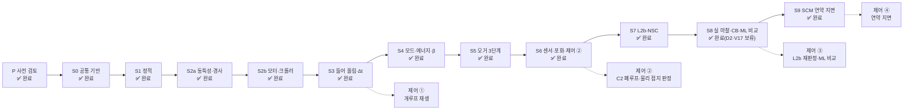

# 프로젝트 로드맵 (2026-10-20, 갱신 2026-10-25)

아우트리거 4개로 상부체 roll·pitch를 제어하는 시뮬레이션의 전체 작업 순서를 한 장에 모은다. 세부는 각 트랙의 원본 문서를 본다. 이 문서는 요약이며 원본과 다르면 원본이 맞다.

| 트랙 | 원본 문서 |
|---|---|
| Chrono 모델 구축 S0~S9 | [03_chrono/chrono_build_plan.md](03_chrono/chrono_build_plan.md) |
| 검증 기준 V0~V17 | [01_dynamics/dynamics_model.md](01_dynamics/dynamics_model.md) |
| 제어기(C2) | [04_control/control_candidates_comparison.md](04_control/control_candidates_comparison.md), 계획 3.5절 |
| 센서·정확도 | [05_sensors/imu_cabin_and_accuracy_review.md](05_sensors/imu_cabin_and_accuracy_review.md) |
| 확정 사항·미정 사항 | [../CLAUDE.md](../CLAUDE.md) |
| 결정 이력 | [decision_log.md](decision_log.md) |
| 제어기 명세·판정(현행 R8 C2) | [04_control/s6_control_spec.md](04_control/s6_control_spec.md) |
| 성능 목표 대비 점검표 | [00_performance_checklist.md](00_performance_checklist.md) |

## 1. 지금 위치

**사전 검토(P)·S0~S5 완료(2026-10-21), S6 제어 판정 완료(C2 R7 기준, 2026-10-24, `04_control/s6_control_spec.md` 개정 29 125절). REXOME35 재검증 묶음 A(L1-R 꺼짐) 판정 완료(2026-10-24, `01_dynamics/dynamics_model.md` 5.12.12 보완 8: S2b V11·S3 V4/V9·S4 β 1.6/rodside·S6 갈래 A 전 항목 통과, V9 오차비는 허용 일치) S7 L2b-NSC V0~V14 통과·L1 대 L2b 비교표 완료, R8 C2(10 Hz, d = 1) Chrono 묶음 C 통과(2026-10-24, `04_control/s6_control_spec.md` 개정 30~36) **S7 완료(2026-10-24, 제어 ③ 준비 통과).** **S8 완료(2026-10-25, 4/6 — D2·V17 보류 2 제외, U-S8-58)**: 제어 ③ 재판정 통과(파일럿 체크 p1r 37 + rest 49 관문 실패 0, 항목 9 결론 "압력 절대값만으로 접지·F_min을 판정하지 않음" U-S8-22), 카운터 밸런스 옵션 통과(CB 6 재실행, 216.8), Chrono V15 통과, ML/DL 비교 종결(J_C 유지, U-S8-53), 재접근 RT 규칙·판독 수정(C-S8-36)·로드 배수 진단 P-S8-21 재실행(c37) 통과(개정 56). 결정 U-S8-* 는 `decision_log.md` 5절, 명세 `s6_control_spec.md` 개정 39~56.** **S9 완료(2026-10-27, 6/6)**: YAML 재생성 묶음(명세 `00_cad/yaml_regen_bundle_2026-10-25.md`)은 1~6단계와 회귀 R0~R3가 끝났고 묶음 탓 차이는 0이다(R1 37 중 36 비트 동일, R2 102 중 98, R3 138 중 4. 나머지는 모두 묶음과 무관한 예외로 수용. 동등성 기록 `06_analysis/01_chrono/00_conventions/params_bundle_2026-10-25_equivalence.json`). C2 토양 대응(명세 개정 57~59)과 S9 실행기(`dynamics_model.md` 개정 48~52)는 메인에 합쳤다. P1·P2·P2′·P3a 판정이 끝났고, P3b 26건(SCM 24 + RE1c 2, 120 s 고정, U-S9P-9~12)도 실행·판정이 끝났다(2026-10-26, control 명세 개정 60: 주 판정 P3-1·P3-3·P3-4 ±0.2° 24/24 통과, 기준 정의 U-S9P-13~16 확정, 실행기 재판정 C-S9-60 24/24; dynamics 개정 53 5.38). 마지막 체크인 착수 전 점검 1~6은 단독 비용 측정(2026-10-27, dynamics 개정 53 보완 5.37.10: 전 하중 2 cm 2.64~2.66, 1 cm 4.55~4.62 ms/스텝, 4병렬 경합은 단독의 1.94~2.10배)으로 닫혔다. S9 뒤로 넘긴 것(체크 항목 아님): R8 C2 PS-7a 판정, U-S8-57 보류 다리 감시(P3b 보류 0건이라 관측 없음), DONE 관문 느린 꼬리 READY 분포(선택), 패드 A 비용 미측정. S5 오거 3단계 통과(`dynamics_model.md` 개정 22, V0 반올림 한계 규칙·V10 하중 P-δ 해 대비 — 사용자 결정 U1·U2). S4(V7 6개 모드·β·감쇠/로드측 감도·V8(b)) 통과(`dynamics_model.md` 개정 19), V8(b)는 Δt 1차·Richardson·수치 소산 몫 판정으로 바꿈.

| 단계 | 진행 | 상태 | 예상 작업 시간 | 예상 계산 시간(벽시계) |
|---|---|---|---|---|
| **S0** | 11 / 11 | ✅ 완료(2026-10-20) | — | 약 2분 |
| S1 | 7 / 7 | ✅ 완료(2026-10-20) | 3.5~4.5시간 | 약 4~6분 |
| S2a | 3 / 3 | ✅ 완료(2026-10-20) | — | 약 6.5분(실측) |
| S2b | 5 / 5 | ✅ 완료(2026-10-21) | — | 약 3분(실측) |
| S3 | 6 / 6 | ✅ 완료(2026-10-21) | — | 약 15분(재실행, P코어 6병렬) |
| S4 | 4 / 4 | ✅ 완료(2026-10-21) | 약 1.5시간(A·B 병렬 + dyn 판정) | 모드·β·감쇠 약 24분(3배치, 4병렬, 고아 프로세스 경합 포함) + 에너지 약 4분(3병렬) |
| S5 | 2 / 2 | ✅ 완료(2026-10-21) | 약 1시간(구현·실행 + 무결성 감사 + dyn 판정) | 배치 29.7 s(9사례, 6 동시) |
| S6 | 9 / 9 | ✅ 완료(2026-10-24): 제어 판정 C2 R7, V11b·V17 REXOME35 재판정 통과(보완 8) | 12~16시간 | 약 30분~1시간 |
| S7 | 8 / 8 | ✅ 완료(2026-10-24): V0~V14 통과, L1 대 L2b 비교표, R8 C2 묶음 C 통과, 제어 ③ 준비(R8 C2 + L2b-NSC) 통과 | 8~11시간 | 30분~1시간 |
| S8 | 4 / 6 | ✅ 완료(2026-10-25, U-S8-58, D2·V17 보류 2 제외): V15·카운터 밸런스·제어 ③·ML/DL 비교(J_C 유지, U-S8-53)·재접근 RT·판독 수정·로드 배수 진단 재실행(C-S8-36/c37) 통과, D2·V17 보류 | 15~20시간 | 1시간 + ML 데이터 수 시간(본 768 약 4.2 h) |
| S9 | 6 / 6 | ✅ 완료(2026-10-27): 착수 전 작업(YAML 묶음 1~6단계·R0~R3 끝·묶음 탓 차이 0, C2 토양 대응, 패드 수평 구속) 끝·메인 합침, P1·P2·P2′·P3a 판정 끝(dynamics 개정 50~52), **P3b 26건(SCM 24 + RE1c 2) 실행·판정 끝**(control 명세 개정 60: 주 판정 24/24, U-S9P-13~16 확정, 실행기 재판정 C-S9-60; dynamics 개정 53 5.38). 체크: SCM 파라미터·패드/로드 분리·단일 패드 격자 수렴·V16·제어 ④(P3b)·착수 전 점검 1~6(4 비용 단독 측정 2026-10-27, dynamics 개정 53 보완 5.37.10) 모두 완료 | 7~10시간 + 파라미터 확보 | P3b 26건(120 s) 직렬 약 57.9 h, 4병렬 약 15~16 h(경합 측정 외삽). 단독 측정(2026-10-27)으로 다시 추정하면 SCM 24건 직렬 약 28.5 h(128 s 외삽, 패드 B 값을 A에도 씀) + RE1c 2건 약 0.3 h. 4병렬은 건당 비용이 약 2배라 처리량 이득은 약 2배 |
| **합계** | 65 / 67 | | **약 67~90시간** | 약 4~6시간 + ML·SCM 계산 |

진행 수는 4절 체크리스트의 항목 수다(선택 항목 제외).

**예상 시간의 기준(2026-10-20 추정, 실측으로 계속 고친다)**
- **작업 시간**: 에이전트가 구현·시험·판정하고 메인 세션이 검토·문서화하는 데 드는 시간. 2026-10-20 실측을 기준으로 잡았다 — 순수 Python 모듈 + 시험 5~10분(params, frames, signals, engine), Chrono 모듈 + 시험 10~20분(make_system, 솔버 변경), 판정·재계산 15~25분(감쇠 개정 7, V7 진단), 재작업·문서 동기화를 더해 항목당 20분~2시간으로 잡았다. **사용자 결정 대기와 외부 자료(제조사 회신, SCM 파라미터) 대기는 넣지 않았다.**
- **계산 시간**: 계획 문서 4절 비용 추정(L1 0.2 ms/스텝 → dt 1×10⁻⁴ s에서 시뮬레이션 1 s당 2 s, 1×10⁻⁵ s에서 20 s)과 2026-10-20 솔버 벤치마크. **S0 실측(2026-10-20, `06_analysis/01_chrono/01_cost/step_cost_S0.json`)**: 패드 접지 181 µs/스텝(추정의 0.95배), 크롤러 정착 68 µs(0.35배) — **P코어 고정 + EcoQoS 해제일 때만**(OS 기본 배치는 2.4배 느림, CLAUDE.md).
- 체크리스트 각 항목 끝의 ⏱가 항목별 추정이다. 단계를 마치면 실제 걸린 시간을 이 표 옆에 적어 다음 추정을 고친다.

## 2. 사전 검토(P) — 완료한 것

| 분야 | 결과 | 문서 |
|---|---|---|
| CAD | 다리 4개 기하, 질량 특성(경우 C 38,556 kg — 당시 값, 현행 38,400.8 kg은 CLAUDE.md 기준값 표), 오거 3단계, 3면도·GIF | [00_cad/](00_cad/) |
| 동역학 기준해 | 하중 분배·고유진동수·들어 올림 V4, 검증 기준 V0~V17(사전 검토 때 개정 9, 현행 개정 55) | [01_dynamics/dynamics_model.md](01_dynamics/dynamics_model.md) |
| 구동기 | L1 기본, L2b 병행(운용안 B) | [01_dynamics/actuator_L2_feasibility.md](01_dynamics/actuator_L2_feasibility.md) |
| 감쇠비 | 다리 0.03, 크롤러 0.05/0.2 | [01_dynamics/damping_survey.md](01_dynamics/damping_survey.md) |
| 유압 | 회로 해석, 210/350 bar, β 1.0 GPa | [02_hydraulic/](02_hydraulic/) |
| Chrono 규약 | SMC 정지 마찰 없음 → 부싱 + Coulomb | [03_chrono/chrono_stick_friction_test.md](03_chrono/chrono_stick_friction_test.md) |
| 제어 구조 | C2 잠정 채택(대안 C8) | [04_control/](04_control/) |
| 센서 | IMU 캐빈 바닥 아래, ±0.2°, 2차 필터 | [05_sensors/](05_sensors/) |
| 반력 시계열 | 0→680 mm 신장 시 다리 반력, D안 동적 피크 141.0 kN(준정적 119.3 kN), 기준 파일 등록 | [01_dynamics/dynamics_model.md](01_dynamics/dynamics_model.md) 3.7절 |
| V7 진단값 | c_t 2배 오입력 판별(1·2차 의심 → 3차 확정) | [../06_analysis/00_dynamics/v7_diagnostic.json](../06_analysis/00_dynamics/v7_diagnostic.json) |
| 마스트 굽힘(C9) | 1차 굽힘이 L1 로킹 대역과 겹치나 정상상태 영향 무시, 동적은 강체가 보수적 → S1~S6 강체, D2·V17 전 1모드 유연 마스트. 레벨링 목표 = 데크 수평 | [01_dynamics/dynamics_model.md](01_dynamics/dynamics_model.md) 3.9절 |
| 수치 감쇠 재검토 | SMC 접촉은 명시 적분 → 수치 감쇠는 부싱 몫 r·ωΔt/2. dt 1×10⁻⁴ s 유지, 2×10⁻⁴ s 조건부 | [01_dynamics/dynamics_model.md](01_dynamics/dynamics_model.md) 4.3절 |
| 훅 입력 지연 | pychrono 10에서 훅 입력은 다음 스텝부터 반영 → 1스텝 지연을 모델 규약으로 유지(meta `input_lag_steps`), 훅 순서 상태 복사 → R15 → 구동기 → 외력 → 기록 | [01_dynamics/dynamics_model.md](01_dynamics/dynamics_model.md) 4.6절 |
| 제어 소프트웨어 | python-control + scipy가 주력(Chrono-dev). dynamics-dev에 slycot·cvxpy·dkpy·do-mpc·nfoursid·SIPPY 설치·검증, Julia 1.13.2 교차 검증 환경(control-expert) | 조사 리포트(세션 기록), `~/.claude/agents/dynamics-expert.md` 툴체인 표 |
| 주행 시험 연기 | Chrono 예제 궤도차량(M113 JSON 사본, 피치 0.1732 m·11이빨)을 `make_system`(NSC) 안에서 스프로킷 토크로 전진·후진. 부호 규약 실측(+T → +x, `GetAxleSpeed` 음수). 우리 크롤러 모델 아님 | [03_chrono/track_drive_plan.md](03_chrono/track_drive_plan.md) 10절 |

## 3. 단계별 로드맵

| 단계 | 내용 | 모델 | 통과 기준 | 제어기 트랙 | 접지 판정 트랙 |
|---|---|---|---|---|---|
| **S0** ✅ | 공통 기반(로더·좌표·타입·시스템·부싱·기록·스냅숏·비용) | — | V0 규약, 블록 회귀 | | |
| S1 ✅ | 상부체 + 고정 다리 + 지면 부싱, 수평 정적 | L1 | V0~V3, V13 | | |
| S2a ✅ | 부싱 동특성, 경사 정적 | L1 | V7 진단, V12, V13 | | |
| S2b ✅ | 속도 모터, 크롤러 D안 24구(롤러 12 + 틈 있는 끝 슈 12), 접지 이벤트 | L1 | V0, V11, V13 | | |
| S3 ✅ | 수치 감쇠 확인 → 들어 올림 → 다리 단독 신장, **Δt 확인** | L1 | V8(a), V4, V5, V6, V9 | **① 개루프 명령 재생**(runner·Record 확인) | |
| S4 ✅ | 6개 모드, 에너지 수지, β 감도 | L1 | V7, V8(b) | | |
| S5 ✅ | 오거 3단계 | L1 | V10 | | |
| S6 ✅ | 센서 진값, 210 bar 힘 포화, 제어기 경계 | L1 | V11b, V17 경로 | **② IMU 오차 모델 + 2차 필터 + C2 폐루프**, ±0.2°·F_min·오거 3단계 | **물리 기반 결합 판정**(압력·스트로크·자세) + 탐침 |
| S7 ✅ | L2b-NSC | L2b | V0~V13(L2b), V14 | 제어 ③ 준비(R8 C2 + L2b-NSC) | |
| S8 ✅ | 실 마찰, 카운터 밸런스, D2 외란(보류) | L2b | V15, V17, V8(b) | **③ 큰 경사·실 마찰·D2 재판정** | 압력만 vs 결합 판정 비교, **ML/DL 학습 데이터 생성**(접촉력 = 라벨, F_s·β·경사·오거·노이즈 무작위화) → 물리 기반과 비교 |
| S9 ✅ | SCM 연약 지면 | L2b + SCM | V16 | **④ 연약 지면 재판정** | 연약 지면에서 판정기 재평가 |

- 일반 실행 dt L1 2×10⁻⁴ s(2026-10-21 YAML 반영), L2b-NSC 1×10⁻⁴ s, L2 5×10⁻⁵ s, 기준해·접지 전환 1×10⁻⁵ s(CLAUDE.md).
- ML/DL 환경은 준비됨(`pytorch_214_cuda_python_313`). Chrono-dev가 만든 npz를 읽고, 시뮬레이션 안 추론이 필요하면 ONNX로 내보낸다.
- 담당: Chrono 모델·시뮬레이션은 cad-expert, 물리 판정·플랜트 모델은 dynamics-expert, 제어기 설계·튜닝·강건성은 control-expert(2026-10-20 추가), 엔진 독립 Python 구현(타입·센서·제어기 코드)은 python-expert.
- **선택 트랙 T(주행 시험, 사용자 결정 2026-10-20)**: 크롤러 앞쪽 스프로킷(유압 주행 모터)을 돌려 실제 궤도 모델로 전진·후진한다. Chrono Vehicle 궤도 템플릿(JSON, SinglePin 강체 슈 44개/측, NSC 접촉). 레벨링 S 단계와 모델·시나리오·기록을 분리한다. 원본 [03_chrono/track_drive_plan.md](03_chrono/track_drive_plan.md). T0 CAD 추출·JSON 생성기 → T1 한쪽 트랙 공회전 → T2 평지 정적 → T3 전진·후진·정지 + GIF → T4(선택) SCM. 작업 약 18~27시간. 선행: S0 `make_system`(주행용 선택지 추가 필요), S2b 크롤러 접촉, S7 NSC.

## 4. 단계별 체크리스트

계획 문서 각 단계의 체크리스트와 항목이 같다(제어·접지 판정 트랙 항목 포함, 2026-10-20 동기화). **체크 상태는 계획 문서가 원본**이며, 항목을 끝내면 계획 문서와 이 절을 함께 고친다. "시작 전 결정"은 5절의 마감 항목이다.

### S0 공통 기반 ✅
- [x] 패키지 뼈대, `pyproject.toml`, `05_tests/conftest.py`
- [x] `params` 로더 + 전 키 왕복 시험
- [x] `frames`(wxyz 쿼터니언, ZYX roll·pitch, 기체↔CAD, 원점 오프셋 한 곳) + 시험
- [x] `signals`(Command, Measurements, TruthState, Record 스키마) + 시험
- [x] `make_system()`(중력 명시 R1, Bullet R2, 바닥 R6, 적분기·솔버 R11) + 시험. Pardiso MKL 크래시는 env 미활성 실행의 libomp 포워더 문제였고 미리 로드로 해결. L1 기본 솔버는 **SPARSE_LU + 희소 패턴 고정**(사용자 결정 2026-10-20, 전체 규모 L1 잠금 켬 QR 147 / LU 133 / Pardiso 447 µs/스텝, 결과 동일). QR·Pardiso·잠금 끔은 옵션. 잠금 상태 구조 변경(R15 부싱 생성·소멸) 시험 포함
- [x] `engine`(SimEngine 프로토콜: reset·step·apply_command·measure·truth·snapshot·restore·close, `Snapshot` 지문 검사) + 시험
- [x] Chrono 10 SMC 감쇠 처리 확인: `c = gn·m₁m₂/(m₁+m₂)`, 재질 kn·gn 산술 평균 합성, YAML gn으로 heave ζ 0.02999 실측(설계 0.03) — gn 환산식 수정 불필요. **SMC 접촉은 명시 적분이라 접촉 모드에 ωΔt/2 수치 감쇠가 없음**(dt 규칙 재검토 대상) + 시험 22건
- [x] `GroundBushingCoulomb`(R15 히스테리시스, t_lift 1 ms) + 블록 회귀 3건·들었다 놓기 시험 ⏱ 1~1.5시간 — 2026-10-20 완료(`chrono/ground_bushing.py`, 회귀 기준 차 ≤ 2e-9, 히스테리시스 생성 1·소멸 1). 입력 1스텝 지연은 모델 규약으로 유지(dynamics-expert 판정, `dynamics_model.md` 4.6절)
- [x] `record`(npz + meta.json) + 스냅숏(R16) — 결정됨(2026-10-20): 실제 스트로크 별도 필드 `stroke_true`, Measurements 저장 ⏱ 45분~1시간 — 2026-10-20 완료(`record.py`, `chrono/snapshot.py`, 왕복 비트 단위 일치)
- [x] `verify/reference`(R12 키 상수 68개, 자리표시를 펼치면 158경로 모두 파일에 존재, 계획 문서 경로를 실행 중에 대조) + 시험 177건
- [x] 전체 규모 스텝 비용 재측정(크롤러 포함, dt 1×10⁻⁴·1×10⁻⁵ s) ⏱ 30분(계산 약 2분) — 2026-10-20 완료(`06_analysis/01_chrono/01_cost/step_cost_S0.json`): 패드 접지 181 µs/스텝(계획 0.2 ms의 0.95배), 크롤러 정착 68 µs(0.35배), dt 무관. **P코어 고정 + EcoQoS 해제 시에만 성립**(OS 기본 배치 2.4배 느림). 지면 부싱(훅 81 µs + Chrono 하중 55 µs)이 72 %. NSC 비용은 S7에서
- 시작 전 결정: 기체 좌표 원점 ✅ CAD 원점 유지(2026-10-20)

### S1 상부체 + 고정 다리 + 지면 부싱, 정적 ✅
- [x] 선행: 지면 부싱 훅 최적화 — 훅 80.9 → 10.6 µs, 스텝 192.6 → 116.0 µs(0.60배), 결과 비트 동일
- 결과(2026-10-20, `06_analysis/01_chrono/11_S1/verify_S1_L1.json`, 최종 판정 `dynamics_model.md` 개정 11 5.2절): 오거 3단계 + 무초기화 53 s 교차 4사례 모두 통과. 선형 기준 대비 최대 67 N 차는 기하 비선형(P-δ, 20.9 N/m × CoM 높이)으로 독립 확인(`06_analysis/00_dynamics/s1_pdelta_check.json`, 차 ≤ 0.24 N). 재실행 `04_scripts/02_chrono/run_S1.py all`(약 2.5분)
- [x] V0 질량 특성 자동 비교(오거 3단계) ⏱ 20~30분 — 91항목, 재질은 float32(YAML) 기준
- [x] 다리별·크롤러 바닥 패치, 재질, 충돌 패밀리(R14) API 확인 ⏱ 45분~1시간 — pychrono 10 API는 `DisallowCollisionsWith`/`CollidesWith`
- [x] 해석 정적해 초기화 + 부싱 t = 0 ⏱ 1시간
- [x] 패드별 수직력: 프레임 확인, 콜백 교차 ⏱ 30~45분 — 콜백·부싱 수직력 차 0 N
- [x] 초기화 없는 53 s 정착 교차 1건 ⏱ 20분(계산 약 2분) — 수직 결과 같음, 부싱 접선 예하중 ±4~5 kN 잔류(낙하 충격 산물) → 해석 초기화가 기본
- [x] 정착 상태 저장(3단계) ⏱ 20~30분 — `07_results/states/S1_L1_{top,middle,bottom}`

### S2a 지면 부싱 동특성 · 경사 정적 ✅
- 결과(2026-10-20, `06_analysis/01_chrono/12_S2/verify_S2a_L1.json`, 최종 판정 `dynamics_model.md` 개정 12 5.3절): V7 1·2·3차 진동수 ±0.1 %, ζ(수치 감쇠 차감) 기준과 ±0.05 % → 진단 ① 정상, 부싱 감쇠 입력 c_t/2 확인. V12 3경우 수직 차 ≤ 295 N(허용 956), 수평 ≤ 11 N, 미끄럼 0. 기준 대비 차는 P-δ + **구 지렛대**(부싱 접선력이 볼 중심 아래 0.06 m에 걸림)로 독립 확인(`s2a_slope_pdelta_check.json`, ≤ 1.2 N). Bullet float32 때문에 접촉력이 약 2.5 N 단위로 양자화됨(증분 강성·ML 라벨에서 감안). 재실행 `04_scripts/02_chrono/run_S2a.py all`
- [x] 초기 속도 가진(roll, pitch; V7 진단 ⑤이면 yaw 2 s 추가) ⏱ 45분~1시간 (실측 단가 116 µs/스텝)
- [x] 경사 바닥 + t = 0 부싱 + 중력 램프 ⏱ 45분 — 첫 ~30 ms 접촉력 0(float32) 때문에 다리별 수직력 > N_th까지 부싱 hold(옵션, dynamics-expert 승인)
- [x] V12 3경우, 정착 ≥ 53 s 뒤 마지막 3 s 평균, 항복 스텝 수 기록 ⏱ 30분(계산 약 7분) — **부싱 변형 0에서 중력 램프로 시작**(S1 스냅숏·낙하 상태에서 시작 금지, 램프 시작 시 부싱 변형 0 확인)
- 시작 전 결정: 지면 경사 시험 범위(미정이면 V12 3경우)

### S2b 모터 · 크롤러 · 접지 이벤트 ✅
- 결과(2026-10-21, `06_analysis/01_chrono/12_S2/verify_S2b_L1.json`, 최종 판정 `dynamics_model.md` 개정 15 5.6절): 전 항목 통과. 구동기 = 위치 모터 + `ChFunctionRamp`(Const는 부싱 생성·소멸 직후 1스텝 앞섬 → chatter, dyn 승인), 램프 0.1 s로 관성 반력 24 N. 크롤러 정착 pitch 차 +0.0042°는 P-δ, 모드 roll +0.31 %는 세계 축 관성(Chrono가 맞음) — 독립 확인 `06_analysis/00_dynamics/s2b_crawler_check.json`
- [x] 모터 축·부호(R4) ⏱ 30분
- [x] V11(공중 다리) ⏱ 30분 — 기준 **30.1 s ±0.05 s**(= 행정/v_max + 램프, dyn 판정; YAML 30.0 s는 등속 구간 시간) — REXOME33 당시 값. REXOME35(행정 0.70 m, 20.924 mm/s)는 33.45 s + 램프, 재판정은 `dynamics_model.md` 5.12.12 보완 8
- [x] 크롤러 구 배열·패치·재질(R13), 패밀리(R14) ⏱ 1~1.5시간(CAD C7 반영 포함)
- [x] 접지·부상 이벤트(R15; t_lift 1 ms, N_th 100 N을 이벤트 시험으로 조정) ⏱ 1.5~2시간 — **t_lift 1 ms·N_th 100 N 유지**(chatter 0, 두 Δt 사건 시각 차 ≤ 0.67 ms)
- [x] 크롤러 위 정착 상태 저장(3단계, 해석 정착 자세로 초기화, 못 하면 ≥ 65.5 s) ⏱ 20~30분

### S3 수치 감쇠 → 들어 올림 → 다리 단독 신장, Δt 확인 ✅
- 결과(2026-10-21, `06_analysis/01_chrono/13_S3/verify_S3_L1.json` 182/182, 최종 판정 `dynamics_model.md` 개정 17 5.7절): V4 접지 −7.0/−6.6/+7.7/+7.6 ms(±50), 피크 138.9 kN(< 218), V5·V6 P-δ로 설명(독립 ≤ 1 N), V8(a) 크롤러는 판정 정의 변경(감쇠 0 모드 ζ + 60 s 추세), V9 기준 Δt 2×10⁻⁴ s 통과(오차비 1.93·1.94) → YAML 반영(지문 7391487c…). 그림 `S3_summary.png`, `S3_lift_v4.gif` 등. (아래 V4 기준 시각·218 kN 상한은 REXOME33 당시 값이다. REXOME35 재판정은 `dynamics_model.md` 5.12.12 보완 8, 힘 한계는 다리별 CLAUDE.md 기준값 표)
- [x] V8(a) Δt·2Δt, 60 s(수치 감쇠 실측) ⏱ 30분(계산 약 3분)
- [x] 들어 올림(V4): 크롤러 정착 상태에서 모터 출발, 다리별 운용 신장 정지, 다리별 접지 시각 ±0.05 s, 기준 = 감쇠 3자유도 동적 시각(D 15.050 / 15.049 / 15.177 / 15.177 s, `dynamic_events_s`), 준정적 시각(15.051 / 15.049 / 15.148 / 15.148 s)은 참고, 동적 피크 상한 판정, 정지 15 s 뒤 잔류 판정 ⏱ 1.5~2시간(계산 약 4분, 1×10⁻⁵ s 기준해 약 11분)
- [x] V5, V6(FL+, FL−) ⏱ 1시간(계산 약 12분)
- [x] V9(Δt, Δt/2, Δt/4 + 1×10⁻⁵ s 기준해) ⏱ 1~1.5시간(계산 약 28분)
- [x] 병렬 실행기와 meta(`Params.sha256`·`file_sha256`·reference sha256, dt, 솔버, 버전) ⏱ 1~1.5시간
- [x] **제어 ①** 개루프 명령 재생으로 runner·Record 확인 ⏱ 1시간
- 결정됨(2026-10-20): 동적 피크는 ②안(기록 + 상한 218 kN, ±15 %는 참고), `leg_extension_loads.json` 기준 파일 등록

### S4 6개 모드 · 에너지 수지 · β 감도 ✅
- 결과(2026-10-21, `06_analysis/01_chrono/14_S4/`, 독립 확인 `06_analysis/00_dynamics/s4_check.json`, 최종 판정 `dynamics_model.md` 개정 19 5.8절): 전 항목 통과. V7 6개 모드 f ≤ 0.03 %·ζ ≤ 0.6 %(5.8~8.0 Hz 모드 투영으로 분리, ERA 교차 f ≤ 0.03 %). β 세 값 정적·진동수 허용 안(차는 P-δ). 감쇠 감도는 공칭 ζ × 배율 기준 ≤ 0.12 %. V8(b)는 판정 정의 개정(① 주입 없음 ② Δt 1차 비 1.981 ③ Richardson 0.022 % ④ 수치 소산 2.2~2.3 % ≤ 10 % ⑤ D_slip 비 1.003~1.007)
- [x] 초기 속도 6종 + 모드 투영 + ERA/SSI 교차 ⏱ 2~3시간
- [x] V8(b) 에너지 수지 ⏱ 1.5~2시간
- [x] β 3값(0.69 / 1.0 / 1.6 GPa, 감쇠 고정) ⏱ 30분(계산 약 5분)
- [x] 다리 감쇠비 감도 양끝(0.01 / 0.10) ⏱ 30분(계산 약 5분)
- [x] (선택) 로드측 챔버 +10 % 강성 1건 ⏱ 30분 — 감도 기록(f 최대 +4.6 %, 모델 불확도로 수용)
- [x] (선택) V8(b) Δt 5×10⁻⁵ s 3점 확인 — R_end −28.4 J(dyn 기대 −28.7 ± 1.5), Δt 비 1.984. 판정 정의 코드 반영 완료(927 + 319 시험 통과)
- 결정됨: MuJoCo 역할(Q8) = 인터페이스만(사용자 결정 2026-10-21)

### S5 오거 3단계 ✅
- 결과(2026-10-21, `06_analysis/01_chrono/15_S5/`, 최종 판정 `dynamics_model.md` 개정 22 5.9절): 통과. V1 하중 선형 대비 ≤ 66.6 N(전부 P-δ, P-δ 해 대비 ≤ 0.5 N), 1·2차 진동수 ≤ 8×10⁻⁵ 상대, 순서 상 < 중 < 하. V0(오거)는 YAML 9자리 반올림 한계로 판정(잔차/한계 ≤ 0.55)
- [x] 오거 합성 단위 시험 ⏱ 30분
- [x] 3단계 V1·V7(1·2차), V10 ⏱ 1시간(계산 약 6분)
- 결정됨(2026-10-21): U1 V0(오거) = 원소별 반올림 한계(a), U2 V10 하중 = P-δ 비선형 해 대비 0.01 % W/4 판정·선형 대비 1 % W/4 기록(B)

### S6 압력 센서 · 힘 포화 · 제어기 경계 ✅
- [x] `Measurements`·`Command` 확정(py 검토, `signals` 기반) ⏱ 20~30분
- [x] 압력·스트로크 가상 센서 ⏱ 1시간 — 센서 진값 통과(`dynamics_model.md` 5.10절), 두 압력 센서(R6-P)·오차 3등급(U70) 반영
- [x] 스텝별 힘 포화(210 bar) + 양방향 스프링 단일 다리 V11b ⏱ 1~1.5시간 — 통과(REXOME33, 정지 법칙 C, `dynamics_model.md` 5.10절·개정 24). REXOME35 재판정 통과(2026-10-24, `batch_20261024_004403`, 보완 8: 첫 포화 신장 278.74/199.57 kN·수축 79.17/65.97 kN, 최대/한계 ≤ 1.0011, 기어감 ≤ 32.3 µm)
- [x] 350 bar 지표 기록 ⏱ 20~30분 — V17 경로 통과(REXOME33, 5.10절). REXOME35 재판정 통과(최대 89.10 bar, 350 bar 초과 없음, 보완 8)
- [x] **제어 ②** py: IMU 오차 모델, Controller 프로토콜, 빈 제어기 60 s 폐루프 연기 시험 ⏱ 1.5~2시간
- [x] IMU 진값 장착점 기본값 (0.31, 0.88, 0.040) m(C1)과 인자 변경 단위 시험 ⏱ 20~30분
- [x] **제어 ②** py: 센서 등급 5종(이상·우수 영점 후·보통 영점 후·보통 + 반복성·보통 출하), 2차 필터(τ 0.5 s × 2) ⏱ 1~1.5시간
- [x] **제어 ②·접지 판정** py: C2 제어기(대안 C8)와 물리 기반 결합 접지 판정 + 탐침 ⏱ 4~6시간(가장 큼) — C2 R7(두 압력 센서, H4 재설정, 영점 교정 U71)
- [x] 제어기 검증 항목 1~8(L1; ±0.2°, F_min, 오거 3단계), 9는 S7·S8 ⏱ 2~3시간(계산 약 30분~1시간) — ✅ C2 R7 기준 완료(2026-10-24, `s6_control_spec.md` 개정 29 125절: 재실행 5사례 FAIL 0, 93실행 기록 재처리로 진단 오검 0, G1 회귀는 M1 몫으로 인정)
- 설계·튜닝·판정 기준은 control-expert, 구현은 python-expert. 실행기(runner)에 P코어 고정 + EcoQoS 해제 넣기(계획 6절 #24).
- 결정됨: 센서 모델(IMU 등급 5종, 압력 WIKA A-10 오차 3등급 U70)·제어 주기(S6 판정은 20 ms, 실기 10 Hz는 R8로 S7 전 관문). IMU 좌표 ✅ C1. 제어기 세부(D4 탐침 빈도, D5 F_band, D6 비틀림 목표, 게인, D8 경사 한계, 목표 범위)는 5절에서 ✅
- ✅ 닫음: IMU 로킹 잔류 여유(사용자 결정 2026-10-22, 2026-10-24 재확인, 개정 28 114 #9: 실측 잔류 0.012~0.013° < 가정 0.031°, ±0.2° 판정 최대 0.147°)

### S7 L2b-NSC ✅
- 결과(2026-10-24, 배치 `07_results/S7/run_20261024_033206` 32/32 + V9 감도 `run_20261024_040728`, 판정 `06_analysis/01_chrono/17_S7/verify_S7_L2b.json`, `dynamics_model.md` 개정 34·35 5.22절): **V0~V14 전 항목 통과**. V12는 기준해 횡 스프링 배치 정정 뒤 통과(수평 차 ≤ 21 N), V9는 NSC 잡음(1/Δt) 때문에 오차비 대신 기록 규칙(사용자 결정 2026-10-24, 감도 2설정도 잡음 불변), V11b 판정 규칙 정정 승인(사용자 2026-10-24). 1×10⁻⁵ s 창에서는 접촉력 대신 법칙 출력 F를 읽는다
- [x] 가이드 x·y 해제 API 확인 ⏱ 30분 — `SetGuideConstraint` 노출
- [x] 힘 법칙, s_ref, 스텝별 포화 ⏱ 1.5~2시간 — 로드측 챔버 포함, 기둥 길이 = 잠금 순간 s_ref
- [x] 횡 부싱 ⏱ 1시간 — PSOR가 내장 부싱을 거부해 양해 힘 링크로 대체
- [x] V0~V13(L2b-NSC 열) ⏱ 2~3시간(계산 30분~1시간)
- [x] V4(NSC, 다리별 접지 ±0.05 s, 기준 16.657 / 16.657 / 16.291 / 16.291 s, REXOME35) ⏱ 30~45분 — 최대 +26 ms
- [x] V14 3경우(센서 끝 기준 pitch 4.06° / roll 6.23° / 대각 3.48°), RL+ ⏱ 1~1.5시간(계산 약 10분) — 문턱 차 ≤ +4.5 %
- [x] L1 대 L2b-NSC 비교표 ⏱ 30분 — 2026-10-24 `dynamics_model.md` 5.23(개정 36), `06_analysis/01_chrono/17_S7/S7_L1_vs_L2b.json`. 평지 분배 차 ≤ 0.5 N, 모드 −1.0~+2.3 %, V14 문턱 L1이 1.4~4.5 % 보수(0.86~1.84 kN = F_min + 5 kN 여유의 17~37 %). 권고: S8 실 마찰·큰 경사·제어 ③은 L2b, 크롤러 구간·게인 감도·대량 실행은 L1. 제어 ③에서 L1·L2b 짝 사례 D8 차를 기록
- [x] **제어 ③ 준비** py: S6 제어기로 L2b-NSC 폐루프 연기 시험 ⏱ 1시간 — ✅ 2026-10-24 R8 C2 + L2b-NSC(`07_results/S7/ctrl3_20261024_154939` + 경계 재실행 `ctrl3_rerun_20261024_162807`, `s6_control_spec.md` 개정 37): L2b 6사례 모두 READY·자세 ≤ 0.036°·FAULT·포화 0, D8 최소 35.7~56.9 kN, H4V REANCHOR 19.3 kN. L2b 제어기 크롤러 정착 맵은 항등(U-S7-1). L1 짝 차(1 s 평균) −1.48~+0.66 kN(≤ 1.84), 원값 차의 큰 몫(rpB −8.6, roll5.5 −13.8 kN)은 크롤러 이륙 직후 0~3 s 로킹 과도에서 나며(이륙+5 s~READY 차는 +0.6 kN), 강체 NSC 크롤러 이륙 가진 때문으로 추정(크롤러 구간은 L1 몫, dynamics 확인 위임). PS2 old_worst_nocal은 두 모델 같게 미달(감도 기록)
- 시작 전 결정: D2 외력 크기·시간·작용점(Q9) → **근거 자료 없음(사용자 2026-10-24)**: 크기를 정하지 않고 역문제로 간다 — 오거 단계·경사별로 345/350 bar·F_min·부상에 닿는 D2 한계 외력 표를 만들어(dynamics, S8 전) 제조사 확인 기준으로 쓴다. 실제 값이 오면 표와 대조
- **진행 방식(사용자 결정 2026-10-24)**: S7 플랜트 작업(가이드 해제·힘 법칙·횡 부싱·V0~V14·비교표)은 R8 관문과 **병행해 지금 시작**한다. **제어 ③ 준비는 R8 재설계·구현·묶음 C 뒤 R8 제어기로** 돌린다(R7로 먼저 돌리지 않음)
- **S7 시작 전 관문**(`s6_control_spec.md` 개정 29 126절, 사용자 결정 2026-10-24): U-R8-2 출력 지연 ✅ d = 1(사용자 결정 2026-10-24, 실기는 다음 주기 경계 출력) → ✅ R8 d = 1 재설계 조건부 가능(`s6_control_spec.md` 개정 30), 사용자 결정 U-R8-6 **C2**(주기 시작 IMU)·U-R8-7 가드 이득 0.15·U-R8-8 S_ii 정규화·U-R8-10 10 Hz 유지(2026-10-24), U-R8-9 하드웨어 확인 대기 → python `with_10hz_d1()`(C2만 구현) 구현 → Chrono 묶음 C 판정 → **1차 실행 조건부 불합격**(2026-10-24, 49사례 `07_results/S6/bundleC_L1R_20261024_100736`, 개정 32: 레벨링 핵심 통과, 결함 3건 G4 지연·CHECK 자세·탐침 중 저하중) → U-R8-13~16 결정(R-5 기본 켬, 탐침 중단, 시험점 rpB, 수정 뒤 26사례 재실행) → rerun32(26사례, 조건부: G4·CHECK 해결, 급낙하 반복 부상 남음) → P-R8-12(실패, rerun33) → P-R8-13 비틀림 재접근 + β 누수 수정(rerun34, 조건부 통과) → rerun35 H4 β 2사례 REANCHOR 19.77/20.07 kN ✅ **R8 C2 Chrono 묶음 C 통과(2026-10-24, `s6_control_spec.md` 개정 30~35)** → "제어 ③ 준비" 관문 열림(G4 항목 6 ① 포함), ✅ 하중 기준선 평균 저장·R8 진단 상수 프리셋·판정 모듈 superseded 표시(129 ①②③, 2026-10-24 구현, 단위 시험 1394 통과; R8의 나머지 설정(주기·필터)은 묶음 C 때), 묶음 B RE1c D2 물러남 확인(119.4), M4 첫 접지 튐 처리(dynamics, 109.4)

### S8 실 마찰 · 카운터 밸런스 · D2 외란 ✅ (4/6, D2·V17 보류)
- 결과(2026-10-25, `s6_control_spec.md` 개정 39~56, `dynamics_model.md` 개정 38~43, 판정 요약 `06_analysis/01_chrono/18_S8/`): 아래 4항목 통과. 추가로 재접근 RT 규칙(개정 52)·L2b 해제 판독 수정 F1·로드 배수 진단 P-S8-21 재실행(c37) 통과(개정 56), S8 마감(U-S8-58)
- [x] 실 마찰 요소 + V15(a) 단방향 상승(부상까지), V15(b) 0 → 10 → 0 mm 왕복 ⏱ 2~3시간 — ✅ 2026-10-25: 요소 구현·V15 기준값(축소, `dynamics_model.md` 5.26 개정 39), Chrono V15 10사례 + 헤드만 2사례(`07_results/S8/v15_20261025_132215`·`_142154`) 판정기 5.29.7 재판정 실패 0, 통과 확정(개정 43 5.29.11)
- [x] 카운터 밸런스 옵션(`lock_valve`) ⏱ 1.5~2시간 — ✅ 2026-10-25: CB 대응 R6-P 진단(P-S8-11·15) 뒤 6사례 재실행 216.8 통과(`07_results/S8/cb_20261025_013946`)
- [ ] D2 하중(결정 뒤, 1×10⁻⁵ s 전환 창) ⏱ 1~1.5시간 — ⏸ 보류(사용자 방침 2026-10-24)
- [ ] V17 L1·L2b-NSC ⏱ 1시간 — ⏸ 보류(D2와 묶음)
- [x] **제어 ③** py: 큰 경사·실 마찰(F_s 0/2/4/8 kN, 2026-10-24 변경)·D2 재판정, 제어기 검증 항목 9(압력만 vs 결합 판정) ⏱ 3~4시간(계산 약 1시간) — ✅ 2026-10-25: 파일럿 체크 86사례 관문 실패 0(`s6_control_spec.md` 개정 43~46), 항목 9 결론 U-S8-22. D2는 보류
- [x] **접지 판정 ML/DL** — ✅ 2026-10-25 비교 완료·종결(U-S8-53): GRU·LightGBM 불합격(E1 둘째 관문 놓침·E2, `s6_control_spec.md` 개정 53), J_C 유지, ML은 비교 후보로 기록. 판정 규칙 정정 U-S8-54. 재개는 S9 이후 선택. 원 계획: 시범 192 통과(개정 48·49, D1″), 본 768 → 학습 → 물리 기반 비교. py: 학습 데이터 생성(접촉력 라벨, F_s·β·경사·오거·노이즈 무작위화) → 학습(`pytorch_214_cuda_python_313`) → 물리 기반과 비교 ⏱ 6~8시간(데이터 생성 계산 수 시간 별도)

### S9 SCM 연약 지면 ✅
- [x] SCM 파라미터 확보 ⏱ 외부 자료 의존(조사 시 1~2시간) — ✅ 2026-10-25 문헌 기반 세트 확정(U-SOIL-1~4, `02_params/scm_soil_sets.json`, 조사 `01_dynamics/scm_soil_parameter_survey.md`). 현장 값은 미확인(평판재하 권고, U-SOIL-3)
- [x] S9 착수 전 점검 1~6(`dynamics_model.md` 3.11.4: SCM Bekker 폭 b = 2A/둘레·명시 적분 확인, 단일 패드 격자 2/1/0.5 cm, 크롤러 정착 대 독립 numpy 모델 ≤ 6 %, 비용 약 4 ms/스텝, Δt 1×10⁻⁴ 대 5×10⁻⁵ s, 활성 영역 높이 ≥ 최대 침하 + 0.1 m). 파라미터가 정해지면 크롤러 위 정착 pitch가 운용 한계 3.2° 안인지 먼저 확인 ⏱ 1.5~2시간 — ◐ 2026-10-26: 2(단일 패드 격자)는 P1 V16b, 3(크롤러 정착)은 P2(기준을 같은 노드 위상 복제 대비로 바꿈, 5.34.11·5.35.3)로 처리했다. 4(비용)는 경합 상태 실측만 있고 단독 비용 측정이 P3b 전에 남았다(인계 문서). 1·5·6은 이 문서에서 닫힘을 확인하지 못했다(`dynamics_model.md` 5.32.7 표는 4~6 "미실행") → ✅ 2026-10-26 dynamics 개정 53(5.37.10): 1 허용 일치(정의 + V16b + P3b 침하 대 Bekker 0.956~1.034), 4는 P3b 실측(G1·S1 4.0~5.3, J1·J2 8.5~11.2 ms/스텝), 5 일치(D1 정착 −0.0004 %·+0.0035 %, D2 들어 올림 ≤ 0.0049 %), 6 통과(최대 침하 0.132 m + 0.1 < 0.40 m). 크롤러 위 정착 pitch 최대 0.78°(S1) < 3.2°. 남은 것이던 4의 단독 비용 측정 → ✅ 2026-10-27 단독 실측으로 닫힘(dynamics 개정 53 보완, 5.37.10; `06_analysis/01_chrono/01_cost/S9_P3b_solo_step_cost.json`): P코어 고정·4 스레드·패드 B·상단·$F_s$ 4 kN·Δt 1×10⁻⁴ s, 전 하중 G1 2.64·S1 2.66·J1 4.55·J2 4.62 ms/스텝, 128 s 외삽 2.52·2.57·4.14·4.20 ms/스텝(건당 0.90~1.49 h). 설계 추정 약 4 ms/스텝 대비 2 cm 지반 33~34 % 낮음, 1 cm 지반 14~16 % 높음. 4병렬 경합은 단독의 1.94~2.10배. 단축 G1 궤적은 기존 P3b와 0~40 s 비트 동일. **점검 1~6 모두 닫힘**
- [x] 패드/로드 분리 + 구면 조인트 + 경사 제한 ⏱ 2시간 — ✅ 2026-10-26: S9 실행기(`04_scripts/02_chrono/run_S9.py`, 메인 합침)에 패드 바디 + 구면 조인트, 패드 회전 안정 부싱 $k_{sw}$와 ±10° 초과 경고(`dynamics_model.md` 5.33.7 #6, U-S9L-1~5)가 들어갔다. P1 L1~L6 통과(5.35.2)
- [x] 단일 패드 비용·격자 수렴 ⏱ 1.5시간(계산 최대 약 1.5시간) — ✅ 2026-10-26: P1 격자 2/1/0.5 cm(V16b, J1·J2 후방 250은 2 cm 금지 → 이중 터레인 M14s, U-S9G-1), 단일 패드 비용 0.5~0.8 ms/스텝(2 cm), 1 cm 1.91 ms·0.5 cm 7.03 ms(`dynamics_model.md` 5.34.3·5.35.6)
- [x] V16 ⏱ 1.5시간(계산 수십 분~수 시간) — ✅ 2026-10-26: P1에서 V16a~d 통과·기록(개정 50, 5.35.2; V16a J1·J2는 같은 일정 1자유도 복제 기준으로 교체 뒤 통과)
- [x] **제어 ④·접지 판정** py: 연약 지면 재판정(크롤러 토양 ζ 0.2) ⏱ 2~3시간(계산 수 시간) — ✅ 2026-10-26 완료. P3a(열린 루프 들어 올림) 통과(개정 52), P3b C2 레벨링 24건 + RE1c 2건 승인(U-S9P-6 (가), 2026-10-26)·실행기·센서·C2 구성 확정(U-S9P-9~12). **P3b 실행 끝, control 판정 끝(2026-10-26, 명세 개정 60)**: 주 판정(P3-1·P3-3·P3-4 ±0.2°) 24/24 통과, P3-10·RE1c 통과, 재실행 불필요. 기준 정의 U-S9P-13~16 모두 (가) 확정(2026-10-26: P3-2 시간 2.9 s, P3-5 첫 READY 뒤 최소, P3-7 > 0.01 W 창·4 kN, 잔차 예산 기록·IMU 센서 허용 0.12°) → 정정 기준으로 P3 전 항목 통과. dynamics P3b 물리 판정 끝(2026-10-26, `dynamics_model.md` 개정 53 5.38: 24건 통과, D1·D2 일치, 5.37.1 정정). 실행기 반영 cad C-S9-60 끝(2026-10-26: `run_S9.py rejudge`, 사례별 `result_rejudge_rev60.json`(원 `result.json` 불변), 새 요약 `06_analysis/01_chrono/19_S9/s9_P3b_summary.json`, P3-2·P3-5·P3-7 24/24, 시험 30 통과, control 판단 $T_{lim}$ 2.91165 s·P3-7은 $W_{ref}$ 기준, 명세 314.1)
- 시작 전 결정: SCM 파라미터(없으면 S9 보류) → ✅ 문헌 기반 세트 결정(U-SOIL-1~4, 2026-10-25): G1 다짐 자갈(판정 주, 지지력 조건부)·J1 중점토 25 %(연약 판정)·J2 저소성 점토 22 %(경계)·S1 LETE(감도), `02_params/scm_soil_sets.json`, 현장 평판재하는 권고(낮은 우선순위)
- 패드 면적 실험 변수(U-PAD-1~6, 2026-10-25, `dynamics_model.md` 개정 44 5.30절): 타입 A `cad330`(0.1071 m²) / 타입 B `dwg_rear250`(후방 0.0607 m², **기본**). 강체 지면 영향 없음. S9 비교 계획 P0 축소 Bekker(파라미터 전 진행) → P1 단일 패드 2형상×토양 2×격자 3(약 1 h) → P2 정착 → P3a 들어 올림 4사례(약 1 h) → P3b C2 레벨링 12사례(4병렬 약 2.5~3.5 h, 90 s 루프 당시 추정). 준비: ✅ `02_params/pad_variants.json`·`outrigger_sim.pad_variants`·`--pad-variant`·타입별 C8 hull(cad, 2026-10-25, 지문 불변·S1 스모크 비트 동일·형상 검증 실패 0), P0(dyn) 진행 중. S9 실행기 본체는 미작성. **2026-10-26 갱신**: P0 완료(개정 45). YAML 묶음으로 형상 원본이 YAML `pad_shapes`가 됐고 `pad_variants.json`은 C8 대응표가 됐다. S9 실행기는 작성해 메인에 합쳤다. 실제 P3b는 SCM 24건(G1 10 → J1 10 → J2·S1 4) + RE1c 2건 = 26건이고 루프 120 s 고정이다(U-S9P-6 (가)·9·12, 인계 문서)

### CAD(STEP) 작업 트랙
`REXOME33_Assy_r3(미니어쳐).stp`에서 뽑아야 하는 것. S 단계 체크리스트와 별도로 **이 절이 원본**이다(2026-10-20 사용자 요청). 담당 cad-expert(계산은 dynamics-expert). STEP 원본은 수정·이동하지 않는다.

| 작업 | 필요 단계 | 결과물 / 쓰는 곳 | 상태 |
|---|---|---|---|
| **C1 기체 좌표 원점 후보** 제시 → 사용자 결정 | S0 | `00_cad/cad_origin_mass_imu.md` 1절 | ✅ O0(CAD 원점) 유지 결정 |
| **C2 질량 감사**: 자리표시 재질 부품, 질량 상위 부품, 빠진 질량, 제조사 질문 목록 | 언제든(빠를수록) | 같은 문서 2·3.9절, `01_cad/01_parts/mass_audit_parts.csv` | ✅ 경우 C 유지 결정, 제조사 질문 Q1~Q8 대기 |
| **C3 IMU 장착점 실제 좌표**: 상부 프레임 평평한 면 후보 | S6 전 | `00_cad/cad_origin_mass_imu.md` 4절, `01_cad/01_parts/imu_c1_*.png` | ✅ C1 (0.31, 0.88, 0.040) m 결정 |
| **C4 전체 부품 B-rep 캐시**(프로토타입별 `.brep` + 인스턴스 배치 변환, git 제외, 생성 스크립트) | C5~C8 전 | `01_cad/06_brep/`(`prototypes/*.bbrep` 681개 바이너리 387.7 MB git 제외, `instances.csv` 1,214행), 생성 `04_scripts/00_cad/build_brep_cache.py`, 로더 `brep_cache.py`, 형식 변환 `convert_brep_cache.py`, 검증 `verify_brep_cache.py`, 크롤러 파생 캐시 `derived/crawler/`(`derive_crawler_cache.py`) → STEP 재파싱 없이 형상 질의. `00_cad/cad_review.md` 8절 | ✅ 2026-10-20 (parts.csv 부피·무게중심 전수 일치, 다리·마스트 B-rep 동일) |
| **C5 전체 면 색인**(평면·원통 면 면적·법선·중심·소속 부품) ⏱ 1~1.5시간 | C3·C6 보강 | `01_cad/07_faces/`(instance_faces.csv.gz 80,676면·prototype_faces.csv.gz, 크롤러는 지면 +50 mm·그라우저 끝만), `04_scripts/00_cad/build_face_index.py`, 질의 `face_index.py`, 검증 `cad_review.md` 9절 | ✅ 2026-10-20 |
| **C6 캐시 목록(manifest)**: STEP 해시, 생성 스크립트·버전, 캐시 파일 해시 | C4와 함께 | `01_cad/cache_manifest.json`(00_step~09_sim_shapes 등록), 점검·갱신 `04_scripts/00_cad/check_cache.py` → 낡은 캐시 자동 감지. `00_cad/cad_review.md` 8.5절 | ✅ 2026-10-20 |
| **C7 크롤러 실제 접지면 치수**(트랙 길이·폭·롤러 위치) ⏱ 1시간 + dynamics 판단 1시간 | S2b 전 | 크롤러 구 배열(R13), S9 SCM 활성 영역 | ✅ CAD 측정·대조 완료(2026-10-21, `00_docs/00_cad/cad_crawler_ground.md`, `01_cad/06_brep/derived/crawler/crawler_ground_sheet.json`·`.png`): CAD ↔ YAML ↔ 기준해 치수 불일치 없음(최대 0.047 mm, 반올림). 평탄 접지 1.637 m와 이전 1.84 m 차이는 띠 정의 차(첫 들린 끝 슈 패드 최저점 2.2 mm)로 해소. S9 SCM 시트(접지 사각형, 피치 173.2 mm·블록 높이 43 mm, 침하별 맞물림, 경우 C 3단계 접지압, 활성 영역 트랙당 2.94 × 0.80 m·2 cm 격자 6,068점) 작성. 남는 것: 하부체 기종 확인(REXOME25, 제조사 Q3), 상부 롤러 회전부 질량(T U7, 롤러는 CAD에 있음), SCM 크롤러 접촉 형상(구 → 슈 블록)·끝 롤러 하중점 감도(Σx² 0.963배) — 판정됨(개정 20, `dynamics_model.md` 3.11절: D안 유지·기록만, SCM은 포락선 상자 3개/트랙). 이전 기록: 파생 캐시 준비됨(`01_cad/06_brep/derived/crawler/crawler_summary.json`·`crawler_wheels.csv`, `cad_review.md` 8.6절); D안(롤러 + 틈 있는 끝 슈) 결정(2026-10-20), YAML 반영 완료; 접촉 부품(롤러 12·끝 슈 12·평탄 슈 20) B-rep·색인 완료(`cad_review.md` 8.6.1, YAML 배치와 일치); 기준해 재계산 완료(`reference.json`·`leg_extension_loads.json`, `dynamics_model.md` 개정 8·9), 부품 렌더 `01_cad/06_brep/derived/crawler/crawler_contact_parts_*.png` |
| **C8 Chrono 시각화·충돌 형상**(패드·크롤러 단순 형상, 볼록 분해) ⏱ 1.5~2시간 | S1 전 | S1 바닥 패치·충돌 패밀리(R14) | ✅ 2026-10-21(시각화·충돌 후보 완료, Chrono 기본 접촉은 불변): `01_cad/09_sim_shapes/` — 패드 단순형(팔각 모따기 판 = B-rep 판, 면적 0.1071 m²·47.13°/3.38° 일치), 상부체·마스트·오거·크롤러·배럴·로드 단순화 메시(총 약 172만 삼각형, 오거는 원 메시부터 −10 %), 볼록 껍질·CoACD·V-HACD·상자 후보, 로더 `03_src/outrigger_sim/chrono/sim_shapes.py`(+`test_sim_shapes.py` 15건), 생성 `build_sim_shapes.py`, 검증 `verify_sim_shapes.py`, Irrlicht 렌더, 정리 `00_docs/00_cad/cad_sim_shapes.md`. 시각화 연결은 `attach_model_visuals(model)`. 충돌 형상 접촉 적용은 판정됨(개정 20, 3.11절: S1~S8 시각화·간섭 전용, S9에서만 패드 hull·크롤러 상자 사용; 평평한 패드 껍질을 강체 로드에 붙이면 모서리 접촉 재발, Bullet 조각당 접촉점 4개로 D안 하중 경로 소실). + 2026-10-21 크롤러 상부 롤러(측 1개): `visual/upper_roller_{L,R}.obj`(부피 −0.3~−0.4 %, bbox 0.09 mm), 충돌 후보 원통 3개(답면 Ø120×35 ×2 + 플랜지 Ø140)·볼록 껍질, crawler 중복 제외판 `crawler_no_upper_rollers`(기본은 기존 crawler 유지), `sim_shapes.attach_upper_rollers` / `attach_model_visuals(upper_rollers=True)`, 시험 21개 통과, `cad_sim_shapes.md` 8절. 이전 기록: 크롤러 파생 캐시 준비됨(트랙별 볼록 껍질·상자, `crawler_collision.json`, `cad_review.md` 8.6절). 패드 형상·Chrono 적용은 남음 |
| **C9 마스트 1차 굽힘 진동수**(단면 추출 → 보 모델, 필요 시 FEM 교차) ⏱ 3~4시간(FEM 포함 시 +2시간) | S6 전 | 5절 "마스트 굽힘 진동수", 강체 가정 검증 | ✅ 2026-10-20 판정(`dynamics_model.md` 개정 10 3.9절, `06_analysis/00_dynamics/mast_bending_check.json`): 1차 굽힘이 L1 로킹 대역과 **겹침**(결합 시 상단 로킹 1.785 → 0.91~1.60 Hz, −10~−49 %). 정상상태 자세·하중 영향 무시 가능(자세 ≤ 7e-4°, 패드 ≤ 0.44 kN), 동적 하중·IMU 잔류는 강체가 보수적 → **S1~S6 강체 L1 진행**. 유연 마스트(방향별 1모드 등가)는 D2·V17 전, 정착 길이·완료 필터 확정 전에 넣음. 제조사 질문 Q-B3 > Q-B1 > Q-B4 > Q-B2. Q-B5(레벨링 목표)는 **데크 수평**으로 결정(사용자 2026-10-20) |
| **C10 다리 지지 구조 강성**(아우트리거 빔·브래킷 FEM) ⏱ 4~6시간 | L2 도입 시 | YAML `frame_stiffness_N_m` 가정 검증 | ◐ 간이 계산만(2026-10-24, `00_cad/cad_leg_support_and_closed_length.md`: 전방 프레임 강성 중앙 1.1×10⁸ N/m, 범위 0.67~7.4×10⁸, YAML 1×10⁹보다 무름; S7 C-11 감도로 YAML 쪽이 보수 확인). FEM은 미실시, 제조사 Q-L2·Q-L3 대기 |
| C11 STEP 색·레이어 정보(선택) ⏱ 30분 | — | 그림 품질 | ✅ 2026-10-21: 레이어 없음(0개). 색은 솔리드 4,664·면 63,625·조립 외관 재정의(CDORSI) 184에 있고, 인스턴스 97 %가 재정의 색(주황 #ff4d06·진회색 #696969·밝은 회색 #e0dfdb). `01_cad/08_style`(인스턴스·prototype·면 표, 면 번호 = `07_faces`), 질의 `04_scripts/00_cad/style_index.py`, 렌더 `style_iso*.png`, 정리 `00_docs/00_cad/cad_step_style.md`. 면·솔리드 색은 XCAF와 일치. XCAF 교차 확인 완료(2026-10-21): OCCT 8.0.1은 리프 대상 CDORSI 171개를 읽고(깊이 2·3은 SHUO 165개), 하위조립 대상 13개는 무시하며, 솔리드·면 스타일을 인스턴스보다 우선한다 → OCCT 실효색은 인스턴스 1,000개가 부품 색(우리 display는 Inventor 규칙 = 그림용, OCCT 비교용은 `mode="part"`) |

- 순서: C1~C3(진행 중) → C4 + C6 → C5 → C7·C8(S1·S2b 전) → C9(S6 전) → C10(L2).
- 완료한 CAD 산출물(부품 표, 질량 특성, 다리·마스트 B-rep, 렌더 메시, 3면도, GIF)은 2절 사전 검토에 있다.

### 주행 시험 트랙(T, 선택)
[03_chrono/track_drive_plan.md](03_chrono/track_drive_plan.md)이 원본이다(그 문서 6절 T0~T4 표, 체크 상태는 이 절). 판정은 dynamics-expert.

- [ ] **T0** CAD 추출(스프로킷 23이빨, 슈 44개/측·피치 173.2 mm, 아이들러·롤러·핀), CAD → Chrono Vehicle JSON 생성기, 섀시 질량 정리(상부체 − 궤도 부품) ⏱ 3~4시간(계산 약 2분)
- [ ] **T1** 한쪽 트랙 공회전: 둘레 보존, 체인 속도 = ω·r_eff ±1 %, 탈선 없음, 장력, 회전 부호 ⏱ 4~6시간(계산 2.5~12.5분)
- [ ] **T2** 양쪽 트랙 + 상부체 평지 정적: 반력 합 ±1 %, D안 기준해 ±10 %, heave 8.73 Hz(D안) ±10 %, 표류 < 1 mm ⏱ 5~7시간(계산 4.5~22분)
- [ ] **T3** 전진·후진·정지 + GIF: 미끄럼률 ≤ 3 %, 이동 거리 ±1 %, 정지 후 평형, 필요 토크, 에너지 수지 ⏱ 5~8시간(계산 10~49분)
- [ ] T4(선택) SCM 연약 지면 주행 ⏱ 6~10시간 + SCM 파라미터

## 5. 결정이 필요한 것과 마감 단계

✅ 결정됨 · ⏳ 마감 전 결정 필요 · ⚠ 판단 대기(최근 발생)

| 항목 | 마감(이 단계 시작 전) | 상태 / 미정이면 쓰는 값 |
|---|---|---|
| 기체 좌표 원점 | S0 | ✅ O0 = CAD 원점 유지(선회 링 볼트원 축 ∩ 데크 하면, 사용자 결정 2026-10-20). `frames.BODY_ORIGIN_IN_CAD_MM` 0 그대로, 바꿀 것 없음 |
| `record` 필드: 실제 스트로크 별도 필드, Measurements 저장 여부 | S0 `record` | ✅ 둘 다 저장(사용자 결정 2026-10-20): `stroke_true`, `meas.*` |
| V0 재질 기준 | S1 | ✅ float32로 저장되는 SMC 재질 값은 "float32(YAML)과 정확히 같음"(상대 ≤ 2⁻²⁴), 나머지 V0는 1e-9(사용자 결정 2026-10-20) |
| S2b 구동기 방식 | S2b | ✅ 위치 모터 + 훅에서 s_ref 적분(스냅숏 R16이 속도 모터를 담지 못함, dynamics-expert 동등성 확인: 위치 1스텝 위상·힘 47.6 N 차) |
| L1 크롤러 접선(마찰) 모델(Q12) | 경사 바닥 L1 들어 올림 전 | ✅ **경사 들어 올림 전에 도입**(사용자 결정 2026-10-21). 평지 S3 V4에는 불필요(R8 미끄럼·패드 예하중은 기록만). 경사 들어 올림에는 필요 — 권고: 롤러 구마다 원형 Coulomb 고정점 부싱(μ 0.5, 접선 강성 가정 + 감도) 옵션 |
| V4 시각 원점 | S3 | ✅ "모터 출발 명령 + 램프/2"(램프로 접지 시각 정확히 +0.050 s, dyn 개정 15). 정지도 램프(제동 시작 t_b = e_op/v_max) |
| 램프 YAML 키화 | S3 V9 뒤 YAML 재생성 때 | ✅ Δt 반영과 함께 `actuator.command_ramp_s: 0.1`(사용자 결정 2026-10-21). 원 권고: `actuator.command_ramp_s: 0.1` 권고 — YAML 재생성은 Params.sha256을 바꿔 저장 스냅숏을 무효화하므로 Δt 2×10⁻⁴ s 반영과 한 번에 |
| 구동기 명령 가속 제한(밸브 램프) | S2b·S6 | ✅ **램프 0 → v_max 0.1 s**(사용자 결정 2026-10-20, 가정치 — 유압 사양이 나오면 교체). 근거: 강체 모터 속도 계단마다 관성 반력 m_rod·Δv/Δt(Δt 1e-4 → 24 kN, 1e-5 → 242 kN, 218 kN 포화 초과 가능). 제안 0 → v_max 0.1 s(스파이크 24 N) 또는 판정 힘에서 m_rod·s̈ 차감 |
| 스트로크 센서 형식 | S6 | ✅ **실린더 내장형(피스톤–헤드 상대 위치) 가정**(사용자 결정 2026-10-20, 제조사 확인 대기) — `stroke_true = s_motor − F_cyl/k_oil`(헤드측)의 전제 |
| 훅 입력 1스텝 지연 | S1 `chrono/model` | ✅ 모델 규약으로 유지(dynamics-expert 판정 2026-10-20), meta `input_lag_steps: 1` |
| 레벨링 목표 기준(Q-B5) | S6 | ✅ **데크(상부체) 수평**(사용자 결정 2026-10-20). 마스트 경사(최대 0.13°)는 기록만 |
| 실행 프로세스 배치 | S3 병렬 실행기·S6 runner | ✅ P코어 고정 + EcoQoS 해제(S0 비용 측정 근거, CLAUDE.md) |
| 지면 경사 시험 범위 | S2a | ✅ V12 3경우로 수행(pitch 2°, roll 2°, roll −2°·pitch 1.5°) |
| L1 부싱 접선력 작용점(구 지렛대) | S3 전 | ✅ **안 A: 볼 중심으로 이동**(사용자 결정 2026-10-20). 실기 스위블은 모멘트를 못 받음. 2026-10-20 반영 완료: `ground_bushing` 기본 `force_point=ball_centre`, V7 기준 rev13 키, S1·S2a 재실행·재판정 통과(V12 대각 차 +295 → +68 N, P-δ만 남음, `dynamics_model.md` 5.5절) |
| V7 진단 문구(새 감쇠 기준) | S2a | ✅ 1·2차 ζ 판정 ①~④ + 의심 시 yaw 2 s 시험으로 3차 ζ 확정(`v7_diagnostic.json`) |
| V12 경사 정착 길이 | S2a | ✅ 정착 ≥ 53 s(τ₁ ln100, 사용자 결정 2026-10-20). S2a 비용 85 → 217 s |
| 부싱 부상 판정 n_lift | S2b | ✅ 시간 기준 t_lift = 1 ms(Δt 1×10⁻⁴ s → 10스텝, 1×10⁻⁵ s → 100스텝). 값은 S2b 이벤트 시험으로 조정 |
| Δt | S3에서 확인 | ✅ 용도별(1×10⁻⁴ / 1×10⁻⁵ s) |
| 일반 실행 Δt 2×10⁻⁴ s 완화 | S3 V9 | ✅ **S3 V9 통과 → YAML 반영 결정**(사용자 결정 2026-10-21; YAML 재생성·정착 상태 재저장·회귀 **완료**, S3 182/182, 지문 7391487c…). **L1 2×10⁻⁴ s로 전환**(사용자 결정 2026-10-20, 안 A). 조건 ①은 S2a Δt 연구로 충족(실측/예측 0.999, `dynamics_model.md` 5.5절). YAML 반영 완료(S3 V9 기준 Δt 2×10⁻⁴ s 통과). 조건 ② 예외 유지. L2b-NSC는 별도. 이전 기록: 1×10⁻⁴ s 유지·조건부 검토(사용자 결정 2026-10-20). 근거: dynamics-expert 수치 감쇠 재검토(SMC 접촉은 명시, 수치 감쇠는 부싱 몫 r·ωΔt/2만 → 상한은 0.1·c_t/k_t = 0.2030/0.2043 ms(정정, 이전 표기 0.205 ms), `06_analysis/00_dynamics/numerical_damping_review.json`). 조건 ① V8(a)에서 3차 ζ_num이 예측의 ±30 % 안(부싱 암시 가정 확인), ② 다리 ζ 0.01 감도 실행은 접선 모드 ζ 미판정 또는 5×10⁻⁵ s. → 충족·반영됨 |
| L1 선형 솔버 | S0 | ✅ SPARSE_LU + 희소 패턴 고정(사용자 결정 2026-10-20, 근거 계획 문서 4절 벤치마크). SPARSE_QR·PARDISO_MKL은 옵션 |
| 감쇠비 | S1~S8 | ✅ 다리 0.03, 크롤러 0.05/0.2, 구조 0.015 |
| `leg_extension_loads.json`을 기준 파일(`verify/reference`)로 등록할지 | S3 | ✅ **등록**(사용자 결정 2026-10-20, D안 재계산 후). S3에서 Chrono L1 신장 시나리오와 비교. 허용 오차는 아래 동적 피크 판정과 함께 정함 |
| 들어 올림 동적 피크(D안 141.0 kN, 준정적 119.3 kN)를 하중 판정에 넣을지 | S3 | ✅ **②안**(사용자 결정 2026-10-20): 기록 + 상한 판정(실린더 힘 < 218 kN, 포화 없음)만. 3자유도 기준 ±15 %는 참고 기록. F_min 동적 여유(+18 N, ×3이면 −5.8 kN)는 개루프 V4 판정에 쓰지 않음 |
| V4 기준 시각 | S3 | ✅ **감쇠 3자유도 동적 접지 시각을 기준**, 준정적 시각은 참고 기록(사용자 결정 2026-10-20). 허용 ±0.05 s 유지. 준정적 기준이면 후방이 29 ms 어긋나 허용의 60 %를 먼저 씀. reference.json `dynamic_events_s` 추가 완료(감쇠 감도 최대 4.7 ms, 허용의 9 %), `verify/reference.py` 동적 상수 반영 완료 |
| 크롤러 접촉 배치 | S2b·S0 비용 측정 | ✅ D안 + 총 강성 1×10⁸ 유지(×3 감도), V4는 다리별 접지 시각 ±0.05 s 판정(사용자 결정 2026-10-20). YAML·기준해·시험 상수 반영 완료(2026-10-20) |
| MuJoCo 역할(Q8) | S4 끝 | ✅ **인터페이스만**(사용자 결정 2026-10-21, dyn 권고): L1 규약(명시 Hooke 패드, 부싱 + Coulomb 복귀 사상 + 1스텝 지연, 위치 모터 램프)을 MuJoCo soft constraint로 재현할 수 없고, S1~S4 교차 검증은 독립 numpy 모델로 닫힘. 재결정 = GPU 대량 ML 데이터(MuJoCo Warp)가 필요해질 때 |
| 센서 모델(노이즈·바이어스·지연), 제어 주기 | S6 | ✅ IMU 등급 5종·영점 허용 0.14°(장착 몫 0.02°, 2026-10-20), 압력 WIKA A-10 오차 3등급(U70)·영점 교정 의무(U71, 2026-10-22). 제어 주기: S6 판정 20 ms, 실기 압력·행정·밸브 10 Hz(사용자 결정 2026-10-22) → R8 재설계, U-R8-2(d)는 S7 전 관문 |
| IMU 정확한 장착 좌표 | S6 | ✅ C1 (0.31, 0.88, 0.040) m(BASE DECK 좌측 폰툰 15 mm 가로판 윗면, 후보 C1, 사용자 결정 2026-10-20). 정확도 재계산은 dynamics-expert |
| IMU 로킹 잔류 여유(잔류 0.029° vs 필터 가정 0.031°) | S6 | ✅ 닫음(사용자 결정 2026-10-22, 2026-10-24 재확인): S6 폐루프 실측 잔류 0.012~0.013° < 가정 0.031° |
| 제어기 게인·세부(D4~D6, N1~N3) | S6 | ✅ `c2_design.md` 제안 채택(사용자 결정 2026-10-21): Kp 0.4·Ki 0.02, heave 클리어런스 필터 τ 0.2 s, Ktw 1.0, 가드 이득 1.0 + 우선, D6 n^T P → 0, D5 F_band 13 kN(늘리기만), D4 완료 뒤 1회 + 트리거. 지연 상한은 요구 아님(감도만). 구현 `control/c2.py`(python-expert). **이 게인은 R7(50 Hz) 값이다. 현행 R8 C2(10 Hz, d = 1)는 Kp 0.2·Ki 0.01, Ktw 0.5, 가드 0.15, 필터 τ 0.8 s × 2(`s6_control_spec.md` 136절·개정 30~56, CLAUDE.md 기준값 표)** |
| 고착점 재설정 동작(G9) | S6 | ✅ **H4 채택**(사용자 결정 2026-10-21, `c2_design.md` 17절): 앞뒤 경사 \|θ_c\| ≥ 2.5°에서만, 접선력 −54 %, 레벨링 +17.6 s. c2.py 구현(R2)은 python-expert. 남은 확인: S6 Chrono 상단 앞내림 3.5° 1건, 탐침 F_s 과대 추정(참값 0에서 +6~+13 kN) 원인 |
| 경사 운용 한계(D8) | S6 | ✅ **잠정 운용 한계 앞뒤 3.2° / 좌우 4.4°**(사용자 결정 2026-10-21, 로드 굽힘 여유 — `00_docs/00_cad/leg_rod_lateral_check.md`, 제조사 질문 9개 대기(개정 2)). 제어·동역학 검증 범위는 **안 2: Θ 3.5° 통일**(사용자 결정 2026-10-21, G8 — R1 적용 전제, S6 Chrono 1회 확인). 이전 안 1(사용자 결정 2026-10-21): \|φ\|/5.5° + \|θ\|/Θ ≤ 1, Θ = 앞내림 3.3°(상단)·3.5°(중·하단), 앞들림 3.5°. 근거 1모드 유연 마스트 재판정(`dynamics_model.md` 개정 16 3.9.7, `06_analysis/00_dynamics/mast_flex_c2_check.json`): 대리 모델 F_min 미달은 인공물, 대각 3° 통과 |
| roll·pitch 목표 범위 | S6 끝 | ✅ **잠정 축별 상한 pitch ±3°, roll ±4°**(사용자 결정 2026-10-21; 같은 날 ±10° → pitch ±3°/roll ±6° → 이 값). 근거 `dynamics_model.md` 개정 21 3.12절(`06_analysis/00_dynamics/target_envelope.json`·`.png`): 도달 집합은 상대 기울기 마름모(평지·크롤러 여유 50 mm: \|φ\|/5.79° + \|θ\|/3.70~3.75° ≤ 1)라 축 위 값(pitch 3°: 행정 626 mm·로드 여유 ≥ 1.76, roll 4°: 로드 1.5 기준 ±4.1~4.6° 안)은 도달 가능하지만 **동시 기울기 모서리(roll 4° + pitch 3°)는 불가**(마름모 밖). 그래서 목표 수용은 축별 상한 + 마름모 검사(권고 규칙 A: \|φ_t−φ_g\|/4.4 + \|θ_t−θ_g\|/3.2 ≤ 1 그리고 \|φ_t\|/4.4 + \|θ_t\|/3.2 ≤ 1)를 함께 쓰고, 밖이면 거부·경고. 경사 바닥에서는 마름모가 바닥 자세만큼 옮겨가 운용 경사 전 범위에서 보장되는 고정 목표는 사실상 수평뿐. 제어 반영은 control-expert(핸드오프 3.12절) |
| C2 축소 모델 규칙 수정(control-expert) | S6 전 | ✅ **R1 채택**(사용자 결정 2026-10-21, G7; `c2_design.md` 16절, 979회 재검증 최악 39.8 kN). c2.py 반영은 python-expert. 원래 지적: (B) 크롤러 여유 < 20 mm 수축 금지 규칙이 로킹을 타 릴레이 한계 사이클(후방 하중 8~28 kN) → 필터·래치, (A) 접지 확인(접지 전 감속·유지 시간), 스트로크 끝 검출(로드 x → s_ref 또는 허용폭 P/k_oil). c2.py에도 반영 |
| D2 외력 크기·시간·작용점(Q9) | 보류 | ⏸ **보류**(사용자 방침 2026-10-24: 목적은 roll·pitch 자세 제어, 그 밖의 정보는 나중에 확인). 정적 한계 표만 있음(`06_analysis/00_dynamics/d2_static_limits.json`, `dynamics_model.md` 5.21), 동적 계산·제조사 질문 8개(5.21.4)는 나중 |
| 카운터 밸런스 교체, 실 마찰 크기 | S8 | ✅ 두 옵션(파일럿 체크 기본, CB 옵션), F_s 0/2/4/8 kN 감도(공칭 4 kN, 후방 0.833배, U-S8-H1~H6). CB 파라미터는 가정(제조사 U-S8-H5) |
| SCM 파라미터 | S9 | ✅ 문헌 기반 세트(U-SOIL-1~4, 2026-10-25): G1 판정 주(지지력 조건부)·J1·J2·S1. 현장 평판재하 값이 오면 교체 |
| R-5 대체 다리 하강률(P-S8-22)·R_hi(H-61-1) | S9 뒤 V-1~V-5 | ✅ 설계 (다)·운용 기본 `nominal_gap` + `column_nominal`, L1은 `plant_meta`(U-S8-60~63, 2026-10-26). H-61-1 채택: L2b·L1 R_hi 유지, 기록 재생 낙관 허용 L2b 1.2 kN·L1 0.05 kN, 실기 κ_hi 식은 U-R8-9 ④ 부가 확인 뒤 구현(U-S8-64~66, 명세 개정 61 보완 3). ✅ merge master 0941c0c(2026-10-27, 푸시 7b4de6f), V-3 통과, V-5 ①·②·④ 통과·③ ML88_ep0 판정 불가(대체 없음, 명세 개정 62) → U-S8-67 (나) 확정(2026-10-27): V-5 ①②④로 닫음, ✅ 양성 시험 ③′ 통과(RR 로드 고장 + G4, Fs0·Fs8, cad C-S8-67, RR R-5 87.6/85.1 s로 짝 정상 센서보다 한 주기 이름, 재생 낙관 −4.00/−3.05 kN·놓친 발동 0, 공식 S8 판정 실패 0, 명세 개정 63 318절), ✅ 재생 도구 결함 D-1~D-4 해결(python, 2026-10-27) → **V-5·P-S8-22 V-1~V-5 종결(2026-10-27)** |
| 마스트 굽힘 진동수 | S8(D2·V17) 전 | ✅ C9 판정(2026-10-20): S1~S6 강체, D2·V17·정착 길이·완료 필터 확정 전 방향별 1모드 유연 마스트. 제조사 질문 Q-B3(붐 실린더 잠김) > Q-B1(백스테이) > Q-B4 > Q-B2 대기 |
| 실제 운용 중량 | 언제든 | 경우 C 유지(당시 38,556 kg, REXOME35 배럴 −155 kg 반영 뒤 38,400.8 kg)(사용자 결정 2026-10-20, 질량 감사 `00_cad/cad_origin_mass_imu.md` 2·3.9절의 제조사 질문 Q1~Q8로 확인 예정). 바뀌면 YAML 재생성 → 기준해 재계산 → 저장 상태 폐기 → V 회귀 |
| 유압 사양(L2 전환) | L2 도입 시 | L1 임시 기본 |
| T: 스프로킷 위치 | T0 | ✅ 앞쪽 = 주행 모터, 뒤쪽 Ø548 = 아이들러(사용자 확정 2026-10-20) |
| T U2: 스프로킷 맞물림 모델 | T1 | ⏳ (a) 23이빨 반피치 r_eff 317.0 mm(권장) / (b) 12이빨 등가 330.8 mm — CAD 핀 반지름과 불일치, 주행 속도 4.3 % 차 |
| T U3: 주행 모터 사양·목표 속도 | T3 | ⏳ 미정이면 0.3 m/s, 가감속 0.15 m/s² |
| T U4: 트랙 장력 | T1 | ⏳ 미정이면 상부 런 처짐 40 mm(약 20 kN — 상부 롤러가 가운데에 있어 경간 약 1.4 m × 2, T ≈ wL²/8f; 롤러 없음 전제의 이전 값 80 kN은 폐기 2026-10-21), 감도 20/60 mm |
| T U5: 주행 시 오거 위치 | T3 | ⏳ 미정이면 상단 |
| T U6: 주행 판정 Δt | T1 | ⏳ 5×10⁻⁴ s vs 1×10⁻⁴ s — 수치 감쇠 재검토(부싱 몫 r·ωΔt/2)는 끝남, NSC 궤도 모델로 T1에서 판단 |
| T U7: 상부 롤러 | T1 | ✅ CAD에 있음(2026-10-21, `01_cad/06_brep/derived/crawler/upper_run_check.json`·`.png`): 측마다 1개, 기체 x 0.000 m·z −0.3327 m(지면 위 718 mm)·y ±1.045 m, 답면 Ø120×35 mm 2개 + 가운데 플랜지 Ø140. B-rep 캐시 `crawler_upper_rollers.csv`(부품 22.5 kg, 로더 `brep_cache.load_crawler_upper_roller`), 회전부 17.2 kg·0.0368 kg·m²는 원통 절단 추정. CAD 상부 런은 롤러 꼭짓점에서 만나는 직선 두 개(처짐 0) — 장력 설정 때 고려 |
| T U8: 실기 하부체 = REXOME25? | 언제든 | 제조사 확인 대기 |

## 6. 다음 할 일

1. 지금(2026-10-28, 명세 개정 72·73 375~383절): **G6(SCM 한 패드 연약부) 하네스 116 판정**(G1 기반 64 + 강체 기반 52). 자세 116/116 ≤ 0.042°. 후방 연약부 READY 지연 → **P-S8-29(V2b, 비틀림 완료 완화) 구현·인수 완료**. 꼬리 생략 검사 여유 0.5 mm 구현. 강체 + S1 전방 대각 부상(C) → 판정 정의 U-S9-G6c (가), P-S8-30 후보 Af3B4 인수 미달 → 수정 후보 P30-f·n·fn 비교 대기. Chrono G6(연약 패드 별도 SCMTerrain, cad 구현 끝) 실행은 P-S8-30 확정 뒤. 남은 공백: G3. (아래는 개정 71 기록) 지금(2026-10-27, 명세 개정 71 371~374절): **P-S8-28(비평면 시작 대응, AG2c5) 구현·인수 완료** — LOC 기준 틈(앵커) + 행정 예산 가드 + `FAULT_STROKE_END` + 행정 끝 재접지. 하네스 경사 174/174·평지 342/342 해시 일치, Chrono L1-R C-S8-76 C1~C4 실패 0(개정 70 366절 C1·C2로 하네스 타당 확인). U-S8-78·79 닫음. 남은 공백: G6(SCM 한 패드 연약부, 앵커 작동 확인 포함)·G3(앞 다리 사건 + 로드 고장). (아래는 개정 69 기록) 지금(2026-10-27, 명세 개정 69 359~365절): **G8(비평면 시작)·G5 잔여 축소 스크린 끝.** 평지 336/336 합격, 경사 + 한 패드 둔덕에서 행정 끝 FAULT·대각 부상(크롤러 틈 평면 맞춤 추정 결함), G5 닫음. U-S8-78 = (가)+(나)·U-S8-79 = 재접지 뒤 FAULT → 순서: control P-S8-28 명세·하네스 후보 비교 ∥ cad C-S8-76 기능(패드 아래 블록) → Chrono C1·C2(L1-R 4건, 현행 제어기) → python P-S8-28 → 하네스 인수 → Chrono C3·C4. 남은 공백: G6(SCM 한 패드 연약부)·G3(앞 다리 사건 + 로드 고장). (아래는 개정 68 기록) 지금(2026-10-27, 명세 개정 68 348~358절): **C-S8-72·73·74·75 판정, U-S8-73~77 결정 반영.** P-S8-26(TOUCH 자유공기 기준 상한)·P-S8-27(TOUCH 래치 골 2표본 허용) 메인 반영, 판정기 U-S8-74(0.5 s 평균 + 부상 없음)·U-S8-75 (나)(저마찰 전방 빠른 사건 짧은 인접 부상 예외). C-S8-75 A·B·C 모두 합격(C = S9 J1 B 상단 $F_s$ 0·4, P3 판정 행 전부 통과, 358.8) → P-S8-27 인수 완료. 같이 닫음: IMU 선정에 연약 지면 영점 허용 ≤ 0.119° 반영(`imu_cabin_and_accuracy_review.md` 10.6), `run_S9.py` `P3B_US_PER_STEP_UPPER` G1·S1 5500 µs(J1·J2 9000 유지), 재레벨 문턱 문서 불일치 정리(dynamics 5.38.4 → 0.07°). U-S8-57·DONE 꼬리 감시는 남음. 남은 공백: G3·G5(중간 $F_s$)·G6·G8(조기 접지 포함). **크롤러 재접촉 합성 사례(322.2)는 나중 — 자세 제어 우선.** (아래는 개정 67 기록) 지금(2026-10-27, 명세 개정 67 341~347절): **커버리지 공백 G1·G2·G7 축소 스크린 끝 → Chrono 보강 대기.** 하네스 384 + PS-7 40 실행: 후방·하단·느린 사건 통과, 전방 빠른 사건(상단)만 U-S8-32·U57·$F_{min}$·재발 금지 실패(Chrono로 판정), PS-7은 D8 통과지만 TOUCH 사전 접지 결함 후보(RR +147 mm, 2.5°). 순서: **U-S8-73** 사용자 결정(P-S8-26 시점) → cad C-S8-72(L2b 11 + L1-R PS 4, RRpre 거부 해제·FLpre 스냅숏, 약 25분, 메인 세션·cpu-scheduler 배치) ∥ python P-S8-26 → control 판정 → C-S8-73(PS 4 재실행). 남은 공백: G3·G5(중간 $F_s$)·G6·G8. **크롤러 재접촉 합성 사례(322.2)는 나중 — 자세 제어 우선(사용자 결정 2026-10-27).** (아래는 개정 66 기록) 지금(2026-10-27, 명세 개정 66 340절): **G4(FAULT_REGROUND) 닫힘** — U-S8-72 = (가) 확정, C-S8-71 재판정 실패 0(G4-4 6/6), 주입 뒤 판독 재생 6/6 일치, dynamics 잠김 로킹 감쇠 타당(개정 55 5.39). 남음: S9 재접촉 합성 사례(322.2, control). (아래는 결정 전 기록) 지금(2026-10-27, 명세 개정 66): **C-S8-68 재실행 판정 끝 — U-S8-72(G4-4 판정량) 사용자 결정 대기.** P-S8-25 동작 확인(FS24 4/4 재접지, 거짓 고장 0), G4-4 엄격은 FS24_RL_Fs0만 실패($F_s$ 0 잠김 로킹 미감쇠). (가) 권고면 cad C-S8-71 판정기 정정 → c68b 기록 재판정(Chrono 재실행 없음)으로 U-S8-68 닫음. 남음: S9 재접촉 합성 사례(322.2), dynamics 잠김 로킹 감쇠 검토(선택). (아래는 개정 65 기록) 지금(2026-10-27, 명세 개정 65): **FAULT_REGROUND 정정** — P-S8-23 통과(기록 재생 판정 차 0), P-S8-24 구현은 명세대로이나 설계 사양 미달(C-S8-68 G4-4 실패). 순서: python P-S8-25(중단 2 삭제·네 다리 접촉 + 멈춤 확인·단서 (d)·틈 축척·D1 계단 정지, T8 수용 = 하네스 24/24) → cad C-S8-70(G4-3·F2·G4-7 정의, 옛 피클 LOC 복원 확인) → `mlj_c68` 6사례 재실행(약 15분, 메인 세션) → control 판정. 남음: S9 재접촉 합성 사례(322.2). (아래는 개정 64 기록) 지금(2026-10-27, 명세 개정 64): **"착지 충격·대각 로킹 = 정상 물리" 전제 전파 후속** — 설계 끝, 구현·확인 대기. 순서: U-S8-69(첫 READY 전 임시 질량, YAML 권고) 사용자 확인 → python P-S8-23(D1″ LOC 조건·임시 질량·재접촉 의심)·P-S8-24(G4 FAULT_REGROUND) → control 축소 하네스 확인(G4 24 실행·S9 재접촉 합성) → cad C-S8-68 판정기·헤드 고장 주입 → Chrono 6사례(약 20분, 메인 세션) → control 판정. 뒤로 미룸(U-S8-71): 밸브 불감대 잠김 정의·착지 피크 물리·유연 마스트(U-R8-9·D2 때). (아래는 개정 64 전 기록) **S9 완료(6/6)·P-S8-22 V-1~V-5 종결**(명세 개정 60~63, dynamics 개정 53·보완, worktree·브랜치 정리 끝). 다음 후보: ① R8 C2 PS-7a 판정(R8 행렬 보강, S9 뒤 예정)·U-S8-57·DONE 꼬리 감시, ② IMU 선정에 연약 지면 영점 허용 ≤ 0.119° 반영, ③ hydraulics H-61-1 후속(P-S8-22b는 U-R8-9 ④ 뒤), ④ `run_S9.py` `P3B_US_PER_STEP_UPPER` 갱신 검토, 재레벨 문턱 문서 불일치(control 311절 0.07° vs dynamics 5.38.4 0.03°) 정리, ⑤ 보류: S8 D2·V17(유연 마스트 1모드 뒤), 선택: 주행 시험 T. 원본은 `handoff/session_handoff.md` "다음 단계"다. (아래는 2026-10-26 P3b 판정·준비 때 기록) **S9 P3b 판정 끝**(control 명세 개정 60, dynamics 개정 53 5.38, C-S9-60 재판정, U-S9P-13~16). 착수 전 작업은 끝났다. YAML 재생성 묶음(D1~D11, 명세 `00_cad/yaml_regen_bundle_2026-10-25.md`)은 1~6단계와 회귀 R0~R3를 마쳤고 묶음 탓 차이는 0이며, 8단계 문서 갱신도 했다. C2 토양 대응(control)과 SCM 패드 수평 구속(dynamics)은 메인에 합쳤다. P1·P2·P2′·P3a 판정은 끝났다(`dynamics_model.md` 개정 50~52). P3b 24건은 승인됐고(U-S9P-6 (가)), 재접근 10 s 양성 시험 RE1c 2건을 더해 묶음은 26건이다(사용자 결정 2026-10-26). 실행기 준비(`run_S9.py level` 가드, 요약 키, 기록 키·감시 W-61-1~4, 묶음 실패 감지)는 끝났다. 센서·C2 구성은 확정됐다(U-S9P-9~12, 명세 284.1). 남은 선결 조건은 스모크 1건 + 단독 비용 측정 → 시간 재추정(배치는 cpu-scheduler-expert)과 P3-10 짧은 실행이다. 원본은 `handoff/session_handoff.md`다. (이전 기록 2026-10-25: S9 착수 준비, SCM 문헌 세트 확정 U-SOIL-1~4.) ✅ S8 완료(2026-10-25, `s6_control_spec.md` 개정 56): 관문(제어 ③, CB, V15, ML 종결, C-S8-36/37, U-S8-56 재실행 `07_results/S8/c37_20261025_180821`) 모두 닫힘. S8에서 넘어온 항목: U-S8-57 보류 다리 하중 S9 감시, DONE 관문 느린 꼬리(READY 분포 재검토, 선택), ML 재개 조건(U-S8-53·54), U-S8-59(U-R8-9 ④ 뒤), D2·V17·마스트 유연 1모드 보류. 지난 단계 경과는 1절과 `decision_log.md`에 있다.
2. ✅ S9 착수 전 dyn 판정 완료(2026-10-21, 개정 20, `dynamics_model.md` 3.11절, `06_analysis/00_dynamics/crawler_contact_check.json`): C7 끝 롤러 하중점·반 피치는 D안 유지·기록만(pitch 모드 −1.3~+2.5 %, V4 접지 −11~+18 ms, Chrono 재실행 없음). SCM 크롤러는 구 폐기 → 포락선 상자 3개/트랙 기본 + 슈별 상자 감도(사용자 확인 2026-10-21). 토양 ζ 0.2는 SCM damping_R = 2ζ√(Km/A_c)(K 확정 뒤). C8 충돌 형상은 S1~S8 시각화·간섭 전용, S9에서만 패드 hull(패드 바디 + 구면 조인트)·크롤러 상자를 접촉에 사용.
3. (선택, 낮은 우선순위) V7 진동수 판정을 f_n(= f_d/√(1−ζ²)) 비교로 바꾸기(python-expert) — S4(`verify/s4.py`)와 S2a(`verify/s2a.py`)는 이미 f_n 비교. 남은 곳이 있는지 확인 후 닫기.
4. 제조사 회신 대기: 마스트 Q-B3·Q-B1(유연 마스트 진동수 확정), 질량 Q1~Q8(운용 중량), 하부체 기종(T U8).
5. ✅ IMU 로킹 잔류 보류는 닫음(사용자 결정 2026-10-22, 2026-10-24 재확인, S6 폐루프 잔류 0.012~0.013° < 가정 0.031°, `s6_control_spec.md` 개정 28). **S6 완료 기준(사용자 결정 2026-10-22, 2026-10-24 재확인)**: C2 R7 기준으로 닫는다. 조건은 개정 28의 D5·E-5 기준선 분리, D4 지속 조건, base·sensitivity 분류, J6 한쪽 판정 반영과 대표 3사례 재실행의 진단 오검 0이다. R8(10 Hz) Chrono 묶음 C 판정과 U-R8-2(d)는 S7 시작 전 관문으로 둔다. → ✅ 2026-10-24 C2 R7 기준 S6 제어 판정 완료(개정 29: 재실행 5사례 FAIL 0, 93실행 기록 재처리로 진단 오검 0, G1 회귀는 M1 몫으로 인정). ✅ 앞내림 3.2° 직접 판정은 확정됐다(2026-10-22, `dynamics_model.md` 5.19.7: 크롤러 k_t ×0.3~×3에서 최소 SF 1.59). Δt 2×10⁻⁴ s 전환은 결정됨 — S3 V9 통과 뒤 YAML 재생성. S3 V8(a)는 역할 축소(감쇠 0 에너지 비증가, 1~6차 ζ_num ≤ 0.1ζ, Δt 1e-4·2e-4 s).
6. 커밋: 단계 단위로(최근 = 명세 개정 69~71·P-S8-28 커밋(`git log -1`), 7862ef6 개정 67·68·C-S8-75, e8ef7df G4 FAULT_REGROUND, 255981c 무결성 정리, 3eb1220 P-S8-22 종결; 목록은 `git log`).

## 갱신 규칙

- 단계 항목을 끝내면 계획 문서 체크리스트와 이 문서 4절을 함께 체크하고, 1절 진행 수를 고친다.
- CAD(STEP) 작업 트랙(4절 끝)은 이 문서가 원본이다. 끝내면 상태 열을 ✅로 바꾸고 결과물 경로를 적는다.
- 결정이 생기면 5절을 고치고, 확정 사항이면 CLAUDE.md에도 적는다.
- 세부 내용은 원본 문서에 쓰고 여기에는 한 줄 요약과 링크만 둔다.
