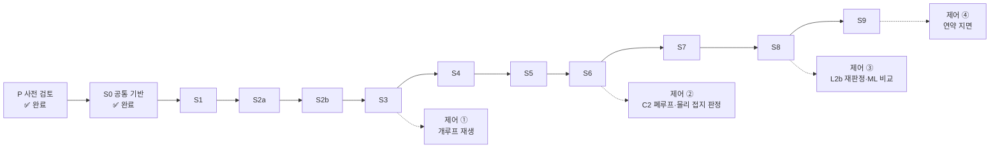

# 프로젝트 로드맵 (2026-10-20)

아우트리거 4개로 상부체 roll·pitch를 제어하는 시뮬레이션의 전체 작업 순서를 한 장에 모은다. 세부는 각 트랙의 원본 문서를 본다. 이 문서는 요약이며 원본과 다르면 원본이 맞다.

| 트랙 | 원본 문서 |
|---|---|
| Chrono 모델 구축 S0~S9 | [03_chrono/chrono_build_plan.md](03_chrono/chrono_build_plan.md) |
| 검증 기준 V0~V17 | [01_dynamics/dynamics_model.md](01_dynamics/dynamics_model.md) |
| 제어기(C2) | [04_control/control_candidates_comparison.md](04_control/control_candidates_comparison.md), 계획 3.5절 |
| 센서·정확도 | [05_sensors/imu_cabin_and_accuracy_review.md](05_sensors/imu_cabin_and_accuracy_review.md) |
| 확정 사항·미정 사항 | [../CLAUDE.md](../CLAUDE.md) |

## 1. 지금 위치

**사전 검토(P)·S0 공통 기반 완료(2026-10-20) → 다음 S1.**

| 단계 | 진행 | 상태 | 예상 작업 시간 | 예상 계산 시간(벽시계) |
|---|---|---|---|---|
| **S0** | 11 / 11 | ✅ 완료(2026-10-20) | — | 약 2분 |
| S1 | 0 / 6 | ⬜ | 3.5~4.5시간 | 약 4~6분 |
| S2a | 0 / 3 | ⬜ | 2~3시간 | 약 7분 |
| S2b | 0 / 5 | ⬜ | 4~5시간 | 약 5분 |
| S3 | 0 / 6 | ⬜ | 6~8시간 | 약 47분(4병렬 12~13분) |
| S4 | 0 / 4 | ⬜ | 4.5~6시간 | 약 18분(4병렬 5분) |
| S5 | 0 / 2 | ⬜ | 1.5시간 | 약 6분 |
| S6 | 0 / 9 | ⬜ | 12~16시간 | 약 30분~1시간 |
| S7 | 0 / 8 | ⬜ | 8~11시간 | 30분~1시간 |
| S8 | 0 / 6 | ⬜ | 15~20시간 | 1시간 + ML 데이터 수 시간 |
| S9 | 0 / 5 | ⬜ | 7~10시간 + 파라미터 확보 | 수 시간(SCM 2 cm 격자 1 s당 약 31 s) |
| **합계** | 11 / 65 | | **약 67~90시간** | 약 4~6시간 + ML·SCM 계산 |

진행 수는 4절 체크리스트의 항목 수다(선택 항목 제외).

**예상 시간의 기준(2026-10-20 추정, 실측으로 계속 고친다)**
- **작업 시간**: 에이전트가 구현·시험·판정하고 메인 세션이 검토·문서화하는 데 드는 시간. 2026-10-20 실측을 기준으로 잡았다 — 순수 Python 모듈 + 시험 5~10분(params, frames, signals, engine), Chrono 모듈 + 시험 10~20분(make_system, 솔버 변경), 판정·재계산 15~25분(감쇠 개정 7, V7 진단), 재작업·문서 동기화를 더해 항목당 20분~2시간으로 잡았다. **사용자 결정 대기와 외부 자료(제조사 회신, SCM 파라미터) 대기는 넣지 않았다.**
- **계산 시간**: 계획 문서 4절 비용 추정(L1 0.2 ms/스텝 → dt 1×10⁻⁴ s에서 시뮬레이션 1 s당 2 s, 1×10⁻⁵ s에서 20 s)과 2026-10-20 솔버 벤치마크.
- 체크리스트 각 항목 끝의 ⏱가 항목별 추정이다. 단계를 마치면 실제 걸린 시간을 이 표 옆에 적어 다음 추정을 고친다.

## 2. 사전 검토(P) — 완료한 것

| 분야 | 결과 | 문서 |
|---|---|---|
| CAD | 다리 4개 기하, 질량 특성(경우 C 38,556 kg), 오거 3단계, 3면도·GIF | [00_cad/](00_cad/) |
| 동역학 기준해 | 하중 분배·고유진동수·들어 올림 V4, 검증 기준 V0~V17(개정 9) | [01_dynamics/dynamics_model.md](01_dynamics/dynamics_model.md) |
| 구동기 | L1 기본, L2b 병행(운용안 B) | [01_dynamics/actuator_L2_feasibility.md](01_dynamics/actuator_L2_feasibility.md) |
| 감쇠비 | 다리 0.03, 크롤러 0.05/0.2 | [01_dynamics/damping_survey.md](01_dynamics/damping_survey.md) |
| 유압 | 회로 해석, 210/350 bar, β 1.0 GPa | [02_hydraulic/](02_hydraulic/) |
| Chrono 규약 | SMC 정지 마찰 없음 → 부싱 + Coulomb | [03_chrono/chrono_stick_friction_test.md](03_chrono/chrono_stick_friction_test.md) |
| 제어 구조 | C2 잠정 채택(대안 C8) | [04_control/](04_control/) |
| 센서 | IMU 캐빈 바닥 아래, ±0.2°, 2차 필터 | [05_sensors/](05_sensors/) |
| 반력 시계열 | 0→680 mm 신장 시 다리 반력, D안 동적 피크 141.0 kN(준정적 119.3 kN), 기준 파일 등록 | [01_dynamics/dynamics_model.md](01_dynamics/dynamics_model.md) 3.7절 |
| V7 진단값 | c_t 2배 오입력 판별(1·2차 의심 → 3차 확정) | [../06_analysis/00_dynamics/v7_diagnostic.json](../06_analysis/00_dynamics/v7_diagnostic.json) |
| 주행 시험 연기 | Chrono 예제 궤도차량(M113 JSON 사본, 피치 0.1732 m·11이빨)을 `make_system`(NSC) 안에서 스프로킷 토크로 전진·후진. 부호 규약 실측(+T → +x, `GetAxleSpeed` 음수). 우리 크롤러 모델 아님 | [03_chrono/track_drive_plan.md](03_chrono/track_drive_plan.md) 10절 |

## 3. 단계별 로드맵

| 단계 | 내용 | 모델 | 통과 기준 | 제어기 트랙 | 접지 판정 트랙 |
|---|---|---|---|---|---|
| **S0** 🔶 | 공통 기반(로더·좌표·타입·시스템·부싱·기록·스냅숏·비용) | — | V0 규약, 블록 회귀 | | |
| S1 | 상부체 + 고정 다리 + 지면 부싱, 수평 정적 | L1 | V0~V3, V13 | | |
| S2a | 부싱 동특성, 경사 정적 | L1 | V7 진단, V12, V13 | | |
| S2b | 속도 모터, 크롤러 D안 24구(롤러 12 + 틈 있는 끝 슈 12), 접지 이벤트 | L1 | V0, V11, V13 | | |
| S3 | 수치 감쇠 확인 → 들어 올림 → 다리 단독 신장, **Δt 확인** | L1 | V8(a), V4, V5, V6, V9 | **① 개루프 명령 재생**(runner·Record 확인) | |
| S4 | 6개 모드, 에너지 수지, β 감도 | L1 | V7, V8(b) | | |
| S5 | 오거 3단계 | L1 | V10 | | |
| S6 | 센서 진값, 210 bar 힘 포화, 제어기 경계 | L1 | V11b, V17 경로 | **② IMU 오차 모델 + 2차 필터 + C2 폐루프**, ±0.2°·F_min·오거 3단계 | **물리 기반 결합 판정**(압력·스트로크·자세) + 탐침 |
| S7 | L2b-NSC | L2b | V0~V13(L2b), V14 | | |
| S8 | 실 마찰, 카운터 밸런스, D2 외란 | L2b | V15, V17, V8(b) | **③ 큰 경사·실 마찰·D2 재판정** | 압력만 vs 결합 판정 비교, **ML/DL 학습 데이터 생성**(접촉력 = 라벨, F_s·β·경사·오거·노이즈 무작위화) → 물리 기반과 비교 |
| S9 | SCM 연약 지면 | L2b + SCM | V16 | **④ 연약 지면 재판정** | 연약 지면에서 판정기 재평가 |

- 일반 실행 dt 1×10⁻⁴ s, 기준해·접지 전환 1×10⁻⁵ s(CLAUDE.md).
- ML/DL 환경은 준비됨(`pytorch_214_cuda_python_313`). Chrono-dev가 만든 npz를 읽고, 시뮬레이션 안 추론이 필요하면 ONNX로 내보낸다.
- 담당: Chrono 모델·시뮬레이션은 cad-expert, 판정은 dynamics-expert, 엔진 독립 Python(타입·센서·제어기)은 python-expert.
- **선택 트랙 T(주행 시험, 사용자 결정 2026-10-20)**: 크롤러 앞쪽 스프로킷(유압 주행 모터)을 돌려 실제 궤도 모델로 전진·후진한다. Chrono Vehicle 궤도 템플릿(JSON, SinglePin 강체 슈 44개/측, NSC 접촉). 레벨링 S 단계와 모델·시나리오·기록을 분리한다. 원본 [03_chrono/track_drive_plan.md](03_chrono/track_drive_plan.md). T0 CAD 추출·JSON 생성기 → T1 한쪽 트랙 공회전 → T2 평지 정적 → T3 전진·후진·정지 + GIF → T4(선택) SCM. 작업 약 18~27시간. 선행: S0 `make_system`(주행용 선택지 추가 필요), S2b 크롤러 접촉, S7 NSC.

## 4. 단계별 체크리스트

계획 문서 각 단계의 체크리스트와 항목이 같다(제어·접지 판정 트랙 항목 포함, 2026-10-20 동기화). **체크 상태는 계획 문서가 원본**이며, 항목을 끝내면 계획 문서와 이 절을 함께 고친다. "시작 전 결정"은 5절의 마감 항목이다.

### S0 공통 기반 ✅
- [x] 패키지 뼈대, `pyproject.toml`, `05_tests/conftest.py`
- [x] `params` 로더 + 전 키 왕복 시험
- [x] `frames`(wxyz 쿼터니언, ZYX roll·pitch, 기체↔CAD, 원점 오프셋 한 곳) + 시험
- [x] `signals`(Command, Measurements, TruthState, Record 스키마) + 시험
- [x] `make_system()`(중력 명시 R1, Bullet R2, 바닥 R6, 적분기·솔버 R11) + 시험. Pardiso MKL 크래시는 env 미활성 실행의 libomp 포워더 문제였고 미리 로드로 해결. L1 기본 솔버는 **SPARSE_LU + 희소 패턴 고정**(사용자 결정 2026-10-20, 전체 규모 L1 잠금 켬 QR 147 / LU 133 / Pardiso 447 µs/스텝, 결과 동일). QR·Pardiso·잠금 끔은 옵션. 잠금 상태 구조 변경(R15 부싱 생성·소멸) 시험 포함
- [x] `engine`(SimEngine 프로토콜: reset·step·apply_command·measure·truth·snapshot·restore·close, `Snapshot` 지문 검사) + 시험
- [x] Chrono 10 SMC 감쇠 처리 확인: `c = gn·m₁m₂/(m₁+m₂)`, 재질 kn·gn 산술 평균 합성, YAML gn으로 heave ζ 0.02999 실측(설계 0.03) — gn 환산식 수정 불필요. **SMC 접촉은 명시 적분이라 접촉 모드에 ωΔt/2 수치 감쇠가 없음**(dt 규칙 재검토 대상) + 시험 22건
- [x] `GroundBushingCoulomb`(R15 히스테리시스, t_lift 1 ms) + 블록 회귀 3건·들었다 놓기 시험 ⏱ 1~1.5시간 — 2026-10-20 완료(`chrono/ground_bushing.py`, 회귀 기준 차 ≤ 2e-9, 히스테리시스 생성 1·소멸 1). 미결: Python 입력 1스텝 지연 규약(dynamics-expert 판정 대기)
- [x] `record`(npz + meta.json) + 스냅숏(R16) — 결정됨(2026-10-20): 실제 스트로크 별도 필드 `stroke_true`, Measurements 저장 ⏱ 45분~1시간 — 2026-10-20 완료(`record.py`, `chrono/snapshot.py`, 왕복 비트 단위 일치)
- [x] `verify/reference`(R12 키 상수 68개, 자리표시를 펼치면 158경로 모두 파일에 존재, 계획 문서 경로를 실행 중에 대조) + 시험 177건
- [x] 전체 규모 스텝 비용 재측정(크롤러 포함, dt 1×10⁻⁴·1×10⁻⁵ s) ⏱ 30분(계산 약 2분) — 2026-10-20 완료(`06_analysis/01_chrono/step_cost_S0.json`): 패드 접지 181 µs/스텝(계획 0.2 ms의 0.95배), 크롤러 정착 68 µs(0.35배), dt 무관. **P코어 고정 + EcoQoS 해제 시에만 성립**(OS 기본 배치 2.4배 느림). 지면 부싱(훅 81 µs + Chrono 하중 55 µs)이 72 %. NSC 비용은 S7에서
- 시작 전 결정: 기체 좌표 원점 ✅ CAD 원점 유지(2026-10-20)

### S1 상부체 + 고정 다리 + 지면 부싱, 정적
- [ ] V0 질량 특성 자동 비교(오거 3단계) ⏱ 20~30분
- [ ] 다리별·크롤러 바닥 패치, 재질, 충돌 패밀리(R14) API 확인 ⏱ 45분~1시간
- [ ] 해석 정적해 초기화 + 부싱 t = 0 ⏱ 1시간
- [ ] 패드별 수직력: 프레임 확인, 콜백 교차 ⏱ 30~45분
- [ ] 초기화 없는 53 s 정착 교차 1건 ⏱ 20분(계산 약 2분)
- [ ] 정착 상태 저장(3단계) ⏱ 20~30분

### S2a 지면 부싱 동특성 · 경사 정적
- [ ] 초기 속도 가진(roll, pitch; V7 진단 ⑤이면 yaw 2 s 추가) ⏱ 45분~1시간
- [ ] 경사 바닥 + t = 0 부싱 + 중력 램프 ⏱ 45분
- [ ] V12 3경우, 정착 ≥ 53 s 뒤 마지막 3 s 평균, 항복 스텝 수 기록 ⏱ 30분(계산 약 7분)
- 시작 전 결정: 지면 경사 시험 범위(미정이면 V12 3경우)

### S2b 모터 · 크롤러 · 접지 이벤트
- [ ] 모터 축·부호(R4) ⏱ 30분
- [ ] V11(공중 다리) ⏱ 30분
- [ ] 크롤러 구 배열·패치·재질(R13), 패밀리(R14) ⏱ 1~1.5시간(CAD C7 반영 포함)
- [ ] 접지·부상 이벤트(R15; t_lift 1 ms, N_th 100 N을 이벤트 시험으로 조정) ⏱ 1.5~2시간
- [ ] 크롤러 위 정착 상태 저장(3단계, 해석 정착 자세로 초기화, 못 하면 ≥ 65.5 s) ⏱ 20~30분

### S3 수치 감쇠 → 들어 올림 → 다리 단독 신장, Δt 확인
- [ ] V8(a) Δt·2Δt, 60 s(수치 감쇠 실측) ⏱ 30분(계산 약 3분)
- [ ] 들어 올림(V4): 크롤러 정착 상태에서 모터 출발, 다리별 운용 신장 정지, 다리별 접지 시각 ±0.05 s, 기준 = 감쇠 3자유도 동적 시각(D 15.050 / 15.049 / 15.177 / 15.177 s, `dynamic_events_s`), 준정적 시각(15.051 / 15.049 / 15.148 / 15.148 s)은 참고, 동적 피크 상한 판정, 정지 15 s 뒤 잔류 판정 ⏱ 1.5~2시간(계산 약 4분, 1×10⁻⁵ s 기준해 약 11분)
- [ ] V5, V6(FL+, FL−) ⏱ 1시간(계산 약 12분)
- [ ] V9(Δt, Δt/2, Δt/4 + 1×10⁻⁵ s 기준해) ⏱ 1~1.5시간(계산 약 28분)
- [ ] 병렬 실행기와 meta(`Params.sha256`·`file_sha256`·reference sha256, dt, 솔버, 버전) ⏱ 1~1.5시간
- [ ] **제어 ①** 개루프 명령 재생으로 runner·Record 확인 ⏱ 1시간
- 결정됨(2026-10-20): 동적 피크는 ②안(기록 + 상한 218 kN, ±15 %는 참고), `leg_extension_loads.json` 기준 파일 등록

### S4 6개 모드 · 에너지 수지 · β 감도
- [ ] 초기 속도 6종 + 모드 투영 + ERA/SSI 교차 ⏱ 2~3시간
- [ ] V8(b) 에너지 수지 ⏱ 1.5~2시간
- [ ] β 3값(0.69 / 1.0 / 1.6 GPa, 감쇠 고정) ⏱ 30분(계산 약 5분)
- [ ] 다리 감쇠비 감도 양끝(0.01 / 0.10) ⏱ 30분(계산 약 5분)
- [ ] (선택) 로드측 챔버 +10 % 강성 1건 ⏱ 30분
- 끝나기 전 결정: MuJoCo 역할(Q8)

### S5 오거 3단계
- [ ] 오거 합성 단위 시험 ⏱ 30분
- [ ] 3단계 V1·V7(1·2차), V10 ⏱ 1시간(계산 약 6분)

### S6 압력 센서 · 힘 포화 · 제어기 경계
- [ ] `Measurements`·`Command` 확정(py 검토, `signals` 기반) ⏱ 20~30분
- [ ] 압력·스트로크 가상 센서 ⏱ 1시간
- [ ] 스텝별 힘 포화(210 bar) + 양방향 스프링 단일 다리 V11b ⏱ 1~1.5시간
- [ ] 350 bar 지표 기록 ⏱ 20~30분
- [ ] **제어 ②** py: IMU 오차 모델, Controller 프로토콜, 빈 제어기 60 s 폐루프 연기 시험 ⏱ 1.5~2시간
- [ ] IMU 진값 장착점 기본값 (0.31, 0.88, 0.040) m(C1)과 인자 변경 단위 시험 ⏱ 20~30분
- [ ] **제어 ②** py: 센서 등급 5종(이상·우수 영점 후·보통 영점 후·보통 + 반복성·보통 출하), 2차 필터(τ 0.5 s × 2) ⏱ 1~1.5시간
- [ ] **제어 ②·접지 판정** py: C2 제어기(대안 C8)와 물리 기반 결합 접지 판정 + 탐침 ⏱ 4~6시간(가장 큼)
- [ ] 제어기 검증 항목 1~8(L1; ±0.2°, F_min, 오거 3단계), 9는 S7·S8 ⏱ 2~3시간(계산 약 30분~1시간)
- 시작 전 결정: 센서 모델·제어 주기(미정이면 20 ms), IMU 실제 좌표. 끝나기 전 결정: 제어기 세부(D4 탐침 빈도, D5 F_band, D6 비틀림 목표, 게인, D8 경사 한계, 목표 범위)
- 보류: IMU 로킹 잔류 여유 — 폐루프 결과에서 잔류가 가정(0.031°)을 넘거나 ±0.2° 여유가 줄면 재점검

### S7 L2b-NSC
- [ ] 가이드 x·y 해제 API 확인 ⏱ 30분
- [ ] 힘 법칙, s_ref, 스텝별 포화 ⏱ 1.5~2시간
- [ ] 횡 부싱 ⏱ 1시간
- [ ] V0~V13(L2b-NSC 열) ⏱ 2~3시간(계산 30분~1시간)
- [ ] V4(NSC, 다리별 접지 ±0.05 s, 강체 극한 동적 기준 15.382 / 15.382 / 15.040 / 15.040 s) ⏱ 30~45분
- [ ] V14 3경우, RL+ ⏱ 1~1.5시간(계산 약 10분)
- [ ] L1 대 L2b-NSC 비교표 ⏱ 30분
- [ ] **제어 ③ 준비** py: S6 제어기로 L2b-NSC 폐루프 연기 시험 ⏱ 1시간
- 시작 전 결정: D2 외력 크기·시간·작용점(Q9)

### S8 실 마찰 · 카운터 밸런스 · D2 외란
- [ ] 실 마찰 요소 + V15(a) 단방향 상승(부상까지), V15(b) 0 → 10 → 0 mm 왕복 ⏱ 2~3시간
- [ ] 카운터 밸런스 옵션(`lock_valve`) ⏱ 1.5~2시간
- [ ] D2 하중(결정 뒤, 1×10⁻⁵ s 전환 창) ⏱ 1~1.5시간
- [ ] V17 L1·L2b-NSC ⏱ 1시간
- [ ] **제어 ③** py: 큰 경사·실 마찰(F_s 0/2/5/12 kN)·D2 재판정, 제어기 검증 항목 9(압력만 vs 결합 판정) ⏱ 3~4시간(계산 약 1시간)
- [ ] **접지 판정 ML/DL** py: 학습 데이터 생성(접촉력 라벨, F_s·β·경사·오거·노이즈 무작위화) → 학습(`pytorch_214_cuda_python_313`) → 물리 기반과 비교 ⏱ 6~8시간(데이터 생성 계산 수 시간 별도)

### S9 SCM 연약 지면
- [ ] SCM 파라미터 확보 ⏱ 외부 자료 의존(조사 시 1~2시간)
- [ ] 패드/로드 분리 + 구면 조인트 + 경사 제한 ⏱ 2시간
- [ ] 단일 패드 비용·격자 수렴 ⏱ 1.5시간(계산 최대 약 1.5시간)
- [ ] V16 ⏱ 1.5시간(계산 수십 분~수 시간)
- [ ] **제어 ④·접지 판정** py: 연약 지면 재판정(크롤러 토양 ζ 0.2) ⏱ 2~3시간(계산 수 시간)
- 시작 전 결정: SCM 파라미터(없으면 S9 보류)

### CAD(STEP) 작업 트랙
`REXOME33_Assy_r3(미니어쳐).stp`에서 뽑아야 하는 것. S 단계 체크리스트와 별도로 **이 절이 원본**이다(2026-10-20 사용자 요청). 담당 cad-expert(계산은 dynamics-expert). STEP 원본은 수정·이동하지 않는다.

| 작업 | 필요 단계 | 결과물 / 쓰는 곳 | 상태 |
|---|---|---|---|
| **C1 기체 좌표 원점 후보** 제시 → 사용자 결정 | S0 | `00_cad/cad_origin_mass_imu.md` 1절 | ✅ O0(CAD 원점) 유지 결정 |
| **C2 질량 감사**: 자리표시 재질 부품, 질량 상위 부품, 빠진 질량, 제조사 질문 목록 | 언제든(빠를수록) | 같은 문서 2·3.9절, `01_cad/01_parts/mass_audit_parts.csv` | ✅ 경우 C 유지 결정, 제조사 질문 Q1~Q8 대기 |
| **C3 IMU 장착점 실제 좌표**: 상부 프레임 평평한 면 후보 | S6 전 | `00_cad/cad_origin_mass_imu.md` 4절, `01_cad/01_parts/imu_c1_*.png` | ✅ C1 (0.31, 0.88, 0.040) m 결정 |
| **C4 전체 부품 B-rep 캐시**(프로토타입별 `.brep` + 인스턴스 배치 변환, git 제외, 생성 스크립트) | C5~C8 전 | `01_cad/06_brep/`(`prototypes/*.bbrep` 681개 바이너리 387.7 MB git 제외, `instances.csv` 1,214행), 생성 `04_scripts/00_cad/build_brep_cache.py`, 로더 `brep_cache.py`, 형식 변환 `convert_brep_cache.py`, 검증 `verify_brep_cache.py`, 크롤러 파생 캐시 `derived/crawler/`(`derive_crawler_cache.py`) → STEP 재파싱 없이 형상 질의. `00_cad/cad_review.md` 8절 | ✅ 2026-10-20 (parts.csv 부피·무게중심 전수 일치, 다리·마스트 B-rep 동일) |
| **C5 전체 면 색인**(평면·원통 면 면적·법선·중심·소속 부품) ⏱ 1~1.5시간 | C3·C6 보강 | `01_cad/07_faces/`(instance_faces.csv.gz 80,676면·prototype_faces.csv.gz, 크롤러는 지면 +50 mm·그라우저 끝만), `04_scripts/00_cad/build_face_index.py`, 질의 `face_index.py`, 검증 `cad_review.md` 9절 | ✅ 2026-10-20 |
| **C6 캐시 목록(manifest)**: STEP 해시, 생성 스크립트·버전, 캐시 파일 해시 | C4와 함께 | `01_cad/cache_manifest.json`(00_step~07_faces 등록), 점검·갱신 `04_scripts/00_cad/check_cache.py` → 낡은 캐시 자동 감지. `00_cad/cad_review.md` 8.5절 | ✅ 2026-10-20 |
| **C7 크롤러 실제 접지면 치수**(트랙 길이·폭·롤러 위치) ⏱ 1시간 + dynamics 판단 1시간 | S2b 전 | 크롤러 구 배열(R13), S9 SCM 활성 영역 | 🔶 파생 캐시 준비됨(`01_cad/06_brep/derived/crawler/crawler_summary.json`·`crawler_wheels.csv`, `cad_review.md` 8.6절); D안(롤러 + 틈 있는 끝 슈) 결정(2026-10-20), YAML 반영 완료; 접촉 부품(롤러 12·끝 슈 12·평탄 슈 20) B-rep·색인 완료(`cad_review.md` 8.6.1, YAML 배치와 일치); 기준해 재계산 완료(`reference.json`·`leg_extension_loads.json`, `dynamics_model.md` 개정 8·9), 부품 렌더 `01_cad/06_brep/derived/crawler/crawler_contact_parts_*.png` |
| **C8 Chrono 시각화·충돌 형상**(패드·크롤러 단순 형상, 볼록 분해) ⏱ 1.5~2시간 | S1 전 | S1 바닥 패치·충돌 패밀리(R14) | 🔶 크롤러 파생 캐시 준비됨(트랙별 볼록 껍질·상자, `crawler_collision.json`, `cad_review.md` 8.6절). 패드 형상·Chrono 적용은 남음 |
| **C9 마스트 1차 굽힘 진동수**(단면 추출 → 보 모델, 필요 시 FEM 교차) ⏱ 3~4시간(FEM 포함 시 +2시간) | S6 전 | 5절 "마스트 굽힘 진동수", 강체 가정 검증 | ✅ 2026-10-20 판정(`dynamics_model.md` 개정 10 3.9절, `06_analysis/00_dynamics/mast_bending_check.json`): 1차 굽힘이 L1 로킹 대역과 **겹침**(결합 시 상단 로킹 1.785 → 0.91~1.60 Hz, −10~−49 %). 정상상태 자세·하중 영향 무시 가능(자세 ≤ 7e-4°, 패드 ≤ 0.44 kN), 동적 하중·IMU 잔류는 강체가 보수적 → **S1~S6 강체 L1 진행**. 유연 마스트(방향별 1모드 등가)는 D2·V17 전, 정착 길이·완료 필터 확정 전에 넣음. 제조사 질문 Q-B3 > Q-B1 > Q-B4 > Q-B2. Q-B5(레벨링 목표)는 **데크 수평**으로 결정(사용자 2026-10-20) |
| **C10 다리 지지 구조 강성**(아우트리거 빔·브래킷 FEM) ⏱ 4~6시간 | L2 도입 시 | YAML `frame_stiffness_N_m` 가정 검증 | ⬜ |
| C11 STEP 색·레이어 정보(선택) ⏱ 30분 | — | 그림 품질 | ⬜ |

- 순서: C1~C3(진행 중) → C4 + C6 → C5 → C7·C8(S1·S2b 전) → C9(S6 전) → C10(L2).
- 완료한 CAD 산출물(부품 표, 질량 특성, 다리·마스트 B-rep, 렌더 메시, 3면도, GIF)은 2절 사전 검토에 있다.

### 주행 시험 트랙(T, 선택)
[03_chrono/track_drive_plan.md](03_chrono/track_drive_plan.md)이 원본이다(체크 상태 포함). 판정은 dynamics-expert.

- [ ] **T0** CAD 추출(스프로킷 23이빨, 슈 44개/측·피치 173.2 mm, 아이들러·롤러·핀), CAD → Chrono Vehicle JSON 생성기, 섀시 질량 정리(상부체 − 궤도 부품) ⏱ 3~4시간(계산 약 2분)
- [ ] **T1** 한쪽 트랙 공회전: 둘레 보존, 체인 속도 = ω·r_eff ±1 %, 탈선 없음, 장력, 회전 부호 ⏱ 4~6시간(계산 2.5~12.5분)
- [ ] **T2** 양쪽 트랙 + 상부체 평지 정적: 반력 합 ±1 %, D안 기준해 ±10 %, heave 8.73 Hz(D안) ±10 %, 표류 < 1 mm ⏱ 5~7시간(계산 4.5~22분)
- [ ] **T3** 전진·후진·정지 + GIF: 미끄럼률 ≤ 3 %, 이동 거리 ±1 %, 정지 후 평형, 필요 토크, 에너지 수지 ⏱ 5~8시간(계산 10~49분)
- [ ] T4(선택) SCM 연약 지면 주행 ⏱ 6~10시간 + SCM 파라미터

## 5. 결정이 필요한 것과 마감 단계

✅ 결정됨 · ⏳ 마감 전 결정 필요 · ⚠ 판단 대기(최근 발생)

| 항목 | 마감(이 단계 시작 전) | 상태 / 미정이면 쓰는 값 |
|---|---|---|
| 기체 좌표 원점 | S0 | ✅ O0 = CAD 원점 유지(선회 링 볼트원 축 ∩ 데크 하면, 사용자 결정 2026-10-20). `frames.BODY_ORIGIN_IN_CAD_MM` 0 그대로, 바꿀 것 없음 |
| `record` 필드: 실제 스트로크 별도 필드, Measurements 저장 여부 | S0 `record` | ⏳ `record` 모듈 만들 때 결정 |
| 지면 경사 시험 범위 | S2a | ⏳ V12 3경우 |
| V7 진단 문구(새 감쇠 기준) | S2a | ✅ 1·2차 ζ 판정 ①~④ + 의심 시 yaw 2 s 시험으로 3차 ζ 확정(`v7_diagnostic.json`) |
| V12 경사 정착 길이 | S2a | ✅ 정착 ≥ 53 s(τ₁ ln100, 사용자 결정 2026-10-20). S2a 비용 85 → 217 s |
| 부싱 부상 판정 n_lift | S2b | ✅ 시간 기준 t_lift = 1 ms(Δt 1×10⁻⁴ s → 10스텝, 1×10⁻⁵ s → 100스텝). 값은 S2b 이벤트 시험으로 조정 |
| Δt | S3에서 확인 | ✅ 용도별(1×10⁻⁴ / 1×10⁻⁵ s) |
| 일반 실행 Δt 2×10⁻⁴ s 완화 | S3 V8(a) 뒤 | ⏳ **1×10⁻⁴ s 유지, 조건부 검토**(사용자 결정 2026-10-20). 근거: dynamics-expert 수치 감쇠 재검토(SMC 접촉은 명시, 수치 감쇠는 부싱 몫 r·ωΔt/2만 → 상한은 3차 yaw-sway 0.205 ms, `06_analysis/00_dynamics/numerical_damping_review.json`). 조건 ① V8(a)에서 3차 ζ_num이 예측의 ±30 % 안(부싱 암시 가정 확인), ② 다리 ζ 0.01 감도 실행은 접선 모드 ζ 미판정 또는 5×10⁻⁵ s. 둘 다 충족하면 2×10⁻⁴ s로 바꿀지 다시 결정 |
| L1 선형 솔버 | S0 | ✅ SPARSE_LU + 희소 패턴 고정(사용자 결정 2026-10-20, 근거 계획 문서 4절 벤치마크). SPARSE_QR·PARDISO_MKL은 옵션 |
| 감쇠비 | S1~S8 | ✅ 다리 0.03, 크롤러 0.05/0.2, 구조 0.015 |
| `leg_extension_loads.json`을 기준 파일(`verify/reference`)로 등록할지 | S3 | ✅ **등록**(사용자 결정 2026-10-20, D안 재계산 후). S3에서 Chrono L1 신장 시나리오와 비교. 허용 오차는 아래 동적 피크 판정과 함께 정함 |
| 들어 올림 동적 피크(D안 141.0 kN, 준정적 119.3 kN)를 하중 판정에 넣을지 | S3 | ✅ **②안**(사용자 결정 2026-10-20): 기록 + 상한 판정(실린더 힘 < 218 kN, 포화 없음)만. 3자유도 기준 ±15 %는 참고 기록. F_min 동적 여유(+18 N, ×3이면 −5.8 kN)는 개루프 V4 판정에 쓰지 않음 |
| V4 기준 시각 | S3 | ✅ **감쇠 3자유도 동적 접지 시각을 기준**, 준정적 시각은 참고 기록(사용자 결정 2026-10-20). 허용 ±0.05 s 유지. 준정적 기준이면 후방이 29 ms 어긋나 허용의 60 %를 먼저 씀. reference.json `dynamic_events_s` 추가 완료(감쇠 감도 최대 4.7 ms, 허용의 9 %), `verify/reference.py` 동적 상수 반영 완료 |
| 크롤러 접촉 배치 | S2b·S0 비용 측정 | ✅ D안 + 총 강성 1×10⁸ 유지(×3 감도), V4는 다리별 접지 시각 ±0.05 s 판정(사용자 결정 2026-10-20). YAML·기준해·시험 상수 반영 완료(2026-10-20) |
| MuJoCo 역할(Q8) | S4 끝 | ⏳ 인터페이스만 |
| 센서 모델(노이즈·바이어스·지연), 제어 주기 | S6 | ⏳ 영점 허용 0.14°(장착 몫 0.02°, 2026-10-20 결정), 등급 감도, 20 ms |
| IMU 정확한 장착 좌표 | S6 | ✅ C1 (0.31, 0.88, 0.040) m(BASE DECK 좌측 폰툰 15 mm 가로판 윗면, 후보 C1, 사용자 결정 2026-10-20). 정확도 재계산은 dynamics-expert |
| IMU 로킹 잔류 여유(잔류 0.029° vs 필터 가정 0.031°) | S6 | 보류(사용자 결정, 2026-10-20): 지금은 판정 통과라 그대로 둔다. S6 폐루프 결과 등에서 잔류가 가정을 넘거나 ±0.2° 여유가 줄면 그때 재점검(선택지: 필터 τ 조정, 가정 진폭 상향 후 재검토) |
| 제어기 세부: 탐침 빈도(D4), F_band(D5), 비틀림 목표(D6), 게인, 경사 운용 한계(D8), roll·pitch 목표 범위 | S6 끝 | ⏳ 비교 문서 7.1절 값 |
| D2 외력 크기·시간·작용점(Q9) | S7 시작 | ⏳ 정착 상태 지표만 |
| 카운터 밸런스 교체, 실 마찰 크기 | S8 | 막지 않음 — 두 옵션, F_s 0/2/5/12 kN 감도 |
| SCM 파라미터 | S9 | ⏳ S9 보류 |
| 마스트 굽힘 진동수 | S6·S8 | 자료가 오면 — 그때까지 강체 |
| 실제 운용 중량 | 언제든 | 경우 C(38,556 kg) 유지(사용자 결정 2026-10-20, 질량 감사 `00_cad/cad_origin_mass_imu.md` 2·3.9절의 제조사 질문 Q1~Q8로 확인 예정). 바뀌면 YAML 재생성 → 기준해 재계산 → 저장 상태 폐기 → V 회귀 |
| 유압 사양(L2 전환) | L2 도입 시 | L1 임시 기본 |
| T: 스프로킷 위치 | T0 | ✅ 앞쪽 = 주행 모터, 뒤쪽 Ø548 = 아이들러(사용자 확정 2026-10-20) |
| T U2: 스프로킷 맞물림 모델 | T1 | ⏳ (a) 23이빨 반피치 r_eff 317.0 mm(권장) / (b) 12이빨 등가 330.8 mm — CAD 핀 반지름과 불일치, 주행 속도 4.3 % 차 |
| T U3: 주행 모터 사양·목표 속도 | T3 | ⏳ 미정이면 0.3 m/s, 가감속 0.15 m/s² |
| T U4: 트랙 장력 | T1 | ⏳ 미정이면 상부 런 처짐 40 mm(약 80 kN), 감도 20/60 mm |
| T U5: 주행 시 오거 위치 | T3 | ⏳ 미정이면 상단 |
| T U6: 주행 판정 Δt | T1 | ⏳ 5×10⁻⁴ s vs 1×10⁻⁴ s — dynamics-expert의 수치 감쇠 재검토 결과로 판단 |
| T U7: 상부 롤러 가정 추가 | T1 | ⏳ CAD에 없음 |
| T U8: 실기 하부체 = REXOME25? | 언제든 | 제조사 확인 대기 |

## 6. 다음 할 일

1. S0 나머지: `engine` → Chrono 감쇠 처리 확인 → `GroundBushingCoulomb`·회귀 → `record`·스냅숏 → `verify/reference` → 비용 측정(cad-expert).
2. 판단 대기 없음(IMU 로킹 잔류는 보류).
3. 계획 문서 R13·5절의 "크롤러 YAML 키 추가 중" 낡은 문구 정리(키는 이미 YAML에 있음).
4. 커밋은 S0 단계를 마친 뒤 한다(사용자 결정, 2026-10-20).

## 갱신 규칙

- 단계 항목을 끝내면 계획 문서 체크리스트와 이 문서 4절을 함께 체크하고, 1절 진행 수를 고친다.
- CAD(STEP) 작업 트랙(4절 끝)은 이 문서가 원본이다. 끝내면 상태 열을 ✅로 바꾸고 결과물 경로를 적는다.
- 결정이 생기면 5절을 고치고, 확정 사항이면 CLAUDE.md에도 적는다.
- 세부 내용은 원본 문서에 쓰고 여기에는 한 줄 요약과 링크만 둔다.
