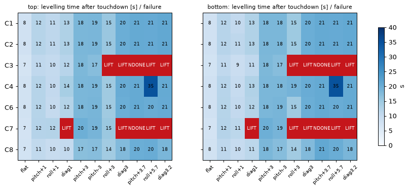
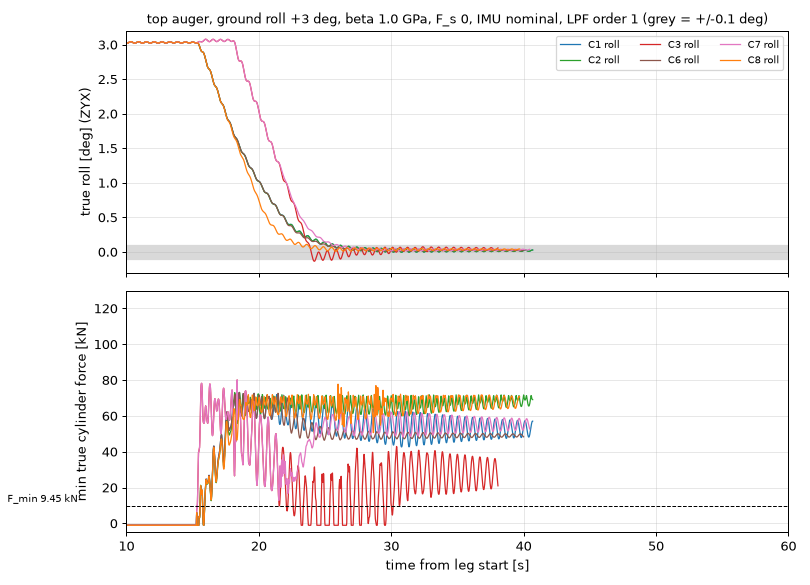

# 레벨링 제어 구조 후보 비교 (2026-10-20, 개정 3)

dynamics-expert 작업이다. 후보 C1~C10을 정성적으로 비교하고, 프로젝트 축소 모델에서 대표 후보 7개(C1, C2, C3, C4, C6, C7, C8)를 같은 시나리오로 시뮬레이션했다. **결정은 사용자가 한다.** 이 문서는 비교 자료와 추천만 담는다.

**개정 3(2026-10-20, IMU 장착점 C1)**: 사용자 결정으로 IMU 장착점이 **C1 (0.31, 0.88, 0.040) m**(BASE DECK 좌측 폰툰 15 mm 가로판 윗면, 방진 마운트 아래 구조체)가 됐다. 스크립트 기본값을 C1으로 바꾸고(상수 `IMU_POINT_C1_BODY_M`, 이전 가정점은 `IMU_POINT_CAB_ASSUMED_BODY_M`으로 비교용), C2 회귀(`--regress`)를 C1으로 다시 돌렸다(10.1절 끝). **C2 추천과 ±0.2° 판정은 바뀌지 않았다.** 본문 시뮬레이션 수치(`--legacy`, 옛 점 (0.45, 0, 0.30) m)는 그대로다. 전체 행렬(308회)을 새 기본값으로 돌리지는 않았다(약 90 s, 필요하면 인자 없이 실행). C1의 로킹 증폭·센서 등급별 폐루프는 [imu_cabin_and_accuracy_review.md](../05_sensors/imu_cabin_and_accuracy_review.md) 10절.

**개정 2(2026-10-20, 감쇠 개정 7 재실행)**: [dynamics_model.md](../01_dynamics/dynamics_model.md) 개정 7의 감쇠(다리 축 ζ 0.05 → 0.03, 그래서 1차 로킹 ζ 0.0129 → 0.0078; 크롤러 heave ζ 0.10 → 0.05)로 `control_comparison.json`(`--legacy`, 308회)과 `control_comparison_c2_regress_rev6.json`(`--regress`)을 다시 돌렸고, 이 문서의 시뮬레이션 수치를 모두 그 값으로 바꿨다. 강성·기하·게인·시나리오·시드 12345는 같다. **C2 추천과 ±0.2° 판정은 바뀌지 않았다.** 판정이 바뀐 곳:
- **C4**: 연약 패드(FL 강성 ½) 대각 3°가 새로 실패했다(FL 부상, 212 bar, 150 s 안에 완료 못 함. 접지 직후와 129 s 부근에 QP 불가해 반복). 비틀림 외란 두 가지(침하·연약 패드)를 모두 견디는 후보는 **C2·C6만** 남는다(0절, 4.3절). 6절 점수에서 C4를 3.85 → 3.45로 내렸다.
- **C7**: 기본 행렬 실패 수는 11/22로 같지만 실패 사유가 늘었다(상단 roll +5.7°, 하단 roll +3°·+5.7°에 부상, roll +5.7°에 미완료가 더해짐). 실 마찰 묶음에서 결합 판정 $F_s$ 0 roll +3°가 새로 실패(부상)했고, $F_s$ 12 kN roll +3°는 $F_{min}$ 위반(8.6 kN)에서 통과(19.5 kN)로 바뀌었다.
- **C1**: 결합 판정 roll +3°의 최소 실제 실린더 힘이 $F_s$ 12 kN에서 **42.4 → 15.7 kN**, $F_s$ 0에서 42.5 → 25.7 kN(탐침 미해결 표지)으로 내려갔다. 탐침 뒤 재레벨링·재탐침이 되풀이된다. $F_{min}$ 위반은 아니다. 기본 행렬 roll 경사의 최소 힘도 56 → 41 kN(r+1), 58 → 43 kN(r+3)으로 내려갔다. 5.2절에 C1 행을 넣었고 6절 실 마찰 점수를 3 → 2로 내렸다(가중 합 3.35 → 3.25).
- **C3**: IMU 최악 수평이 0.0994 → 0.1057°로 ±0.1°를 넘는다(±0.2°로는 통과). β 0.69 GPa roll +3°는 $F_{min}$ 위반(3.2 kN)에서 통과(17.2 kN)로 바뀌었다.
- 그 밖: 기본 행렬의 최소 실제 실린더 힘이 대체로 0~15 kN 줄었다(통과 실행 기준 C2 50.4 → 45.3 kN). 통과 실행 최대 압력 165 → 169 bar(C7). 감쇠가 줄어 크롤러 이탈·이동 중 동적 하중 변동이 커진 것으로 보지만 원인은 따로 분해하지 않았다(추정).

개정 1(2026-10-20): 사용자 결정 반영(아래 문단). 시뮬레이션 수치는 바꾸지 않았다.

- 근거 문서: [leveling_control_survey.md](leveling_control_survey.md)(문헌, C1~C10), [dynamics_model.md](../01_dynamics/dynamics_model.md) 6절(상태공간, C1~C5)과 3.2·3.3절($J$, 비틀림 벡터 $n$, 하중 민감도 $S$), [actuator_L2_feasibility.md](../01_dynamics/actuator_L2_feasibility.md) 3.3절(실 마찰), [hydraulic_circuit.md](../02_hydraulic/hydraulic_circuit.md)
- 스크립트: `04_scripts/01_dynamics/run_control_comparison.py`(`dyn_model.py`는 import만 한다)
- 결과: `06_analysis/00_dynamics/control_comparison.json`(308회 실행, 263 KB), 그림 `06_analysis/00_dynamics/control_comparison_timeseries.png`, `06_analysis/00_dynamics/control_comparison_matrix.png`
- 재실행(이 문서 수치 재현): `conda run -n dynamics-dev python -I 04_scripts/01_dynamics/run_control_comparison.py --legacy`(20 프로세스, 약 86 s. 개정 2 재실행 85.6 s). 스크립트 기본값은 2026-10-20 결정값(목표 ±0.2°, IMU 캐빈 아래 프레임 C1 (0.31, 0.88, 0.040) m(개정 3), 2차 필터)으로 바뀌었고, 인자 없이 돌리면 `control_comparison_rev6.*`로 따로 쓴다(이 문서의 결과 파일은 덮어쓰지 않는다).

**2026-10-20 사용자 결정 반영(개정 1. 시뮬레이션은 옛 가정 `--legacy` — 목표 ±0.1°, IMU (0.45, 0, 0.30) m, 1차 필터 — 로 돈 값이고 개정 2에서도 같다)**: 목표 **±0.2°**(±0.1°에서 완화), 데드밴드 0.03° 유지, IMU 현장 영점 교정 의무, 센서 정지 영점 허용 0.13°(2.27 mg), IMU 장착 **캐빈 바닥 아래 상부 프레임 (0.20, 0.88, 0.30) m**(개정 3에서 C1 (0.31, 0.88, 0.040) m로 확정), 자세 필터 **2차(1차 τ 0.5 s × 2단)**, 제어 구조 **C2 잠정 확정**. 근거는 [imu_cabin_and_accuracy_review.md](../05_sensors/imu_cabin_and_accuracy_review.md). 아래 표의 "±0.2° 기준 판정"과 "결정 상태"는 덧붙인 것이다. 새 기본값의 C2 회귀 실행은 10절 끝.

## 0. 요약

| 항목 | 결과 |
|---|---|
| **추천 1안** | **C2 = 기구학 분해(heave·roll·pitch) + 압력 기반 비틀림 루프 + F_min 가드**에 **결합 접지 판정**(레벨링 뒤 탐침)을 붙인다 |
| 대안 1안 | **C8 = 2상(자세 → 같은 속도 평행 리프트 → 재접지 → 미세 조정)**. 반드시 결합 접지 판정과 함께 쓴다 |
| 기본 행렬(경사 11가지 × 오거 상단·하단, 22회) 통과 | C1, C2, C4, C6, C8: 22/22. C3: 12/22. C7: 11/22 |
| 접지 후 레벨링 시간(통과 중앙값) | C8 17.1 s, C1·C2·C4·C6 18.4 s, C3 10.8 s, C7 12.3 s(C3·C7은 쉬운 경우만 통과해서 짧다) |
| 비틀림 외란에 대한 강건성 | **C2·C6만 패드 침하(RR 11.5 mm)와 연약 패드(FL 강성 ½)를 모두 견딘다.** C4는 침하는 회복했지만 연약 패드 대각 3°에서 FL이 뜬다(개정 2에서 새로 생김, 4.3절). C1은 두 경우 모두 다리가 뜬다(스트로크 비틀림 유지가 다리를 강체로 만든다, 5.3절) |
| 압력만으로 접지 판정(실 마찰 12 kN) | C3·C8은 침하 뒤 **RR 실제 하중 6.9~7.9 kN(< F_min)을 압력 18.6~19.2 kN으로 읽어 놓친다.** 결합 판정(탐침)은 잡아낸다(RR 28~34 kN으로 재접지) |
| 탐침 비용 | 한 바퀴(4다리 × ±2 mm) **6.1 s**. 그 동안 실제 자세 최대 0.04~0.07°(탐침 1회 실행, 정상 오프셋 포함, 탐침 자체 기여 ≈ 0.024°). 재접지가 생기면 최대 34.6 s |
| IMU | 바이어스 0.5 mg(가정)이면 정상상태 실제 오차 0.013~0.050°(22/22 후보). **1.7 mg이면 모든 후보가 0.105~0.121°로 ±0.1°를 넘는다.** 데드밴드 0.03°를 쓰면 바이어스 허용치는 약 1.0 mg다(장착 몫 미포함). **±0.2° 기준 판정(2026-10-20 결정)**: 1.7 mg 최악도 모든 후보가 0.105~0.121°로 통과한다. 장착 몫(캐빈 0.03°)을 넣은 새 예산의 센서 영점 허용은 **0.13° = 2.27 mg**(현장 영점 교정 후 값, 4.2절. **IMU C1·장착 몫 0.02° 결정으로 0.14° = 2.44 mg**, 2026-10-20). IMU는 캐빈 바닥 아래 상부 프레임 C1 (0.31, 0.88, 0.040) m에 단다(개정 3 결정, 이전 가정 (0.20, 0.88, 0.30) m. 이 표의 시뮬레이션은 옛 가정점 (0.45, 0, 0.30) m. 두 점의 정상 오차 차는 같은 경우끼리 ≤ 0.004°, C8 이상 등급 한 경우 0.009°, [imu_cabin_and_accuracy_review.md](../05_sensors/imu_cabin_and_accuracy_review.md) 4.2절) |
| 210 bar | 통과한 실행은 모두 ≤ 169 bar(C1·C2 ≤ 141 bar). 210 bar 근접은 실패 실행(C3·C7, 개정 2부터 C4 연약 패드 대각 3° 212 bar 포함)에서만 생긴다 |
| 사용자 결정 필요 | 7절 |

## 1. 정성 비교

기호: ◎ 좋음, ○ 보통, △ 약함, × 해당 안 됨·불가.

| 후보 | 구조 | 센서 요구(우리 센서로 되는가) | 제약 처리(F_min, 210/350 bar, 속도·스트로크, extend-only) | 부정정·비틀림 처리 | 관측(heave·twist는 IMU로 안 보임) | 실 마찰 취약성 | 구현·튜닝 | 산업 실적 |
|---|---|---|---|---|---|---|---|---|
| C1 기구학 분해 + PI | $u=A[\dot z,\dot\phi,\dot\theta]^T+n\dot\tau$, 자세 PI, heave는 스트로크 기반 크롤러 여유, 비틀림은 스트로크로 유지 | ◎ IMU+스트로크 | △ 포화 스케일만. F_min을 보지 않는다 | **× 스트로크 비틀림 유지는 하중을 모른다.** 연약 패드·침하에서 다리가 뜬다 | heave·twist를 스트로크로만 본다 | ◎ 압력을 안 쓴다(그래서 하중도 모른다) | ◎ | ○ 비례 동시 이동(Kwikee), 대각 분해의 일반형 |
| **C2** C1 + 압력 비틀림 루프 | C1에 $\dot\tau=-K\,(n^TP)/k$와 F_min 가드 | ◎ IMU+스트로크+압력 | ○ F_min 가드(비틀림 방향으로). 속도·스트로크 포화 | ◎ 목표 $n^TP=0$은 같은 강성의 무비틀림 분배다. **무게중심을 몰라도 된다** | twist를 압력으로 본다 | ○ 다리가 같은 방향으로 움직였으면 마찰 편차가 공통 모드라 $n^TP$에서 상쇄된다($\sum n_i=0$). 섞이면 ±$F_s$ 수준 오차 | ○ 게인 2개 추가 | ○ 하중 결합 제어(Cai 2024, 실험대 0.02°) |
| C3 최고점 추종 | 균등 리프트 → 2축 판별로 낮은 쪽 **쌍**을 v_max on/off(거친, 0.15°) → 비례 미세 → 저압 다리 재접지 | ◎ IMU(경사계)+압력 | △ extend-only. 스트로크 소모가 크다 | △ 비틀림 무제어. 축마다 쌍을 올리면 앞·뒤 반폭 차(1.32 / 1.17~1.24 m) 때문에 비틀림이 쌓인다 | twist를 보지 않는다(재접지만) | △ 재접지를 압력 절대값으로 하면 놓친다 | ○ 규칙은 단순, 경우 나눔이 많다 | ◎ 주류(Sany, Palfinger, 30 t 레이더 0.035°) |
| C4 QP/MPC(1단계 QP) | C2의 목표 속도를 자세 우선 가중으로 추종. 제약: 속도, 스트로크 0.5 s 예견, $P+S\,u\,T\ge F_{min}+3$ kN, $\le$ 200 kN | ◎ | ◎ 명시적 | ◎ C2와 같음 + 제약 | 같음 | ○ $S$가 β 가정에 묶인다 | △ 솔버·가중·실패 처리(접지 직후 2~5주기 불가해) | △ 시뮬레이션 문헌뿐(Xu 2025) |
| C5 LQR/LQI | 준정적 적분기 모델 $\dot s=u$에서 LQI = 대각 PI(C1과 같은 구조). 동적 LQR은 로킹 상태(속도) 측정이 필요 | ○ | × 제약을 못 다룬다 | C1과 같다 | 같음 | C1과 같음 | ○ | × 출처 없음 |
| **C6** 정정화(능동 3 + 종동 1) | FL·FR·RL은 $u=A_3\dot q$, RR은 강체 피드포워드 $A_{RR}\dot q$ + 힘 루프(목표 $\sum P/4$) | ◎ | ○ 종동 다리 힘 목표로 간접 | ○ 비틀림은 종동 다리 힘 목표가 정한다(목표 W/4면 비틀림 약 44 kN, 최소 하중 31~50 kN) | twist = 종동 다리 압력 | ○ C2와 비슷 | ○ | △ Liu 2022, US12162735(정량값 없음) |
| C7 대각축 분해 + extend-only + 최소압 | 대각 쌍(FL–RR, FR–RL)마다 낮은 다리 하나를 비례 신장. 최소압 인터록(히스테리시스) | ◎ | △ extend-only, 인터록 | **× 다리 하나만 늘리면 신장의 약 23 %가 비틀림이 된다**($n_i^2$). 강한 4점 지지에서 비틀림이 빠르게 쌓인다 | twist 무제어 | △ | ○ | ○ Schwing(펌프카, 약 3° 이내) |
| **C8** 2상 | 접지 후 최고 다리 기준 동기 비례로 자세 → 같은 속도 평행 리프트 → 저압 다리 재접지 → 미세 조정 | ◎ | ○ extend-only지만 리프트가 마지막이라 스트로크 낭비가 없다 | ○ 동기 비례(같은 시각 도착)라 비틀림이 거의 생기지 않는다. 외란 비틀림은 재접지로만 | twist는 재접지 판정으로만 | **△ 재접지를 압력 절대값으로 하면 놓친다(실측, 5.4절)** | ◎ | ○ JPH05155316A. 압력 보상 비례 밸브와 잘 맞는다 |
| C9 작업 중 능동 유지 | 무게중심 이동 피드포워드 | — | — | — | — | — | — | 연구 단계(Yang 2022, Fan 2026) |
| C10 다리별 게인 스케줄 PID | 하위 루프(다리 위치·속도) | ◎ | — | 상위 구조에 따름 | — | — | ○ | 실험대(Zuo 2017, 2023) |

C5, C9, C10은 시뮬레이션하지 않았다.
- **C5**: 이 문제는 준정적이다(1차 로킹 1.78 Hz ≫ 레벨링 대역 0.06 Hz). 적분기 플랜트 $\dot s=u$에 LQI를 쓰면 대각 PI가 나와 C1·C2와 같아진다. 로킹까지 넣은 동적 LQR은 속도 상태를 측정해야 하고 제약을 다루지 못한다. 이득이 없다.
- **C9**: 천공 반력이 없는 현재 시나리오 밖이다. 상용은 잠금 + 감시 + 인터록이 주류다. 이 비교의 "레벨링 뒤 감시"(자세·저하중 트리거로 다시 레벨링, 5.4절)가 C9의 최소형이다. 외란 D1~D5가 정해지면 다시 본다.
- **C10**: L1 구동기는 압력 보상 비례 밸브를 이상적 속도원으로 둔다. 그래서 다리별 하위 루프가 할 일이 없다. 밸브 불감대·비선형·유량 포화가 모델에 들어오는 L2b 단계에서 C2·C8의 하위 루프로 다시 판단한다.

## 2. 축소 모델

### 2.1 구성

| 요소 | 모델 | 근거·상태 |
|---|---|---|
| 상부체 | 비선형 강체 6자유도. 쿼터니언(wxyz), 기체 각속도. 다리 이동부 4개를 운용점 신장에서 상부체에 합쳤다(`dm.body_with_rods`, 38,982.8 kg) | 로드 이동에 따른 무게중심 이동(약 3 mm)은 무시(가정) |
| 중력 | $\mathbf g=-9.80665\,\hat z$ m/s²(세계) | YAML |
| 지면 | 강체 평면 $z=s_xx+s_yy$, $s_x=-\tan\theta_g$, $s_y=\tan\phi_g$. 처음에 기계가 지면 위에 놓이면 기체 roll = $\phi_g$, pitch = $\theta_g$ | `run_reference.levelled_extension`과 같은 부호 |
| 다리 | 기름 스프링 $k_{oil}(e_{op};\beta)$ ∥ 실 마찰 $\lvert f\rvert\le F_s$, 직렬로 로드·프레임·콘크리트 $k_s$ = 2.17×10⁸ N/m. 로드 무질량, 매 스텝 반환 사상 | `actuator_L2_feasibility.py` C절과 같은 요소. $F_s=0$이면 L1 패드 강성 $k_n$ = 2.08×10⁷ / 2.12×10⁷ N/m를 재현한다 |
| 구동기 | 다리별 속도 명령, $\lvert u\rvert\le$ 22.667 mm/s, 0~680 mm, **210 bar(218.1 kN) 힘 포화를 물리 스텝마다 판정** | L1, `dynamics_model.md` 4.4절 |
| 압력 센서 | $P=k_{oil}(s_{ref}-x)$ = (접촉력 − 로드 무게) − $f$(실린더 힘 기준) + 잡음 σ 0.3 kN(가정) | 2.1절 기준 |
| 스트로크 센서 | 실제 로드 위치 $x$ + 잡음 σ 0.1 mm(가정) | |
| 감쇠·접선 | 패드 수직 $c_n$(L1, 다리 축 ζ 0.03 heave 7.39 Hz 기준; 개정 7, 이전 0.05), 접선 부싱 $k_t$, $c_t$(L1, 같은 ζ) + 원형 Coulomb μ 0.5 | YAML L1, `dyn_model.ASSUMPTIONS` |
| 크롤러 | 2 × 9 단방향 점, 합 1×10⁸ N/m, heave ζ 0.05(2026-10-20 감쇠 결정, 이전 0.1), 접선 부싱(점당 $k_t=k_n$, **가정**), μ 0.5 | `dm.crawler_points` |
| 적분 | 반암시적(심플렉틱) 오일러, Δt 5×10⁻⁴ s. 최대 $\omega\Delta t$ ≈ 0.08 | Δt/2와 비교(2.3절) |
| 제어 주기 | 20 ms, 영차 유지 | |

비교의 한계:
- 지면은 강체 평면이다. SCM 침하와 패드 기울기는 없다.
- 밸브 동역학(지연·불감대)은 없다. 비례 밸브를 이상적 속도원으로 둔다.
- 기름 강성은 운용점 값으로 고정했다(L1과 같음). 큰 경사에서 신장에 따른 강성 변화(≤ 25 %)는 L2b 재판정 몫이다.

### 2.2 시나리오와 센서·제어 공통 가정

| 항목 | 값 | 상태 |
|---|---|---|
| 시작 | 다리 0 mm, 크롤러로 지면 위에 정착(3 s, 기록 안 함) | |
| 접지 탐색(공통) | 네 다리가 $v_{max}$로 신장하다가 다리마다 접지 판정이 나면 멈춘다. 압력만: $P\ge1.5F_{min}$ = 14.2 kN. 결합: 공중 판독(처음 5 s 중앙값)을 뺀 하중 ≥ 14.2 kN | 가정 |
| 목표 | roll = pitch = 0, 크롤러 최소 여유 50 mm(스트로크로 지면 평면 추정) | `dynamics_model.md` 1.3절 |
| 완료 | 완료 판정 신호(제어용 저역 필터 출력 뒤에 1차 τ 1 s를 직렬로 하나 더 건 것. 이 문서의 실행은 제어 필터 1차 τ 0.5 s라 합쳐서 2차)로 본 자세 < 0.03°가 1 s 지속 + 후보별 조건 → 잠금 | 가정(데드밴드 0.03°는 6.2절 권고). 2026-10-20 이후 기본값은 제어 필터 2차(τ 0.5 s × 2) + 완료 1차 τ 1 s |
| 감시 | 잠근 뒤 자세 > 0.07°이거나 하중 추정 < $F_{min}$+3 kN이면 다시 레벨링 | 가정 |
| IMU | 가속도계 기울기(점 (0.45, 0, 0.30) m, **가정**). 20 ms 평균, 바이어스 (x, y) = (+0.5, −0.5) mg, 잡음 100 µg/√Hz(기준). 최악 (1.7, 1.7) mg, 150 µg/√Hz. 제어용 저역 필터 τ 0.5 s | 문서 권고 ≤ 1.7 mg 기준. 장착 위치 미정(Q4). **2026-10-20 이후 스크립트 기본값**: 점 C1 (0.31, 0.88, 0.040) m(개정 3. 그 전에는 가정점 (0.20, 0.88, 0.30) m), 필터 2차(τ 0.5 s × 2), 목표 0.2°(`--legacy`로 이 행의 값 재현) |
| 게인 | 자세 $K_p$ 0.4 1/s, $K_i$ 0.02 1/s²(조건부 적분), heave 0.5 1/s, 비틀림 0.5 1/s(데드밴드 2 kN), C6 힘 루프 1 1/s, 미세 단계 0.5 1/s | 가정(튜닝 최소화. 같은 대역으로 맞췄다) |
| 난수 | 시드 12345(IMU·압력·스트로크 잡음) | |

실행 행렬(308회):

| 묶음 | 내용 | 회수 |
|---|---|---|
| base | 후보 7 × 오거 상단·하단 × 경사 11(수평, pitch +1, roll +1, 대각 1, pitch ±3, roll +3, 대각 3, **pitch +3.7, roll +5.7, 대각 3.2** = 한계 근처. 한계는 pitch +3.86°, roll 5.92°, 대각 3.31°), β 1.0 GPa, $F_s$ 0, 압력만 판정 | 154 |
| beta | 상단, 대각 3·roll +3, β 0.69 / 1.6 GPa(제어기는 β 1.0 기준 강성을 그대로 쓴다) | 28 |
| seal | 상단, 수평·roll +3, $F_s$ 0/5/12 kN × 판정 방식(압력만 / 결합) | 70 |
| settle | 상단 수평. 레벨링 완료 2 s 뒤 RR 패드 아래 지면이 2 s 동안 11.5 mm 내려간다($F_{min}$ 문턱 10.68 mm와 부상 12.50 mm 사이, `dynamics_model.md` 3.2절). $F_s$ 0/12 × 판정 방식 | 28 |
| imu_worst, soft_FL | 상단, 수평·대각 3. IMU 최악 / FL 패드 강성 ½(FL 지지 $k_n$ × 0.5) | 28 |

### 2.3 모델 점검(실행함)

| 항목 | 축소 모델 | 기준(L1, `dynamics_model.md`) | 판정 |
|---|---|---|---|
| V1 정적 접촉력, 상단 [kN] | 119.38 / 117.35 / 73.72 / 71.84 | 선형 119.29 / 117.32 / 73.76 / 71.92, 비선형 기준해 119.36 / 117.37 / 73.71 / 71.86 | 비선형 기준해와 ≤ 0.02 kN(개정 7 전 ≤ 0.01) |
| V3 정착 자세 [°] | (−0.0021, +0.0267) | (−0.0021, +0.0266) | 일치 |
| V5 FL +1 mm ΔF [kN] | +4.68 / −4.71 / −5.30 / +5.32 | +4.77 / −4.77 / −5.24 / +5.24 | ≤ 1.9 %(개정 7 전 ≤ 1.4 %. 6자유도 기하 강성, `actuator_L2_feasibility.md` 3.2절과 같은 차). 정적량인데 감쇠 변경으로 0.5 %p 늘었다. 측정 창 안의 잔류 진동 때문으로 보지만 확인하지 않았다 |
| V7 1·2차 로킹 [Hz] | 1.781 / 2.981 | 1.785 / 2.984 | ≤ 0.2 % |
| Δt 수렴(C2, 상단 대각 3) | Δt 5×10⁻⁴와 2.5×10⁻⁴: 완료 시각 같음(35.22 s), 최소 하중 51.06 / 51.07 kN, 최대 압력 같음(139.1 bar), 최종 하중 차 ≤ 0.03 kN | | 수렴 |

## 3. 기본 행렬 결과 (β 1.0 GPa, $F_s$ 0, IMU 기준, 압력만 판정)

### 3.1 접지 후 레벨링 시간 [s] (`*` = 실패, X = 미완료)

접지(네 다리 모두 판정) 시각은 약 15.2 s다. 아래 값은 접지부터 완료(잠금)까지다.

| 상단 | 수평 | p+1 | r+1 | 대각1 | p+3 | p−3 | r+3 | 대각3 | p+3.7 | r+5.7 | 대각3.2 |
|---|---|---|---|---|---|---|---|---|---|---|---|
| C1 | 7.9 | 12.0 | 11.1 | 12.9 | 18.3 | 18.5 | 15.4 | 20.0 | 20.7 | 20.5 | 21.0 |
| C2 | 7.9 | 12.0 | 11.1 | 12.9 | 18.3 | 18.5 | 15.4 | 20.0 | 20.7 | 20.5 | 21.0 |
| C3 | 7.1 | 10.7 | 10.2 | 11.9 | 18.3 | 17.3 | 12.8* | X | X | X | X |
| C4 | 7.8 | 12.0 | 10.5 | 13.8 | 18.4 | 18.5 | 14.8 | 20.2 | 20.7 | **34.8** | 20.7 |
| C6 | 7.8 | 12.0 | 10.0 | 12.3 | 18.4 | 18.6 | 14.7 | 19.9 | 20.7 | 20.3 | 20.6 |
| C7 | 7.3 | 12.2 | 12.3 | 18.8* | 19.8 | 18.9 | 15.2 | X | X | X | X |
| C8 | 7.4 | 10.6 | 9.5 | 10.2 | 16.9 | 17.2 | 14.4 | 17.7 | 19.9 | 20.2 | 18.4 |

개정 2(감쇠 개정 7)에서 바뀐 것은 대부분 ±0.5 s 안이다. 큰 변화: C3 대각 1 9.8 → 11.9 s, C4 대각 1 12.4 → 13.8 s, C1·C2 r+1 10.5 → 11.1 s, C7 r+5.7 23.0* → X(미완료). 하단도 같은 경향이다(C3는 r+5.7에서 22.5*, C7은 r+3 19.9*, r+5.7 X 등, JSON). 시간은 대부분 스트로크 이동 시간이 정한다(대각 3°에서 내리막 다리 약 300 mm ÷ 22.67 mm/s = 13 s).

### 3.2 크롤러 이탈 뒤 최소 실제 실린더 힘 [kN] ($F_{min}$ = 9.45 kN)

| 상단 | 수평 | p+1 | r+1 | 대각1 | p+3 | p−3 | r+3 | 대각3 | p+3.7 | r+5.7 | 대각3.2 |
|---|---|---|---|---|---|---|---|---|---|---|---|
| C1 | 58 | 57 | **41** | 54 | 57 | 62 | **43** | 52 | 46 | 48 | 53 |
| C2 | 58 | 58 | 59 | 56 | 57 | 70 | 60 | 51 | 45 | 50 | 52 |
| C3 | 58 | 54 | **28** | **32** | 52 | 59 | −1* | −1* | 51* | −1* | −1* |
| C4 | 57 | 61 | 57 | 52 | 42 | 70 | 58 | 44 | 38 | 23 | 44 |
| C6 | 48 | 48 | 48 | 48 | 39 | 49 | 46 | 49 | 25 | 47 | 49 |
| C7 | 58 | 47 | **12** | −1* | 52 | 53 | **13** | −1* | 51* | −1* | −1* |
| C8 | 57 | 58 | 52 | 53 | 57 | 61 | 51 | 51 | 54 | 49 | 53 |

−1 kN = 패드가 뜸(실린더 힘 = −로드 무게). 개정 2(감쇠 개정 7)에서 대부분 0~8 kN 줄었다. 큰 변화: C1 r+1 56 → 41, r+3 58 → 43 kN(스트로크 비틀림 유지, C2는 59·60 kN 유지), C6 p+3.7 32 → 25 kN, C4 p+3 49 → 42 kN(p+3.7은 29 → 38 kN으로 늘었다), C7 p+1 58 → 47 kN.

### 3.3 그 밖의 지표 (통과한 실행 기준, 상단·하단)

| 후보 | 통과 | 최대 압력 [bar] | 로킹 최대 [°] | 정상상태 실제 자세 최대 [°] | 최종 크롤러 여유 중앙값 [mm] | 최대 스트로크(대각 3) [mm] | 실패 사례 |
|---|---|---|---|---|---|---|---|
| C1 | 22/22 | 141 | 0.060 | 0.037 | 48.3 | 652 | 없음 |
| C2 | 22/22 | 139 | 0.059 | 0.037 | 48.4 | 651 | 없음 |
| C3 | 12/22 | 165 | **0.117** | 0.046 | **73.5** | 678(끝) | r+3·r+5.7(다리 부상), 대각 3·3.2·p+3.7(스트로크 부족, 미완) |
| C4 | 22/22 | 139 | 0.063 | 0.047 | 48.4 | 652 | 없음(접지 직후 2~5주기 QP 불가해 → C2 대체 동작) |
| C6 | 22/22 | 150 | 0.060 | 0.043 | 48.3 | 651 | 없음 |
| C7 | 11/22 | 169 | 0.082 | 0.068 | 71.1 | 678(끝) | 대각 1에서도 부상, 대각 3·3.2 210 bar·부상, r+5.7(상·하단) 부상·미완, r+3(하단) 부상 |
| C8 | 22/22 | 139 | 0.066 | 0.050 | 50.2 | 650 | 없음 |

개정 7 전 값(같은 열 순서): C1 141 / 0.059 / 0.036, C2 139 / 0.059 / 0.036, C3 163 / 0.118 / 0.050 / 71.8 mm, C4 149 / 0.063 / 0.043, C6 148 / 0.059 / 0.042, C7 165 / 0.083 / 0.053 / 70.2 mm, C8 139 / 0.063 / 0.043. C7의 r+5.7(상단)·r+3·r+5.7(하단)은 개정 7 전에는 $F_{min}$ 위반만이었다(부상·미완 없음).

- 로킹은 1 s 이동 평균을 뺀 실제 자세의 최대 진폭이다. C3의 v_max on/off 쌍 구동과 C7의 인터록 반복이 1차 로킹(1.78 Hz, ζ 0.0078; 감쇠 결정 전 0.013)을 가장 크게 가진한다.
- 정상상태 오차는 대부분 IMU 바이어스(0.5 mg ≈ 0.029°)와 데드밴드(0.03°)의 합이다. 후보 차이는 작다.
- C3·C7은 리프트를 먼저 끝내고 낮은 쪽만 올린다. 그래서 크롤러 여유가 C3 56~100 mm, C7 49~98 mm로 커지고, 스트로크를 20~50 mm 더 쓴다(스트로크 차는 개정 7 전 값, 다시 세지 않음). **레벨링 가능한 경사가 줄어든다**(대각 3°, pitch +3.7°에서 스트로크 끝). C8은 자세를 먼저 맞추고 리프트를 마지막에 하므로 이 손실이 없다.
- 통과 실행의 최대 압력은 169 bar 이하다. 210 bar는 C3·C7의 실패 실행(비틀림으로 한 대각에 하중이 몰림)에서만 근접했다(C3 r+5.7 210 bar, C7 대각 3 211 bar → 포화 정지. 개정 7 전 221 / 210 bar).

## 4. 감도

### 4.1 β 0.69 / 1.6 GPa (상단, 제어기는 β 1.0 강성 사용)

| 후보 | 대각 3: 시간 [s] / 최소 하중 [kN] | roll +3: 시간 / 최소 하중 |
|---|---|---|
| C1 | 20.3 / 53 · 20.0 / 51 | 15.6 / 44 · 15.1 / 43 |
| C2 | 20.3 / 52 · 20.0 / 51 | 15.6 / 61 · 15.1 / 55 |
| C3 | 실패 · 실패(227 bar) | 12.9 / 17(통과, 개정 7 전 3.2 kN F_min 위반) · 부상, 220 bar |
| C4 | 22.1 / 49 · 20.0 / 41 | 19.5 / 62 · 14.6 / 55 |
| C6 | 19.9 / 49 · 20.0 / 48 | 14.3 / 48 · 14.7 / 45 |
| C7 | 실패 · 실패 | 17.9 / 32 · 부상, 215 bar |
| C8 | 17.9 / 53 · 17.7 / 51 | 14.1 / 56 · 14.3 / 52 |

C1·C2·C6·C8은 β에 둔감하다(같은 경사의 β 1.0 기본 실행 대비 시간 −0.5~+0.3 s, 최소 하중 −5~+5 kN. 개정 7 전 −0.6~+0.2 s, −2~+4 kN). C4는 roll +3°에서 β 0.69일 때 4.7 s 느려진다. 비틀림을 쌓는 C3·C7은 β가 클수록(다리가 단단할수록 mm당 하중 변화가 크다) 나빠진다(roll +3°: β 0.69 통과, 1.6 부상).

### 4.2 IMU 최악(바이어스 1.7 mg 두 축 같은 부호, 150 µg/√Hz)

모든 후보가 정상상태 실제 자세 0.105~0.121°로 ±0.1°를 넘는다(개정 7 전 0.099~0.120°, 그때는 수평 C3 0.0994°만 경계 안). 제어 구조로 고칠 수 없는 센서 예산 문제다.
- 허용 예산: 0.1° − 데드밴드 0.03° − 잡음·로킹 잔류 약 0.01° ≈ 0.06° → **가속도계 바이어스 ≤ 약 1.0 mg**(또는 설치 후 교정).
- 장착 위치(무게중심 아래 1.9 m, 가정)에서는 로킹 가속도가 겉보기 기울기로 들어온다. 완료 판정에 τ 1 s 2차 필터를 쓰지 않으면 C1의 roll 경사에서 완료가 20 s 이상 늦어지는 것을 확인했다(개발 중 실행).

**±0.2° 기준 판정과 새 예산(2026-10-20 결정 반영, 시뮬레이션 수치는 위와 같다)**:
- 위 최악 실행(0.105~0.121°)은 **±0.2° 기준으로 모든 후보가 통과**한다.
- 위 0.06°(1.0 mg) 예산에는 장착 몫이 없었다. 장착 몫을 넣은 새 예산(축마다 선형 합, [imu_cabin_and_accuracy_review.md](../05_sensors/imu_cabin_and_accuracy_review.md) 3.1절):

| 목표 | 데드밴드 | 잡음·로킹 잔류 | 장착 | 센서 영점 허용 |
|---|---|---|---|---|
| ±0.1°(옛 목표, 참고) | 0.03° | 0.01° | 0.03°(영점 기준 0.01 + 캐빈 마운트 0.02, 가정) | 0.03°(0.52 mg) |
| ±0.2°(개정 1 결정, 캐빈 기준, 기록) | 0.03° | 0.01° | 0.03° | 0.13°(2.27 mg) |
| **±0.2°(결정, 2026-10-20 IMU C1)** | **0.03°** | 0.01° | **0.02°**(영점 기준 0.01 + 프레임 국부 0.01, 보수안) | **0.14°(2.44 mg)** |

장착 몫 0.01°(허용 0.15° = 2.62 mg)로 줄이는 조건(핀 러그 무하중 제조사 확인, 브래킷 용접·연결)은 열린 항목이다([imu_cabin_and_accuracy_review.md](../05_sensors/imu_cabin_and_accuracy_review.md) 10.5절). 0.14° 기준 센서 분류는 0.13° 기준과 같다.

- 센서 영점 허용은 **현장 영점 교정 후** 오차(온도계수 × 45 K + 반복성)로 판정한다(교정은 운용 절차로 의무화됨).
- 캐빈 장착점 폐루프(C2·C8, 오거 3단계 × 경사 4가지, 같은 축소 모델) 결과는 [imu_cabin_and_accuracy_review.md](../05_sensors/imu_cabin_and_accuracy_review.md) 4.2절: 영점 오차 0.122°(보통 + 반복성)까지 정상 오차 최대 0.148°로 ±0.2° 통과(장착 몫 0.03°를 더해 0.178°). 감쇠 개정 7 재실행에서도 같은 값이다(보통 영점 후는 0.087 → 0.095°).
- 로킹 겉보기 기울기 대책은 2차 저역통과(1차 τ 0.5 s × 2단)로 결정됐다(D3).

### 4.3 연약 패드(FL 지지 강성 ½)

| 후보 | 수평: 최소 하중 [kN] / 비틀림 하중 $n^TF$ [kN] | 대각 3 |
|---|---|---|
| C1 | **RR 부상** / −133 | **RR 부상** / −135 |
| C2 | 44 / −1 | 46 / 0 |
| C3 | 36 / −37 | 실패 |
| C4 | 44 / −1 | **실패**(FL 부상, 212 bar, 150 s 미완) |
| C6 | 36 / +43 | 29 / +44 |
| C7 | 36 / −9 | 실패 |
| C8 | 36 / −43 | 33 / −43 |

C1이 무너지는 이유는 5.3절에 적었다.

개정 7 전 값: C2 47 / −2 · 50 / −2, C3 36 / −46, C4 46 / −2 · **54 / +2(통과)**, C6 38 / +43 · 33 / +44, C7 36 / +9, C8 37 / −46 · 37 / −44. **C4 대각 3°는 개정 2에서 새로 실패했다.** 접지 직후(15.3 s)와 129 s 부근에 QP가 풀리지 않았고(ProxQP 최대 반복), FL 실제 힘이 23 s 동안 $F_{min}$ 아래였으며 FL이 떴다. 최대 압력 212.5 bar로 QP 상한(200 kN)도 지키지 못했다. 원인(불가해 때 C2 대체 동작과 연약 다리의 상호작용으로 추정)은 조사하지 않았다.

## 5. 접지 판정: 압력만 vs 결합 판정 (사용자 결정 2026-10-20 반영)

### 5.1 비교에 쓴 단순 결합 판정기

상세 설계는 별도 작업이다. 여기서는 효과와 비용을 가늠하는 최소형만 넣었다.

| 단계 | 압력만 | 결합(단순형) |
|---|---|---|
| 접지 탐색 | $P\ge$ 14.2 kN | 공중에서 신장하며 읽은 값($P_{air}=F_s-m_rg$)을 빼고 판정: $P-P_{air}-m_rg\ge$ 14.2 kN |
| 레벨링 중 하중 판정(C2 가드, C3·C7·C8 재접지, C4 제약, 감시) | $P$ | 하한 $P-F_{band}$. $F_{band}$ = 12 kN(설계 상한, 가정)으로 시작하고 탐침 뒤 측정값 + 1 kN |
| 레벨링 뒤 확인 | 없음 | **탐침**: 다리마다 +2 mm(0.25 $v_{max}$), 0.4 s 정지, −2 mm, 0.4 s 정지. ① 증분 강성 $\Delta P/\Delta x>0.3S_{ii}$면 접지 ② 하중 = 신장·수축 판독의 중점 − $S_{ii}\Delta x/2$(마찰 ±$F_s$가 상쇄된다) ③ $F_s$ = 판독 차의 절반 − $S_{ii}\Delta x/2$. 뜬 다리나 $F_{min}$+5 kN 미만이면 그 다리를 늘리고 다시 레벨링·탐침(최대 3회) |

자세 반응과 기구학 $J$의 일치는 이 단순형에 넣지 않았다(접지 여부는 증분 강성으로 충분했다). 상세 설계에서 넣는다.

### 5.2 실 마찰 감도 (상단, 수평 / roll +3)

| 후보 | 판정 | $F_s$ 5 kN: 시간 [s] / 최소 실제 [kN] / 최소 압력 판독 [kN] | $F_s$ 12 kN | 비고 |
|---|---|---|---|---|
| C1 | 압력만 | 7.9 / 63 / 68 · 14.8 / 51 / 56 | 7.9 / 63 / 75 · 14.8 / 52 / 64 | roll +3에서 C2보다 15 kN 낮다(기본 행렬과 같은 경향, 3.2절) |
| C1 | 결합 | 13.9 / 52 / 57 · 20.9 / 36 / 41 | 13.9 / 48 / 50 · 20.9 / **16** / 17 | **개정 2에서 갈라짐**: roll +3 $F_s$ 12는 탐침 뒤 저하중 재레벨링 2회, 최소 15.7 kN(개정 7 전 42.4). $F_s$ 0 roll +3도 25.7 kN(개정 7 전 42.5), 재탐침 3회 뒤 미해결 표지 |
| C2 | 압력만 | 7.9 / 62 / 67 · 14.8 / 68 / 73 | 7.9 / 63 / 75 · 14.8 / 67 / 79 | 판독이 실제보다 +$F_s$(모든 다리가 마지막에 신장했으므로). 비틀림 루프는 공통 모드라 영향 없음 |
| C2 | 결합 | 13.9 / 56 / 61 · 20.9 / 55 / 60 | 13.9 / 53 / 55 · 20.9 / 53 / 55 | 탐침 +6.1 s. ($F_s$ 0 roll +3은 재접지 1회로 35.7 s, 최소 47 kN) |
| C3 | 압력만 | 6.9 / 62 / 67 · **부상** | 6.8 / 62 / 74 · **부상** | roll +3은 마찰과 무관하게 실패 |
| C3 | 결합 | 13.2 / 56 / 61 · **부상**(탐침 재접지 미해결) | 13.2 / 52 / 54 · **부상** | |
| C6 | 압력만 / 결합 | 7.8 / 49 / 54 · 13.9 / 34 / 39 | 7.9 / 49 / 61 · 13.9 / 32 / 34 | (이 행만 수평의 압력만 · 결합) |
| C7 | 압력만 | 6.9 / 56 / 61 · 14.8 / 19 / 24 | 6.9 / 50 / 62 · 14.8 / **17** / 29 | |
| C7 | 결합 | 13.2 / 42 / 47 · 21.5 / 15 / 20 | 13.2 / 32 / 35 · 28.4 / 20 / 32 | 개정 7 전 roll +3 $F_s$ 12는 8.6 kN(F_min 위반) → 개정 2 통과(19.5 kN). 대신 $F_s$ 0 roll +3이 새로 실패(부상, 개정 7 전 12.5 kN) |
| C8 | 압력만 | 6.9 / 62 / 67 · 14.4 / 58 / 63 | 6.8 / 63 / 75 · 14.3 / 58 / 62 | |
| C8 | 결합 | 13.2 / 56 / 61 · 20.5 / 53 / 58 | 13.1 / 52 / 54 · 20.4 / 49 / 50 | |

C4 값은 C2와 비슷하다(JSON). C1은 개정 7 전에는 C2와 비슷했지만 개정 2에서 roll +3°가 갈라져 행을 넣었다.

### 5.3 레벨링 뒤 패드 침하 (RR 11.5 mm, 상단 수평) — 압력 판정이 갈리는 경우

| 후보 | 판정 | $F_s$ 0: 최종 실제 하중 FL/FR/RL/RR [kN] | $F_s$ 12 kN: 최종 실제 [kN] (압력 판독 RR) | $F_s$ 12 kN 판정 |
|---|---|---|---|---|
| C1 | 압력만 | 197 / 88 / 114 / **−1**(부상, 259 bar) | 53 / 182 / 145 / **−1** (8.1) | 놓침(감지해도 고칠 수단이 없다) |
| C1 | 결합 | 47 / 191 / 143 / **−1** | 47 / 188 / 145 / **−1** (−9.9) | 감지했지만 회복 못 함(하중 루프가 없고, 스트로크 비틀림 유지가 재접지를 되돌린다. 탐침 3회 뒤 미해결) |
| C2 | 압력만 | 117 / 118 / 74 / 70 | 117 / 118 / 74 / 70 (81) | 회복 |
| C2 | 결합 | 113 / 122 / 69 / 75 | 115 / 120 / 76 / 67 (57) | 회복($F_s$ 0은 개정 2에서 탐침 3회, 18.5 s) |
| C3 | 압력만 | 70 / 164 / 125 / 18 | 61 / 174 / 136 / **7.9** (**19.2**) | **놓침**(실제 < $F_{min}$, 판독 > 14.2) |
| C3 | 결합 | 80 / 155 / 115 / 28 | 74 / 162 / 112 / 28 (37) | **잡음**(탐침 재접지) |
| C4 | 압력만 (결합) | 117 / 118 / 74 / 70 (119 / 116 / 70 / 74) | 117 / 118 / 74 / 70 (115 / 120 / 76 / 67) | 회복 |
| C6 | 압력만 / 결합 | 139 / 96 / 50 / 93 | 147 / 88 / 41 / 103 | 회복(종동 다리 힘 루프) |
| C7 | 압력만 | 107 / 128 / 84 / 59 | 136 / 99 / 53 / 91 | 회복(인터록) |
| C7 | 결합 | 99 / 136 / 95 / 49 | 146 / 90 / 39 / 105 (112) | 회복(인터록. 개정 1까지는 압력만 행에 합쳐 적었다) |
| C8 | 압력만 | 69 / 166 / 126 / 17 | 60 / 175 / 137 / **6.9** (**18.6**) | **놓침** |
| C8 | 결합 | 79 / 155 / 114 / 29 | 84 / 150 / 111 / 34 (34) | **잡음** |

개정 2(감쇠 개정 7)에서 판정은 하나도 바뀌지 않았다. 바뀐 값: C1 압력만 $F_s$ 0의 최종 분배(207 / 59 / 128 → 197 / 88 / 114 kN, 252 → 259 bar), C2·C4 결합 $F_s$ 0의 최종 분배(RR 70 → 75 / 74 kN, 탐침 2 → 3회), C3·C8 압력만 $F_s$ 12의 RR 실제 6.8 / 7.1 → 7.9 / 6.9 kN과 판독 18.2 / 18.8 → 19.2 / 18.6 kN.

해석:
1. **실 마찰이 있으면 extend-only·재접지형(C3, C8)은 압력 절대값만으로 판정하면 안 된다.** 잠긴 다리의 하중이 줄어도 마찰이 붙잡아 압력이 내려가지 않는다(`actuator_L2_feasibility.md` V15와 같은 현상).
2. **연속 비틀림 루프(C2·C4)와 종동 다리 힘 루프(C6)는 압력만으로도 회복했다.** 하중이 바뀐 다리 쪽으로 다른 다리를 움직이면 그 다리들은 미끄러지며 판독이 다시 실제를 따라간다. 다만 $F_s$ 12 kN에서 판독이 실제보다 +11 kN 높게 남는다(C2: RR 실제 70, 판독 81). 판정 여유가 그만큼 줄어든다.
3. **C1은 스트로크 비틀림 유지 때문에 무너진다.** 측정 스트로크 $x$(로드 위치)로 비틀림을 묶으면 기름 기둥의 유연성이 빠지고 다리가 강체처럼 행동한다($F=k_s(x-g)$, $k_s$ = 2.17×10⁸ N/m로 L1의 10배). 그러면 지지 강성 차·지면 침하에 대한 하중 민감도가 R1 수준(약 15배)이 된다. 연약 패드와 침하에서 RR이 뜬 원인이다. C1을 쓴다면 비틀림을 명령 적분값($s_{ref}$, 유량)으로 묶어야 하는데, 그래도 하중은 모른다.

### 5.4 탐침 비용

| 항목 | 값 |
|---|---|
| 한 바퀴 시간 | 6.1 s(4다리 × (0.35 s + 0.4 s) × 2) |
| 재접지 포함 최대 | 34.0 s(C3 침하 $F_s$ 12, 탐침 3회. C8 33.0 s). 회복하지 못한 C1 결합 침하는 34.6 s |
| 탐침 중 실제 자세 최대 | 0.04~0.07°(탐침 1회 실행, 정상상태 오프셋 0.02~0.04° 포함). 재탐침이 생긴 통과 실행은 최대 0.088°(C8 결합 $F_s$ 0 roll +3°, 개정 2), 실패 실행은 0.128°(C3 결합 $F_s$ 0 roll +3°). 2 mm 탐침 자체는 FL 기준 roll 0.024°($J$: 0.0118°/mm) |
| 탐침 하중 추정 정확도 | 레벨링 직후 실제 대비 −6~+8 kN(탐침 1회 실행. 개정 7 전 −5~+9 kN, "약 ±7 kN"). 증분 강성에 의한 접지 판정은 전 실행에서 맞았다 |
| 탐침 $F_s$ 추정 | **부정확**: 참값 0 / 5 / 12 kN에 −4.7~17 / 0.6~3.3 / 11.8~16.8 kN(통과 실행의 마지막 탐침, 개정 2. 개정 7 전 문서 값 0.6~12 / 0.9~3 / 12.5~17). 0.4 s 정지가 1차 로킹 주기(0.56 s)보다 짧고, 다른 다리 마찰 상태 변화가 섞이기 때문이다. 개정 2에서 $F_s$ 0의 추정 폭이 넓어졌다(감쇠가 줄어 잔류 로킹이 더 섞인 것으로 추정, 확인 안 함). 상세 설계에서 정지 시간, 진폭 2단계, 반복 평균을 정해야 한다 |
| 탐침 뒤 하중 분배 | 마찰 상태가 뒤섞여 판독 편차가 ±$F_s$로 다리마다 달라진다(C2 $F_s$ 12: 판독 124 / 111 / 64 / 60, 실제 117 / 118 / 74 / 69). 탐침 뒤의 비틀림 루프는 판독 대신 탐침 추정 하중을 써야 한다 |

## 6. 점수와 순위

점수 1~5(5 좋음). 가중치는 이 프로젝트의 우선순위(정확도·$F_{min}$ 보장 > 강건성 > 구현)를 반영한 **제안값**이다. 개정 2에서 바꾼 점수는 `옛→새`로 적었다.

| 기준(가중) | C1 | **C2** | C3 | C4 | C6 | C7 | **C8** |
|---|---|---|---|---|---|---|---|
| 기본 행렬 성공·시간(0.20) | 5 | 5 | 2 | 4 | 5 | 1 | 5 |
| $F_{min}$ 여유·하중 균등(0.20) | 3 | 5 | 2 | 4 | 4 | 1 | 4 |
| 비틀림 외란(연약 패드·침하)(0.15) | 1 | 5 | 2 | 5→**3** | 4 | 3 | 3 |
| 실 마찰·압력 판정 의존(0.10) | 3→**2** | 4 | 2 | 4 | 4 | 2 | 2(결합 판정이면 4) |
| 제약 처리(스트로크·210 bar)(0.10) | 3 | 3 | 1 | 5→**4** | 3 | 1 | 4 |
| 로킹 가진(0.05) | 4 | 4 | 2 | 4 | 4 | 2 | 4 |
| 구현·튜닝(0.10) | 5 | 4 | 4 | 2 | 4 | 4 | 4 |
| 산업 실적(0.10) | 3 | 3 | 5 | 2 | 2 | 3 | 3 |
| **가중 합** | **3.25**(옛 3.35) | **4.35** | **2.40** | **3.45**(옛 3.85) | **3.90** | **1.95** | **3.75**(결합 판정이면 3.95) |
| 순위 | 5 | **1** | 6 | 4(옛 3) | 2(C8 결합 판정이면 3) | 7 | 3(결합 판정이면 2, 옛 4) |

점수를 바꾼 근거(개정 2): C4 비틀림 외란은 연약 패드 대각 3°의 새 실패(4.3절), C4 제약 처리는 같은 실행에서 QP 상한 200 kN을 넘은 212.5 bar, C1 실 마찰은 결합 판정 roll +3°의 최소 힘 15.7 kN(5.2절)이다.

C6과 C8의 차는 0.15(결합 판정이면 C8이 0.05 앞선다)로 작다. C4는 개정 2에서 0.40 내려가 C8 아래가 됐다.
- C6는 사실상 "비틀림 목표가 종동 다리 힘인 C2"다. 우리 구동기에서는 네 다리가 모두 단단한 위치형이라, 종동 다리에도 강체 피드포워드가 있어야 한다. 목표 힘을 W/4로 두면 비틀림 약 44 kN이 생겨 최소 하중이 C2보다 10~20 kN 낮다.
- C4는 C2에 제약을 더한 것이다. 이 튜닝에서는 한계 경사(roll 5.7°)에서 34.8 s로 느렸고, 접지 직후 QP가 몇 주기 풀리지 않았다. 개정 2에서는 연약 패드 대각 3°에서 QP 불가해가 다시 생겨 실패했다.
- 그래서 대안으로는 구조가 다른 C8을 고른다. C8은 결합 판정과 함께 쓰는 것을 전제로 한다.

## 7. 추천

### 7.1 추천 1안: C2 + 결합 접지 판정

**결정 상태(2026-10-20)**: 사용자가 C2를 **잠정 확정**했다(CLAUDE.md). C8은 대안으로 남는다.

- 구조: $u=A[\dot z,\dot\phi,\dot\theta]^T+n\dot\tau$. 자세 PI($K_p$ 0.4 1/s), heave는 스트로크 기반 크롤러 여유, 비틀림은 $\dot\tau=-K(n^T\hat F)/k$(목표 $n^T\hat F=0$, 데드밴드 2 kN) + $F_{min}$ 가드. 크롤러가 하중을 지는 동안에는 수축 명령 대신 공통 heave를 더한다. 완료 뒤 탐침 1회, 감시(자세·저하중 트리거).
- 이유:
  1. 기본 행렬 22/22, 시간은 C8 다음으로 짧다(중앙값 18.4 s).
  2. 비틀림 외란 두 가지(연약 패드, 침하)를 압력만으로도 견딘 후보는 C2·C6뿐이다(C4는 개정 2에서 연약 패드 대각 3°가 실패). 둘 중 C2의 최소 하중이 높다(연약 패드 44~46 kN 대 29~36 kN, 기본 행렬 상단 45~70 kN 대 25~49 kN).
  3. 목표 $n^TF=0$은 무게중심을 몰라도 된다. 오거 3단계에서 그대로 쓴다.
  4. 마찰 편차가 다리 공통 방향이면 $n^TP$에서 상쇄된다($\sum n_i=0$).
  5. 개정 2(감쇠 개정 7)에서 C1은 roll 경사 최소 힘이 41~43 kN, 결합 판정 roll +3°에서 15.7 kN까지 내려갔지만, 같은 경우 C2는 59~60 kN, 53 kN을 유지했다. 이번 감쇠 변경(다리 축 ζ 0.05 → 0.03)에 C2 하중 여유는 크게 흔들리지 않았다(통과 실행 최소 50.4 → 45.3 kN. 두 점 비교일 뿐 감도 해석은 아니다).
- 위험:
  1. 비틀림 루프가 압력 판독에 의존한다. 탐침 뒤처럼 다리마다 마찰 상태가 섞이면 판독 편차가 ±$F_s$로 비틀림 오차가 된다. 그래서 $\hat F$는 탐침 추정 하중으로 갱신해야 한다(5.4절).
  2. $k$(비틀림 강성) 추정은 β 가정에 묶인다. β 0.69~1.6에서 루프 게인이 −31 ~ +54 % 바뀌지만 결과는 거의 같았다(4.1절).
  3. 산업 실적은 실험대 수준이다(Cai 2024).
  4. IMU 바이어스 예산(≤ 약 1.0 mg 또는 교정)은 어떤 후보에도 필요하다. (2026-10-20: 목표 ±0.2°, 현장 영점 후 ≤ 0.13° = 2.27 mg로 바뀜, 4.2절. 이어서 IMU C1·장착 몫 0.02°로 ≤ 0.14° = 2.44 mg)

### 7.2 대안 1안: C8 + 결합 접지 판정

- 이유:
  1. 기본 행렬 22/22, 가장 빠르다(중앙값 17.1 s).
  2. extend-only로 수축 동작이 없다.
  3. 크롤러 여유를 목표대로 맞춰 스트로크 손실이 없다.
  4. 압력 보상 비례 밸브와 맞는 단순 순서 제어라 실기 적용이 쉽다.
- 위험:
  1. 레벨링 뒤 비틀림을 재접지(최저 하중 끌어올림)로만 다룬다. 연약 패드에서 비틀림 −43 kN이 남는다(최소 33 kN. 개정 7 전 −46 kN, 37 kN).
  2. **압력만으로 재접지하면 실 마찰에서 뜬 다리를 놓친다(5.3절).** 결합 판정이 필수다.

C3(산업 주류)는 이 축소 모델에서 3° 이상에서 실패했다. 원인은 두 가지다.
- 쌍 단위 on/off 구동이 앞·뒤 반폭 차로 비틀림을 쌓는다.
- 먼저 들고 나중에 낮은 쪽을 올려 스트로크가 부족하다.

경사가 2° 이하로 제한되는 현장이면 후보로 남는다.

### 7.3 Chrono S6에서 추천안을 검증할 항목

| 항목 | 방법 | 판정 기준(제안) |
|---|---|---|
| 1 축소 모델 대조 | L1 Chrono에서 C2를 상단 수평·대각 3°·roll +3°로 실행. 이 문서의 시간·최소 하중·최종 하중과 비교 | 접지 후 시간 ±10 %, 최소 하중 ±5 kN, 최종 하중 다리별 ±1 % W/4 |
| 2 ±0.2° 정확도(2026-10-20 개정, 옛 ±0.1°) | IMU 오차 모델: 장착점 캐빈 아래 프레임 **C1 (0.31, 0.88, 0.040) m**(개정 3. 이전 가정점 (0.20, 0.88, 0.30) m, 옛 데크 점 (0.45, 0, 0.30) m는 비교용), 자세 필터 2차(τ 0.5 s × 2), 영점 오차 등급(두 축 같은 부호) **0.80 / 1.26 / 2.13 / 2.97 mg**(= 0.046 / 0.072 / 0.122 / 0.17°: 우수 영점 후 / 보통 영점 후 / 보통 + 반복성 / 보통 출하) | 정상상태 실제 자세 ≤ **0.2°**. 장착 몫 0.03°를 더해 읽는다. 축소 모델(개정 2): 2.13 mg까지 통과(0.148° + 0.03°), 2.97 mg는 장착 몫을 더하면 넘음(0.193° + 0.03°)([imu_cabin_and_accuracy_review.md](../05_sensors/imu_cabin_and_accuracy_review.md) 4.2절). C1·F2(개정 3): 0.151° / 0.192°로 같은 판정. **장착 몫 0.02° 결정**(2026-10-20): 0.151 + 0.02 = 0.171° 통과, 0.192 + 0.02 = 0.212° 불가로 판정 같음. 센서 영점 허용 0.14°(2.44 mg)(같은 문서 10.5절) |
| 3 $F_{min}$ | 크롤러 이탈 뒤 모든 시각, 실제 실린더 힘 | ≥ 9.453 kN. 최소값과 시각 보고 |
| 4 210 bar 포화 | 물리 스텝마다 판정 경로(V11b)가 동작하는지. 레벨링 중 최대 압력 | 통과 실행 ≤ 150 bar(이 문서 ≤ 141) |
| 5 로킹 | 1 s 이동 평균 제거 자세 진폭, IMU 겉보기 기울기 | ≤ 0.06°(이 문서 C2 ≤ 0.059°, C1 0.060°) |
| 6 비틀림 외란 | 레벨링 뒤 RR 지면 11.5 mm 침하(강체 지면이면 고정점 이동), $F_s$ 0(L1) | 회복 후 모든 다리 ≥ $F_{min}$ |
| 7 탐침 | ±2 mm 탐침의 자세 변화, 증분 강성 판정, 소요 시간 | 자세 변화 ≤ 0.1°(CLAUDE.md 접지 판정 항목의 "±0.1° 안"을 그대로 둔다. 목표 ±0.2°와 연동하지 않음. 탐침 자체 기여 0.024°라 여유가 크다), 접지 판정 일치 |
| 8 오거 3단계 | 상단·중단·하단 | 3.1절과 같은 경향 |
| 9 (S7·S8, L2b) | $F_s$ 0/2/5/12 kN, 침하 시나리오, 압력만 vs 결합 | 5.3절 표 재현. 압력만 판정의 놓침이 L2b에서도 생기는지 |

## 8. 사용자 결정이 필요한 것

| 번호 | 질문 | 이 문서의 제안 | 결정 상태(2026-10-20) |
|---|---|---|---|
| D1 | 제어 구조 | C2(1안) 또는 C8(대안) | **C2 잠정 확정**. C8은 대안 |
| D2 | IMU 바이어스 요구 | ≤ 1.0 mg(데드밴드 0.03° 유지 시). 아니면 설치 후 교정 절차를 둔다 | **결정**: 목표 ±0.2°, 현장 영점 교정 의무, 센서 정지 영점 허용 **0.14° = 2.44 mg**(장착 몫 0.02° 포함 예산, IMU C1, 2026-10-20. 이전 캐빈 장착 몫 0.03° 기준 0.13° = 2.27 mg. 4.2절). 1.0 mg는 장착 몫 없는 ±0.1° 예산이라 폐기 |
| D3 | 완료 판정 데드밴드와 필터 | 0.03°, 2차 필터 τ 1 s(로킹 겉보기 기울기 대책) | **결정**: 데드밴드 0.03° 유지. 제어용 자세 필터 **2차(1차 τ 0.5 s × 2단, 0.32 Hz)**. 완료 판정은 그 뒤 1차 τ 1 s(스크립트 구현 그대로) |
| D4 | 탐침을 기본 절차에 넣는가, 감시 트리거 때만 하는가 | 레벨링 완료 뒤 1회 + 트리거 시. 비용 6.1 s/회 | 미정(CLAUDE.md 미정 사항) |
| D5 | 실 마찰 설계 띠 $F_{band}$ | 측정 전 12 kN. 탐침으로 갱신(정확도 개선은 판정기 설계 작업) | 미정 |
| D6 | 비틀림 목표 | $n^TF=0$(같은 강성 분배). 대안: 최소 하중 최대화 | 미정(CLAUDE.md는 C2를 $n^TP\to0$으로 기록) |
| D7 | IMU 장착 위치 | ~~무게중심 높이 가까이(로킹 가속도 겉보기 기울기 감소)~~ **정정: 낮게 단다.** 로킹 모드는 sway·surge와 결합돼 순간 회전 중심이 IMU 아래 2.0~5.8 m(지면 아래)에 있어, IMU를 올릴수록 겉보기 기울기 증폭이 커진다(캐빈 바닥 +27 / +130배 → 지붕 +47 / +188배, 오거 상단 1·2차). 옛 제안의 근거식 $1-r\omega^2/g$(무게중심 둘레 순수 회전)는 부호가 반대다. 위치로는 해결되지 않으므로(어디서나 1차 25배, 2차 130배 이상) 필터로 거른다 | **결정**: 캐빈 바닥 아래 상부 프레임. 좌표는 **C1 (0.31, 0.88, 0.040) m**(2026-10-20 사용자 결정, BASE DECK 좌측 폰툰 15 mm 가로판 윗면, CAD 면 확인. 이전 가정 (0.20, 0.88, 0.30) m). 증폭 상단 +23.7 / +121배(가정점 +26.8 / +130.5). 캐빈 몸체에 달지 않는다(마운트 오차 회피) |
| D8 | 레벨링 가능 경사 운용 한계 | pitch +3.7°, roll 5.7°, 대각 3.2°까지 C2·C8이 통과. 한계(3.86 / 5.92 / 3.31°)에 마진 0.1~0.2° | 미정 |

## 9. 가정 목록(이 비교에서 새로 둔 것)

| 항목 | 값 |
|---|---|
| IMU 위치 | 이 문서의 시뮬레이션: 기체 (0.45, 0, 0.30) m. **2026-10-20 결정 이후**: 캐빈 바닥 아래 상부 프레임 (0.20, 0.88, 0.30) m(x·y = 운전실 bbox 중심, z = 프레임 최저 모서리 0.275 + 0.025 m, 가정). 두 점은 높이가 같아 로킹 증폭과 정상 오차가 거의 같다(같은 경우끼리 차 ≤ 0.004°, C8 이상 등급 한 경우 0.009°. 개정 7 전 ≤ 0.002°). **개정 3**: 확정 좌표 C1 (0.31, 0.88, 0.040) m(CAD 면). 가정점 대비 정상 오차 차 −0.006 ~ +0.013°(C2 제어기는 ±0.006° 안), 판정 변화 없음([imu_cabin_and_accuracy_review.md](../05_sensors/imu_cabin_and_accuracy_review.md) 10.3절) |
| IMU 오차 | 기준 바이어스 (+0.5, −0.5) mg, 100 µg/√Hz. 최악 (1.7, 1.7) mg, 150 µg/√Hz |
| 압력·스트로크 잡음 | σ 0.3 kN, σ 0.1 mm |
| 크롤러 접선 | 점당 $k_t=k_n$, $c_t=c_n$, μ 0.5 |
| 접지·재접지 압력 | 1.5 $F_{min}$ = 14.2 kN |
| 게인·데드밴드 | 2.2절 표 |
| C6 종동 다리·목표 | RR, $\sum P/4$ |
| C4 | 예견 1 s, $F_{min}$ 여유 3 kN, 상한 200 kN, 가중(heave 0.3, 자세 1, 비틀림 1) |
| 탐침 | ±2 mm, 0.25 $v_{max}$, 정지 0.4 s, 최대 3회 |
| 침하 시나리오 | RR 11.5 mm, 완료 2 s 뒤 2 s 램프 |
| 연약 패드 | FL 지지 $k_n$ × 0.5 |
| 로드 질량 | 상부체에 합침(운용점) |

## 10. 실행 기록

- 명령: `C:\ProgramData\miniforge3\Scripts\conda.exe run -n dynamics-dev python -I 04_scripts\01_dynamics\run_control_comparison.py`
- 환경: dynamics-dev(numpy 2.5.4, numba 0.68.0, proxsuite 0.6.7, matplotlib Agg)
- 시간: 308회 + 점검 + Δt 비교 + 그림, 약 70 s(20 프로세스, 개정 2 재실행 85.6 s). 실행당 0.8~5 s
- 개정 2(감쇠 개정 7) 재실행: 같은 명령에 `--legacy`. 바뀐 입력은 `dyn_model.py`의 감쇠 키뿐이다(`modal_damping_ratio_body` 0.05 → 0.03, `CRAWLER_DEFAULTS.damping_ratio_heave` 0.10 → 0.05). 비교 기준인 개정 7 전 결과는 git HEAD의 `analysis/dynamics/control_comparison.json`이다
- 개발 중 고친 결함(결과에 반영됨):
  1. C1 계열이 크롤러 접지 중 오르막 다리를 수축시켜 패드를 띄웠다 → 공통 heave 가산으로 바꿨다.
  2. 적분기 와인드업(조건부 적분으로 바꿨다).
  3. C3를 다리별 on/off에서 쌍 단위 2축 판별로 바꿨다. 다리별 on/off는 같은 속도로 세 다리를 늘려 네 번째 다리를 띄운다.
  4. C6 능동 다리 사상을 고쳤다($u=A_3\dot q$).
  5. C7 인터록에 히스테리시스를 넣었다.
  6. C4 QP를 스케일링했다(mm/s, kN).

### 10.1 결정값 반영 후 회귀 실행 (2026-10-20)

스크립트 변경: 목표 정확도 `CA["accuracy_target_deg"]`(기본 0.2, `--target-deg`), IMU 장착점 기본값 (0.20, 0.88, 0.30) m(`--imu-point`. 개정 3에서 C1 (0.31, 0.88, 0.040) m, 상수 `IMU_POINT_C1_BODY_M`), 자세 필터 차수 `CA["imu_lpf_order"]`(기본 2, `--imu-lpf-order`), 원래 가정 재현 `--legacy`. 실패 표지는 `ss_err>0.2`처럼 목표값을 따른다. `t_within_0p1deg_s`는 0.1° 고정으로 두고 `t_within_target_s`를 더했다.

- 명령: `conda run -n dynamics-dev python -I 04_scripts/01_dynamics/run_control_comparison.py --regress`(8회 + numba 캐시용 메인 프로세스 1회, 약 7 s). 두 번 돌려 같은 값을 확인했다(개정 1 실행)
- 결과: `06_analysis/00_dynamics/control_comparison_c2_regress_rev6.json`(개정 1 실행 때 기존 `control_comparison.*` 3개 파일은 SHA-256이 실행 전후 같았다). 개정 2에서 감쇠 개정 7로 다시 돌렸고 아래 표는 그 값이다
- 조건: C2, 오거 상단, IMU 기준 등급(바이어스 (+0.5, −0.5) mg, 100 µg/√Hz), β 1.0 GPa, $F_s$ 0, 압력만 판정, 시드 12345

| 경사 | 접지 후 시간 [s] 새 / 옛 | 정상 오차 최대 [°] 새 / 옛 | 로킹 최대 [°] 새 / 옛 | 최소 실제 실린더 힘 [kN] 새 / 옛 | ±0.2° 판정 |
|---|---|---|---|---|---|
| 수평 | 7.8 / 7.9 | 0.033 / 0.032 | 0.016 / 0.018 | 58.9 / 58.1 | 통과 |
| pitch +3 | 17.6 / 18.3 | 0.035 / 0.036 | 0.030 / 0.030 | 55.9 / 56.8 | 통과 |
| roll +3 | 14.4 / 15.4 | 0.020 / 0.033 | 0.057 / 0.045 | 59.1 / 60.1 | 통과 |
| 대각 3 | 19.1 / 20.0 | 0.017 / 0.022 | 0.028 / 0.029 | 51.2 / 51.1 | 통과 |

개정 7 전 값(새 / 옛): 수평 7.8 / 7.8 s, 0.033 / 0.032°, 0.012 / 0.014°, 61.8 / 61.4 kN; pitch +3 17.6 / 18.3, 0.035 / 0.036, 0.034 / 0.034, 58.3 / 58.3; roll +3 14.4 / 15.3, 0.019 / 0.025, 0.053 / 0.051, 61.7 / 61.8; 대각 3 19.3 / 19.9, 0.017 / 0.015, 0.025 / 0.025, 52.1 / 51.8. 감쇠 개정 7로 최소 힘이 0.7~3.3 kN 줄고 옛 설정 roll +3의 정상 오차가 0.025 → 0.033°로 늘었다. ±0.2° 판정은 그대로다.

- **옛 설정(`--legacy`) 재실행은 저장된 `control_comparison.json`의 같은 4경우와 비교한 모든 지표가 차 0**이다(시간, 정상 오차, 최소 힘, 최대 압력, 로킹, 최종 하중, 크롤러 여유, 0.1° 진입 시각, 실패 목록. 개정 2 재실행에서도 `legacy_vs_stored_maxabs_diff` 전부 0). 1차 필터 경로는 바뀌지 않았다.
- 새 설정의 시간 단축(개정 2: 0.1~1.0 s, 개정 7 전 0~0.9 s)은 **필터 차수** 때문이다. 같은 캐빈 점에서 1차 필터로 돌리면 옛 점과 시간 차가 0.04 s 이하였다(7.9 / 18.3 / 15.3 / 19.9 s, `--regress --imu-lpf-order 1` 확인 실행, 개정 7 전 감쇠, 결과 파일은 남기지 않음. 개정 7 감쇠로는 다시 돌리지 않았다). 2차 필터가 로킹 잔류를 줄여 완료 조건이 더 일찍 성립한다.
- 전체 행렬(308회)은 새 설정으로 다시 돌리지 않았다.

**개정 3: C1 회귀(2026-10-20)**. 기본값이 C1이 된 스크립트로 같은 명령을 돌렸다. 결과는 새 파일 `06_analysis/00_dynamics/control_comparison_c2_regress_c1.json`(4.6 s)이고, 위 표의 근거 `control_comparison_c2_regress_rev6.json`(가정점)과 `control_comparison.json`은 덮어쓰지 않았다(SHA-256 실행 전후 같음). 조건은 위와 같다.

| 경사 | 접지 후 시간 [s] C1 / 가정점 | 정상 오차 최대 [°] C1 / 가정점 | 로킹 최대 [°] C1 / 가정점 | 최소 실제 실린더 힘 [kN] C1 / 가정점 | ±0.2° 판정 |
|---|---|---|---|---|---|
| 수평 | 7.8 / 7.8 | 0.033 / 0.033 | 0.016 / 0.016 | 58.8 / 58.9 | 통과 |
| pitch +3 | 17.6 / 17.6 | 0.035 / 0.035 | 0.030 / 0.030 | 55.9 / 55.9 | 통과 |
| roll +3 | 14.4 / 14.4 | 0.020 / 0.020 | 0.057 / 0.057 | 59.1 / 59.1 | 통과 |
| 대각 3 | 19.1 / 19.1 | 0.017 / 0.017 | 0.028 / 0.028 | 51.2 / 51.2 | 통과 |

- 차는 시간 ≤ 0.02 s, 정상 오차 ≤ 0.0002°, 최소 힘 ≤ 0.13 kN이다. 옛 설정(`--legacy`) 재실행은 저장된 `control_comparison.json`과 모든 지표 차 0이다. **C2 판정은 바뀌지 않는다.**
